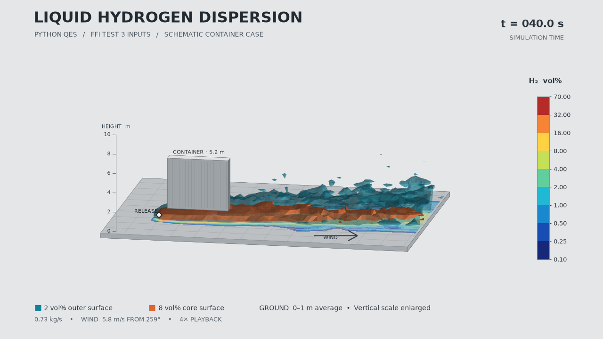

# PlumeSwift

**Fast 3D gas leak dispersion for research**

PlumeSwift builds diagnostic wind fields and simulates the transport of released gas with Lagrangian particles. It can account for terrain and obstacles and collect concentrations on a grid or at receptors. Its liquid hydrogen (LH₂) workflows couple equilibrium mixture properties to particle buoyancy and drag. PlumeSwift is an independently maintained Python port based on [QES v2.3.1](https://github.com/UtahEFD/QES-Public/tree/dced7ec571487be7538eca17bfc25bb3262fb6d0), previously published as QESx.

[PyPI 0.1.0a5](https://pypi.org/project/plumeswift/0.1.0a5/) · [GitHub release](https://github.com/lyullee/plumeswift/releases/tag/v0.1.0a5) · [Zenodo archive](https://doi.org/10.5281/zenodo.24141108) · [Issue tracker](https://github.com/lyullee/plumeswift/issues)

This is an alpha research release for Python 3.11 or newer. The [component status](python_qes/component_status.json) records the QES workflows checked so far and their limits.

- [Install and check the command](#install-and-check-the-command)
- [Run the built-in LH₂ example](#run-the-built-in-lh2-example)
- [Reproduce the FFI benchmarks](#reproduce-the-ffi-benchmarks)
- [Run your own QES-style case](#run-your-own-qes-style-case)
- [Use the Python API](#use-the-python-api)
- [Validation and model scope](#validation-and-model-scope)

## Install and check the command

Create a virtual environment, then activate it for your shell.

```shell
python -m venv .venv
```

**Windows PowerShell**

```powershell
.\.venv\Scripts\Activate.ps1
```

**macOS or Linux**

```bash
source .venv/bin/activate
```

Install the published release and run a smoke test. The final command exercises particle release and slot reuse with a fixed seed and no external data.

```shell
python -m pip install "plumeswift==0.1.0a5"
plumeswift info
plumeswift plume-managed-container --steps 20 --release-per-step 16 --seed 0
```

If the shell cannot find the executable, use `python -m plumeswift` in place of `plumeswift`, using the same interpreter that installed the package. Use `plumeswift --help` to list commands and `plumeswift COMMAND --help` for options. `plumeswift runtime-info` prints runtime information.

| Install extra | What it enables |
| --- | --- |
| `visual` | Plotly HTML and scikit-image isosurface extraction for 3D LH₂ output |
| `ffi` | Reading the official FFI PDF from a local file |
| `fast` | Numba acceleration for supported numerical paths |
| `thermo` | The optional CoolProp thermodynamics backend |
| `gis` | GIS input, including supported Shapefile and raster workflows |
| `plot` | Matplotlib plots for supported diagnostics |
| `cuda11` | Optional CuPy CUDA 11 paths on compatible systems |
| `test` | Pytest for development checks |

The CPU workflows below use the base install plus the relevant extras. CUDA and OptiX coverage varies by component.

## Run the built-in LH2 example

```shell
python -m pip install "plumeswift[visual]==0.1.0a5"
plumeswift lh2-demo --output lh2-result --open
```

The synthetic case releases 0.35 kg/s of hydrogen into a 4 m/s westerly wind beside a 5 m tall obstacle. It simulates 24 seconds and averages gas-phase hydrogen concentration over seconds 8–24. The input is [included in the package](python_qes/plumeswift/example_data/lh2.json).

Open `lh2-result/plume.html` in a browser. Drag to rotate the scene and use the legend to toggle surfaces. The HTML embeds the display code and data, so you can open it offline. Omit `--open` when running on a machine without a desktop.

To edit the case, export the input, change the JSON, and rerun it in a separate output directory.

```shell
plumeswift lh2-demo --write-input lh2-case.json
plumeswift lh2-demo --input lh2-case.json --output lh2-custom --open
```

| Input fields | Meaning |
| --- | --- |
| `grid_cells`, `cell_size_m` | Cell counts and spacing in x, y, z order |
| `wind_speed_m_s`, `wind_from_deg`, `wind_reference_height_m`, `roughness_length_m` | Reference speed, direction the wind comes from, measurement height, and roughness length |
| `building`, `source_position_m` | One rectangular obstacle and the release point. Place the release point inside the fluid domain. |
| `release_rate_kg_s`, `particles_per_s` | Hydrogen mass flow and numerical particle release rate |
| `ambient_temperature_k`, `liquid_mass_fraction`, `relative_humidity_pct` | Inputs to the equilibrium mixture model |
| `duration_s`, `average_from_s`, `step_s`, `seed` | Simulation duration, start of averaging, time step, and random seed. Use a positive step and an averaging start before the end. |
| `isosurfaces_volpct` | Three distinct levels in (0, 100] vol%. The viewer draws the levels reached by the field. |

The run writes `case.json` with the settings used, `plume.html` with the interactive view, and `concentration.npz` with the gridded result. The CLI prints the averaging duration, peak mean concentration, rendered levels, and mass accounting as JSON.

## Reproduce the FFI benchmarks

1. Download the official **FFI-RAPPORT 20/03101** PDF and save it locally as `ffi-report.pdf`. Use the full publication, including Appendix A. [FFI publication page](https://www.ffi.no/en/publications-archive/large-scale-leakage-of-liquid-hydrogen-lh2-tests-related-to-bunkering-and-maritime-use-of-liquid-hydrogen)
2. Install the PDF and visualization extras, then run the seven outdoor release tests.

```shell
python -m pip install "plumeswift[fast,visual,ffi]==0.1.0a5"
plumeswift lh2-ffi --report ffi-report.pdf --workers 5 --output ffi-results --open
```

The command reads 210 sensor averages from Appendix A of your local PDF. The release includes the [model case settings](python_qes/plumeswift/example_data/ffi_cases.json). The report and measurements stay outside the software distribution. Use a quoted absolute path for `--report` if the PDF is elsewhere or the path contains spaces.

```shell
# Run only Test 3 and open its report
plumeswift lh2-ffi --report ffi-report.pdf --tests 3 --output ffi-test3 --open

# Run all tests and save sensor comparisons without generating 3D fields
plumeswift lh2-ffi --report ffi-report.pdf --workers 5 --no-3d --output ffi-sensors
```

The default is one worker. With `--workers 5`, up to five independent test cases run in separate processes. The `fast` extra is optional, and its first run can spend time compiling Numba kernels. For sensor-only runs, install `ffi` and use `--no-3d` to run without `visual`.

| Output | Contents |
| --- | --- |
| `index.html` | Results by test, with links to CSVs and 3D plumes when available |
| `sensor_comparison.csv` | Sensor coordinates, measured and predicted averages in vol%, differences in percentage points, and the measurement and model averaging windows |
| `summary.json` | Aggregate and per-test RMSE, MAE, bias, 4 vol% detection counts, mass accounting, and elapsed time |
| `testN/case.json`, `testN/winds.xml` | The settings used for an individual test |
| `testN/plume.html`, `testN/concentration.npz` | An offline 3D view and the gridded mean concentration, when 3D output is enabled |

In `ffi-results/index.html`, select **3D plume** for a test. Hover over a sensor marker to compare its measured and predicted values. The isosurfaces use the gridded field at 0.5, 2, and 4 vol% where those levels occur. Predictions in the sensor table are averaged separately over a 2 × 2 × 0.2 m box around each sensor, so they can differ from values sampled from the displayed grid.

The default benchmark uses a flat, open site, prescribed wind and a 100-second model spin-up. FFI derives measured hydrogen concentrations from oxygen depletion. The optional measured-weather workflow replays mast winds from the DNV workbooks on the experimental clock. The ISO container, carrier-air handoff and horizontal crossflow jet can be enabled separately. [Benchmark protocol](docs/LH2_direct_benchmark.md) · [Measured-weather workflow](docs/USER_GUIDE.md#4-run-and-interpret-the-ffi-benchmark)

### Try the experimental cryogenic models

The `legacy` setting reproduces the archived benchmark. The `jet`, `pool`, and `dense` settings add an integral two-phase jet, ground impact and pool evaporation for downward releases, and a near-ground density-pressure correction, respectively. The settings are cumulative. Install the `thermo` extra for any of these three settings.

```bash
python -m pip install -e './python_qes[thermo,ffi,fast]'
plumeswift lh2-ffi --report ffi-report.pdf --tests 5 6 --workers 2 --physics jet --no-3d --output ffi-jet
plumeswift lh2-ffi --report ffi-report.pdf --tests 5 6 --workers 2 --physics pool --no-3d --output ffi-pool
plumeswift lh2-ffi --report ffi-report.pdf --tests 5 6 --workers 2 --physics dense --no-3d --output ffi-dense
```

Add the `visual` extra and omit `--no-3d` to export the 3D plots. The cryogenic presets use a nozzle height of 0.32 m for downward releases and 0.50 m for horizontal releases. Tests 5 and 6 use the published CFD exit vapor mass fraction of 0.105. The other tests use the archived phase assumptions. Use `--cryogenic-rh`, `--ground-heat-transfer` and `--density-entrainment` to vary moisture, ground-to-cloud heat and density-driven mixing independently. The summary records the nozzle basis, heat and exchange diagnostics. [Experimental cryogenic workflow](docs/USER_GUIDE.md#experimental-cryogenic-workflow) · [Published FFI CFD inlet conditions](https://hysafe.info/uploads/papers/2023/152.pdf)

## Run your own QES-style case

Use a wind XML file to define the grid, wind observations, terrain and buildings. Use a plume XML file to define release geometry, rate, timing, boundary conditions and collection settings. Place the terrain, release and receptors in the same coordinate system. The FFI workflow writes a `winds.xml` per test that you can inspect as an example.

```shell
plumeswift wind winds.xml --output wind-results
plumeswift plume winds.xml plume.xml --output plume-results
```

These commands expect your own XML files at the paths shown. The `plume` command can also take a saved staggered wind workspace and its matching turbulence NetCDF file through `--turbulence-nc`. Use `--particle-csv` to request particle snapshots. For legacy workflows, use `plumeswift qesWinds`, `plumeswift qesPlume`, `plumeswift qesFire`, or `plumeswift qes` with the supported original-style flags. See the [port status](python_qes/component_status.json) before relying on a specific XML option or backend.

To see a complete plume configuration without external inputs, generate a short analytical case and run it using the saved wind and turbulence fields.

```shell
plumeswift plume-analytical-case powerlaw-x --prepare-only --steps 20 --output analytical-inputs
plumeswift plume analytical-inputs/PowerLawBLFlow_xDir_windsWk.nc analytical-inputs/PowerLawBLFlow_xDir_ContRelease.xml --turbulence-nc analytical-inputs/PowerLawBLFlow_xDir_turbOut.nc --output analytical-results
```

In the examples, x is east, y is north, and z is height. Bearings are measured clockwise from north and describe where the wind comes **from**. Positions are in metres, velocity in m/s, time in seconds, and mass in kilograms. Cell arrays are generally indexed `[z, y, x]`, and particle positions and velocities are `(N, 3)`. Check the format before mixing arrays with legacy QES files.

## Use the Python API

The example below loads the packaged LH₂ case, changes the release rate, runs it, and reads the output grid. It uses the `visual` extra installed above.

```python
import json
from pathlib import Path

import numpy as np
from plumeswift.lh2_demo import example_input, run_demo

case = json.loads(example_input())
case["release_rate_kg_s"] = 0.25
output = Path("lh2-python")
result = run_demo(case, output)
print(result["peak_mean_volpct"], result["accounting"])

with np.load(output / "concentration.npz") as field:
    concentration = field["h2_mean_volpct"]   # [z, y, x], vol%
    obstacle_mask = field["solid"]
    x, y, z = (field[f"coord_{axis}"] for axis in "xyz")  # cell centres, m
    print(concentration.shape, len(z), len(y), len(x))
```

The grid contains mean **gas-phase hydrogen volume concentration** in vol%. Solid cells in the synthetic example are masked with `NaN`. FFI grid output uses horizontal coordinates relative to the release point. Keep volume fraction (0–1), vol% (0–100), and mass concentration (kg/m³) separate when comparing outputs.

The main components can also be composed directly.

| Module | Inputs and outputs |
| --- | --- |
| `assembly`, `contracts` | Select a solver, thermodynamics backend, numerical settings and seed through `AssemblyConfig`. |
| `domain`, `geometry`, `gis`, `terrain`, `cutcell_*` | Build grid coordinates, solid cells, and cut-cell geometry from dimensions, obstacles and terrain. |
| `meteorology`, `native_sensor`, `wrf`, `hrrr` | Build inflow profiles or load supported weather fields from observations or meteorological data. |
| `wind_case`, `wind_projection`, `numerics.poisson` | Build a wind workspace and solve the divergence correction. `read_wind_case(path).run()` returns the workspace, solver diagnostics and turbulence output. |
| `building_pipeline`, `vegetation`, `canopy_*` | Apply diagnostic velocity adjustments around buildings and vegetation. |
| `turbulence`, `mixing_length`, `interpolation.FieldSampler` | Construct turbulence fields and sample wind and turbulence at particle positions. |
| `sources`, `particles`, `boundaries`, `walls` | Define release and boundary behavior, integrate particle trajectories, and track mass. |
| `thermo`, `lh2.LH2Momentum` | Evaluate mixture properties from local hydrogen concentration and couple buoyancy and drag to particle drift. |
| `statistics`, `plume_collection`, `io` | Average concentrations at receptors or on a grid and write arrays or diagnostic output. |
| `fire_case`, `fire_run`, `cuda_*`, `optix_ray_mixing` | Provide selected research workflows and backend paths with component-specific coverage. |

For a longer example of coupling thermodynamics and particle drift, see the [user guide](docs/USER_GUIDE.md). For function signatures and module coverage, see the [module index](docs/MODULE_REFERENCE.md) and the [port inventory](python_qes/port_inventory.json).

## Validation and model scope

[Changes and validation in 0.1.0a5](docs/RELEASE_0.1.0a5.md) · [FLADIS ammonia validation closeout](docs/FLADIS_VALIDATION.md)

In the documented FFI benchmark, PlumeSwift obtained an RMSE of **1.9843 percentage points** across 210 time-averaged measurements. Nine sensors measured at least 4 vol%, and the model predicted at least 4 vol% at two of those sensors. The documented serial and parallel Python runs agreed on sensor concentrations and mass accounting. An earlier timing comparison took 78.1 seconds for five Python case workers and 92.9 seconds for five C++ case workers with the research LH₂ coupling. The two workflows performed different output work, so these figures describe those runs. [Development and validation notes](docs/DEVELOPMENT.md) · [Timing and comparison data](docs/evidence/ffi5_comparison.json)

The LH₂ model uses equilibrium properties and particle coupling for research. Separate validation is needed for scenarios dominated by flashing, separate liquid droplets or pools, ground heat transfer, density feedback on the wind field, or ignition. The FFI results also show limited recovery of high measured concentrations. Use the [validation protocol](docs/LH2_direct_benchmark.md) and [component status](python_qes/component_status.json) to assess fit for a particular scenario.



The illustration shows a separate postprocessing example using FFI Test 3 wind and flow conditions, dry air, and a schematic container. Cyan and orange denote 2 and 8 vol%, respectively, with an exaggerated vertical axis.

## Develop and cite

From a repository checkout, install in editable mode and run the targeted tests.

```shell
git clone https://github.com/lyullee/plumeswift.git
cd plumeswift
python -m pip install -e "./python_qes[fast,test,visual,ffi]"
python -m pytest -q python_qes/tests/test_components.py python_qes/tests/test_numerics.py python_qes/tests/test_lh2_demo.py python_qes/tests/test_ffi_lh2.py
```

See the [development notes](docs/DEVELOPMENT.md) for reproducibility details and the [release procedure](docs/RELEASE.md) for packaging.

When using PlumeSwift in research, cite the specific version and acknowledge the relevant QES methods and experimental data sources. [Citation metadata](CITATION.cff) · [PlumeSwift 0.1.0a5 DOI](https://doi.org/10.5281/zenodo.24141108) · [Historical QESx archive](https://doi.org/10.5281/zenodo.24073832)

The QES-derived code is distributed under GPL-3.0-only. The glibc-derived numerical components retain LGPL-2.1-or-later. See the [GPL license](LICENSE), [LGPL license](python_qes/LICENSE.LGPL-2.1), and [attribution and third-party notices](python_qes/NOTICE.md).
