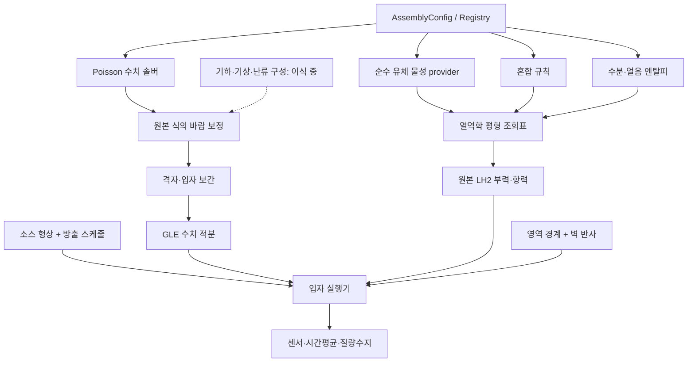

# QES Python 이식 프로젝트 — 전체 이식 진행 중

파일 목록의 412개 항목은 Python 대응 구현이 있는 항목 387개와 비활성 참조 25개로 분류되어 있다. 대응 구현 수에는 부분 이식이 포함된다. 구성요소별 대조 범위와 미해결 동작은 `component_status.json`에 기록한다.

Python 패키지를 설치하면 `qesWinds`, `qesPlume`, `qesFire`, `qes`를 설치 환경에서 직접 실행할 수 있다. `plumeswift`는 보조 비교 도구와 Python 실행 모드를 제공한다. 모든 명령은 `python -m plumeswift` 뒤에 이름을 붙여 호출할 수도 있다.

레거시 `qesWinds`, `qes`, `qesFire`의 풍장 XML은 원본과 같이 추가 메타데이터를 계산에서 제외하며, 제외한 경로를 호환성 기록에 남긴다. 현대 `wind` 명령은 알 수 없는 필드를 오류로 표시한다. 본문과 외부 센서 XML에 메타데이터를 추가한 비교에서 작업공간 변수 10개와 시각화 변수 12개가 일치했다. [XML 비교](../results/python_port/wind_cli/domain_vectors.json)

사용자가 지정한 목표는 **공개 QES의 부가 기능까지 Python으로 이식**하는 것이다. 현재 상태는 전체 완료가 아니다. 공개 체크아웃에서 추적한 412개 C++/CUDA/header 파일, 약 74,000줄의 기능을 `port_inventory.json`에 기록했다. 이전 로컬 LH2 수정도 포함되며 원본 commit과 변경 파일을 함께 기록한다.

`python -m plumeswift runtime-info`는 원본 버전과 CPU 시작 배너를 표시한다. `--cuda`를 지정하면 CUDA 장치, 드라이버·런타임 버전, 장치 메모리·클럭과 PCI 정보를 조회한다. `--optix`는 설치된 PyOptiX 바인딩 버전을 표시한다. 원본 CPU·CUDA 배너와 GPU가 숨겨진 실행의 종료 코드를 대조했다. `qesPlume`은 시각 문자열이 없는 풍장이나 난류 파일을 읽을 때 원본과 같이 표준 오류에 경고를 기록한다. [검증 스크립트](../scripts/check_python_runtime_info.py)

`plumeswift.gis.polygon_layer_extents()`는 폴리곤 레이어의 최소·최대 좌표와 올림한 수평 영역 크기를 반환한다. EPA 장애물 레이어에서 원본과 6개 값이 일치했다. `qesFire` 호환 모드는 시간 배열 길이만큼 점화 좌표를 읽고 NetCDF 스케일 적용 전의 저장값을 사용한다. `qesPlume` 호환 모드는 입자 경로에서 사용하지 않는 비유한 풍장값을 허용한다. 점 누출 사례의 7개 출력 시점에서 8개 변수가 원본과 일치했다. 입자 위치에 보간한 평균 풍속이 비유한 경우 Python은 오류를 반환한다.

풍장 XML의 비표준 정수 옵션은 원본 분기에 따라 해석한다. `upwindCavityFlag`를 7 또는 −1로 지정하고 후류·옥상·측벽·가로 협곡·벽면 로그 옵션을 함께 바꾼 두 건물 사례에서 초기 풍속 세 성분과 셀 플래그가 원본과 일치했다.

풍장 XML은 한 디렉터리 안의 건물·수목 Shapefile 레이어를 `pyshp`로 읽는다. 원본과 셀 플래그가 일치했고 풍속 성분 최대 차이는 1.28e−5 m/s였다. `qesFire`의 회전 GeoTIFF 연료 지도는 원본처럼 픽셀 인덱스와 변환 행렬의 대각 성분을 사용한다. 두 격자 해상도에서 연료 코드, 출력 시각, 연소 격자, 풍속이 일치했다.

`--native-full-domain-bounds`는 `qesPlume`, `qes`, `qesFire`에서 원본의 전 영역 방출 좌표 순서를 재현한다. 기본값은 올바른 축별 경계를 사용한다. 독립 플룸 시험에서 농도 파일 변수 8개와 입자 스냅샷 16개의 활성 ID가 일치했다. CUDA 플룸의 장치 저장소는 TKE를 포함한 난류 필드 12개를 전달하며, 원본 CUDA 전송 함수와 720개 값이 일치했다.

`--cpu-serial`은 `qesWinds`, `qes`, `qesFire`에서 OpenMP를 끈 원본 빌드의 직렬 압력 솔버를 선택한다. `qesWinds`의 5개 레코드에서 초기·보정 풍속과 셀 플래그 732,540개 값이 일치했다. 두 결합 명령에서도 난수 시드를 맞추면 시험한 농도 파일의 모든 변수가 일치했다. 원본 호환 플룸은 음수 CSV 저장 주기를 허용하며, 저장 시작 시각에 도달하면 매 이동 단계에 저장한다. 원본과 CSV 14개가 바이트 단위로 일치했다. `qesFire`는 단정밀도 좌표 산술로 초기 및 시각별 점화 셀을 고른다. 별도 모듈 `plumeswift.fire_fuels_legacy`의 `HISTORICAL_FUELS`로 과거 연료표 18종을 원본 클래스 이름으로 조회할 수 있다.

다중 높이 실측 풍속 프로파일은 지면 높이 0 m를 첫 측정점으로 사용할 수 있다. 지면 풍속을 각각 0과 1 m/s로 둔 두 사례에서 원본과 풍장이 일치했다. 계단식 벽 반사는 이동 종점이 격자 밖에 있어도 경로상 지붕을 먼저 만나는지 확인한다. 지붕 사례에서 입자 CSV 16개와 농도 파일 16개 시점이 원본과 일치했다.

풍장 XML은 GDAL `/vsizip/` 또는 상대 경로로 지정한 ZIP 안의 DEM을 직접 읽는다. 원본과 지형 높이, 셀 플래그, 초기·보정 풍속이 일치했다. `qesPlume` 호환 모드는 난류 파일의 명목 시간축이 짧아도 실제 필드 레코드가 있으면 풍장 레코드 순서로 읽는다. `qesFire` 호환 모드도 원본처럼 플룸 XML의 추가 메타데이터를 허용한다.

CUDA 입자 이류와 독립 검증은 같은 장치 행렬 함수를 사용한다. 원본 GPU와 256개 입력을 대조해 역행렬, 행렬곱, 불변량, 역행렬 성공 여부가 일치했다. 응력 보정의 최대 절대 차이는 4.77e−7이었다.

CUDA MTGP32 난수는 균등·부호 있는 균등·32비트 정수 배열을 제공한다. 원본 커널과 같은 시드로 생성한 589,824개 값이 비트 단위로 일치했다. `qesPlume`은 풍장 레코드 수를 넘어서는 시간 문자열을 무시하고, `qesFire`는 화재·점화 XML의 추가 항목을 원본처럼 무시한다. 일반 Python 모드의 엄격한 입력 검사는 유지한다.

기복이 작은 WRF-SFIRE 입력은 수직 셀 1개 또는 2개로 풍장을 계산할 수 있다. 원본 WRFOnly 생성자의 인자 순서를 보정한 참조 빌드와 초기 풍속과 셀 플래그가 일치했다. 2층 보정 풍속의 최대 차이는 2.38e−7 m/s였고, Red/Black 반복은 원본 583회, Python은 3,000회 한도였다.

CUDA 피벗 분할은 그룹 내부의 입력 순서를 보존한다. 원본 커널과 30,010개 값을 대조해 각 그룹에 속한 값의 비트가 일치했다. 레거시 풍장 XML의 난류 `method=3`은 `rayBackend`를 생략하면 OptiX가 없는 원본 빌드처럼 직렬 `method=1`로 전환한다. `rayBackend`를 지정하면 광선 추적을 선택할 수 있다.

독립 `qesPlume`은 한 축의 격자 중심이 두 개일 때 원본의 폭 0인 주기 경계를 재현한다. 원본과 입자 CSV 두 개가 바이트 단위로 일치했다. `qesFire`는 HeatPot 조회표를 단정밀도 저장값과 원본 배열 범위로 읽는다. 배율·패딩 유무에 따른 출력은 각 구현에서 일치했고, 구현 간 풍속 차이는 최대 5.96e−7 m/s였다.

`python -m plumeswift wind-input-test -q winds.xml -o geometry.nc`는 풍속 프로파일을 적용하기 전의 지형, 장애물, 셀 플래그와 압력 계수를 저장한다. 예전 `UIDugdTest`의 생성 단계에 해당한다. 현재 원본 생성자 직후에 작업 배열을 저장하도록 계측한 참조와 빈 격자, 건물, 지형에서 변수 28개씩 일치했다.

레거시 난류 `method=4`는 배율이 지정되거나 축이 패딩된 NetCDF에서도 원본처럼 위치 기준으로 저장값을 읽는다. 원본 호환 해석적 멱법칙 보간은 높이 0에서 응력을 0으로 계산하고, 그 입자만 GLE에서 탈락 처리한다. `qesFire`는 연소 경과시간과 체류시간을 단정밀도로 유지하며, 경계 시험에서 점화 셀 4개의 연소 종료 단계가 원본과 일치했다.

`python -m plumeswift wrf-input-test pressure.nc`는 원본 WRF 입력 예제의 `pr` 자료를 두 순서로 출력한다. `--wrf-input wrf.nc`는 검증한 WRF 프레임을 요약하며 `--wrf-live`는 시작 마커를 기다린 뒤 읽는다. 압력 출력은 원본과 바이트 단위로 일치했다. 레거시 풍장 계수 재입력도 원본과 같은 위치 기반 저장값을 읽는다. 지면 아래 해석적 멱법칙 방출의 원본 재현에서는 해당 입자만 탈락하며, 생존 입자의 ID와 농도 출력이 원본과 일치했다.

`qesFire`의 플룸 반사는 풍장에 준비된 지형 메쉬를 사용한다. 계단형 경사 지형의 같은 시드 대조에서 외부 추적자의 출력 변수 8개가 3개 시점 모두 원본과 일치했다. 화재 연기는 마지막 시점의 집계가 1개 달랐다. 원본 호환 절단 셀 경로는 혼합 길이가 0일 때의 `NaN`을 보존한다. Halo가 있는 절단 셀 사례에서 지형 반사를 켜고 끈 두 조건 모두 난류 배열 11개의 `NaN` 위치와 유한값, 두 플룸의 농도 출력이 원본과 일치했다. 변경 전 입자 집계 차이는 별도 비교 결과에 기록했다.

`python -m plumeswift.single_building_demo --output output`은 2018년 원본의 40×40×40 단일 건물 CPU 진단을 실행해 면 중심과 셀 중심 속도 표를 만든다. 초기화되지 않은 끝 좌표와 배열 범위 접근을 보정한 C++ 참조와 360회 반복 및 출력 숫자 1,225,818개가 일치했다. 원본 배포 표와 비교한 격자 내부 풍속 차이는 최대 1.0e−5 m/s였다.

레거시 지형 높이 계산은 삼각형 교차를 단정밀도로 수행한다. 겹치는 경사면과 경계를 포함한 1,035개 높이 질의가 원본과 비트 단위로 일치했다. HRRR 입력은 원본처럼 소수 초를 버리고 같은 정수 초의 출력마다 마지막 입력 레코드를 사용한다. 중복 시각 사례의 초기·보정 풍속과 셀 플래그가 일치했다. [지형 비교](../results/python_port/mesh/comparison.json) [HRRR 비교](../results/python_port/wind_hrrr_duplicate_clock/comparison.json)

`NativeTrilinear`는 원본의 단정밀도 및 배정밀도 필드 보간을 지원한다. 두 정밀도에서 각각 1,472개 값이 비트 단위로 일치했다. 원본 CUDA 농도 집계 시험은 100만 입자씩 10,000회 집계했고 버퍼를 0으로 초기화한 원본 참조와 8,000칸의 결과가 일치했다. [보간 비교](../results/python_port/cpu_trilinear/comparison.json) [CUDA 집계 비교](../results/python_port/cuda_concentration/comparison.json)

레거시 풍장 솔버는 허용오차 0에서 변화량이 정확히 0이 되거나 반복 한도에 도달할 때까지 계산하고, 1 이상에서는 반복을 건너뛴다. 원본 CPU와 세 사례의 풍장과 반복 횟수가 일치했다. CUDA의 다섯 번 반복 사례는 바닥 경계를 보정한 원본 참조와 일치했다. [솔버 비교](../results/python_port/wind_solver_tolerance_modes/comparison.json)

NetCDF 출력은 바이트 또는 `S1` 배열의 문자 벡터를 기록할 수 있다. `remove_static_fields()`로 시간에 따라 변하지 않는 필드의 기록을 종료하면 이미 저장한 값과 스키마가 유지된다. 원본과 중복 시각을 포함한 3개 레코드가 일치했다. [출력 비교](../results/python_port/output_v2/comparison.json)

레거시 건물 셀 분류는 지붕 높이와 격자 높이를 단정밀도로 비교한다. 지붕이 셀 중심에 닿는 사례에서 16개 셀의 고체 분류와 초기·보정 풍속이 원본과 일치했다. 레거시 `verticalStretching`은 균일 격자를 유지하면서 수직 난류 미분식을 전환한다. 층 두께를 지정하거나 생략한 두 사례의 19개 필드가 각각 원본과 일치했다. [건물 비교](../results/python_port/wind_cli/building_roof_rounding.json) [수직 미분 비교](../results/python_port/wind_legacy_vertical_stencil/comparison.json)

`--poisson cpu-historical-sor`는 과거 `CPUSolver.cpp`의 직렬 계산을 선택한다. 발산 계산만 하는 경우, 반복 0회·11회, 수렴까지 53회 반복한 경우에 발산항, 압력 보정값, 풍속 3,610개가 원본 메서드와 비트 단위로 일치했다. 원본 헤더가 체크아웃에 없어 비교용 자료구조를 별도로 정의했다. [구형 솔버 비교](../results/python_port/historical_cpu_sor/comparison.json)

`fire --full-level-set`은 결합 화재 실행에서 원본의 전체 격자 레벨셋을 사용한다. 원본 레벨셋 호출을 연결한 참조의 두 사례에서 출력 시각과 풍속이 일치했다. 확산율과 레벨셋의 최대 절대 차이는 각각 2.98e−8 m/s와 9.54e−7이었다. 원본 전체 격자 함수는 열방출장 `H0`를 채우지 않는다. [전체 격자 비교](../results/python_port/fire_full_level_set/comparison.json)

새 `plumeswift` 패키지는 원본 C++/CUDA 소스나 QES 실행파일·공유 라이브러리를 포함하거나 호출하지 않는다. 계산은 Python 소스로 구현하고 NumPy/SciPy, 선택적으로 CoolProp을 사용한다. 이 외부 수치 라이브러리의 내부까지 순수 Python으로 다시 작성했다는 의미는 아니다. 원본은 비교 자료로 기존 `external/`에 보관하며 실행 패키지의 의존성이 아니다. 알고리즘 번역에 적용되는 GPL과 저작자 표시는 유지한다.

## 지켜야 할 변경 경계

- 열역학: 모델·물성을 개선할 수 있다. 교체 효과를 별도로 평가한다.
- 그 밖의 물리식, 경험식·계수, 소스 가정: 원본 및 이전 LH2 결합의 정의를 유지한다.
- 수치 계산: 선형계 풀이, 수렴 판정, 시간 적분, 정밀도, 경계 교차 검사, 자료 검증·성능 개선을 허용한다.
- 이식하지 않은 원본 기능을 단순한 대체식으로 채우지 않는다. 완료 여부는 `component_status.json`에서 추적한다.
- 구성요소 테스트, 같은 입력장의 수치 비교, 전체 프로그램 동등성, 실험 검증을 구분한다.

## 세부 조립 구조



| 교체 단위 | 구현 위치 | 역할 |
|---|---|---|
| 모델 계약·단위·정책 | `contracts.py` | SI 단위, 배열 의미, 수치 정책과 물리 계수 분리 |
| 조립·등록 | `assembly.py` | 중첩된 구성요소 선택, 의존성 주입, 실행 manifest |
| 순수 유체 EOS/물성 | `thermodynamics/properties.py` | CoolProp adapter, Hydrogen/ParaHydrogen/OrthoHydrogen 선택 |
| 혼합 밀도 규칙 | `thermodynamics/mixing.py` | Amagat 규칙. 정확한 혼합물 EOS와 구분 |
| 수분·얼음 에너지 | `thermodynamics/moisture.py` | 현열·잠열·273.15 K 상 공존 |
| 평형 상태·조회표 | `thermo.py` | 기존 상수 비열 경로와 실제 물성 경로 |
| 압력 보정 수치해법 | `numerics/poisson.py` | Red-black SOR 또는 BiCGSTAB, 같은 stencil |
| 원본 바람 보정식 | `wind_projection.py` | 기하 계수와 초기장을 받아 같은 Euler–Lagrange 식 평가 |
| 격자·건물·벽 계수 | `domain.py`, `geometry.py` | 균일/사용자 지정 z 격자, 계단식 다각형 배치, 벽 stencil |
| 기상 관측 입력 | `meteorology.py` | 프로파일 0~3, 평지 단일 관측점/다중 관측점 Barnes |
| 건물 경험식 조립 | `building_pipeline.py` | 원본 호출 순서, 구성요소별 교체·제거, 명시적 중간 상태 |
| 건물 경험식 | `upwind.py`, `wake.py`, `sidewall.py`, `rooftop.py`, `street_canyon.py` | 원본 상류 공동·후류·측벽·지붕·기존형 협곡 식 |
| 국소 난류 생성 | `turbulence.py` | method 0, 속도 미분·벽 처리·응력·소산·응력 발산 |
| GIS 입력 | `gis.py`, `georeference.py` | 다중 링 SHP, 이름 있는 벡터 레이어, 선택적 UTM 변환, 관측소 경위도 |
| GLE 적분 | `numerics/langevin.py` | 직접 선형계 풀이, backward Euler/midpoint 선택 |
| 격자·입자 보간 | `interpolation.py` | staggered trilinear/nearest, 공통 보간 가중치 재사용 |
| 소스 형상·시간 | `sources.py` | 점·선·상자·구면, 연속·기간·순간 방출 |
| 영역 경계 | `boundaries.py` | 유출·주기·반사 |
| 벽 반사 | `walls.py` | voxel segment traversal, 얇은 장애물 관통 방지 |
| LH2 힘 | `lh2.py` | 열역학 제공자만 주입, 기존 부력·항력·지면 반력식 유지 |
| 입자 상태·실행 | `particles.py` | 소스·적분기·경계·관측기의 실행 조정, 질량수지 |
| 관측 연산자 | `statistics.py` | 센서 상자와 정확한 시간창 평균 |
| 데이터 어댑터 | `io.py` | 기존 NetCDF 데이터 입력, 불완전/NaN 입력 거부 |
| XML 풍장 실행 | `wind_case.py`, `__main__.py` | 미지원 옵션 사전 거부, 독립 실행·NetCDF 출력·코드 해시 |
| 침적 | `deposition.py` | 원본 생존율 식, SI 질량 회계, 선택 활성화와 침적 격자 출력 |

중앙 실행기는 물성식이나 벽 반사식을 직접 구현하지 않는다. 환경변수나 숨겨진 모델 자동 전환을 사용하지 않는다. 물리 계수와 수치 옵션을 별도 객체로 기록한다.

## 조립 예제

```python
from plumeswift.assembly import AssemblyConfig, ComponentChoice, assemble

config = AssemblyConfig(
    thermodynamics=ComponentChoice("thermo.coolprop", {
        "ambient_temperature": 276.45,
        "liquid_fraction": 0.559,
        "relative_humidity": 75,
        "properties": ComponentChoice("properties.coolprop", {
            "hydrogen_fluid": "Hydrogen"
        }),
        "mixing_rule": ComponentChoice("mixing.amagat"),
        "moisture": ComponentChoice("moisture.trace"),
    }),
    poisson_solver=ComponentChoice("poisson.krylov"),
    seed=20261107,
)
components = assemble(config)
state = components.thermo.evaluate([0.001, 0.01, 0.05])
print(state.temperature)
```

`thermo.legacy`로 바꾸면 이전 상수 비열 근사와 대조할 수 있다. `poisson.redblack`으로 바꾸면 물리식·경계조건을 유지한 채 수치해법만 바뀐다. 사용자 구현은 Registry에 등록하거나 객체를 직접 주입할 수 있다.

## 실제로 확인한 범위

- 압력 보정: 저장된 초기장·기하 계수로 Python 솔버와 기존 장애물 사례의 C++/CUDA 결과를 대조했다. 최대 성분 차이는 약 **1.1e−4 m/s**, 성분 RMSE는 약 **1.5e−6~2.1e−6 m/s**였다. 초기장·건물 경험식 생성까지 이식됐다는 뜻은 아니다.
- GLE: 같은 난수 입력에서 원본 행렬식과 새 직접 풀이의 일치를 확인했다. 원본 backward Euler를 유지하고, 같은 SDE의 midpoint 적분도 선택 가능하게 했다. 균일 난류의 정상 공분산 보존을 해석식으로 검증했다.
- 열역학: 기존 상수 비열과 CoolProp 실제 엔탈피·밀도 경로를 선택 가능하게 했다. Amagat 혼합 근사는 명시적으로 유지한다. 기본 실제 물성 경로는 기상 공기 EOS의 유효 범위를 고려해 **85 K 이상**이며, 범위 밖을 기존 모델로 몰래 대체하지 않는다.
- 질량수지, 상자 계수, 소스 시간창, 장시간 방출 개수, 벽 관통 방지, 주기·반사 경계, 모듈 교체 등의 테스트를 실행했다.
- Python 입자 실행기로 FFI Test 4의 기존 바람·난류 **데이터를 처방 입력**해 LH2 계산을 진행했다. 이 실행은 C++ QES를 호출하지 않지만, 기하·난류 생성까지 Python으로 완료된 전체 실행은 아니다.

열역학 교체가 실험 정확도를 개선한다는 결론은 아직 없다. 실제 물성의 정밀도와 전체 누출 모델의 농도 정확도는 구분해야 한다. 파일 `results/python_port/`의 파일별 실행 구성과 후속 비교를 확인한다.

CUDA와 OptiX를 포함해 구성요소 테스트는 **357 passed, 0 skipped**다. Windows에서 영문 드라이브 경로로 실행하고 로컬 PyOptiX 바인딩을 연결했다. 100,000개 입자에 같은 난수를 넣은 GLE 대조에서 원본 행렬식과 등식 변환 후 결과의 최대 속도 차이는 **8.0e−15 m/s**였다. Python 안에서 명시적 역행렬을 계산한 기준식의 중앙값 약 0.122초에 비해 변환식은 약 0.084초였다. 이 핵심 연산은 약 31% 단축됐다. `results/python_port/gle_kernel.json`에 원시 시간이 있다.

## 초기 풍장 생성의 추가 이식 및 원본 대조

2026-11-07 추가 구현에서는 저장된 원본 초기장·건물 마스크·계수를 공급하지 않고 Python에서 생성했다. 같은 버전의 원본 실행파일로 별도 기준 출력을 만들어 대조했다. 기준 생성 스크립트만 Docker를 사용하며 `plumeswift` 실행 경로는 원본을 호출하지 않는다.

| 비교 | 원본 대조 조건 수 | 확인 결과 |
|---|---:|---|
| 상류 공동: 0/Röckle/MVP/HMVP, 풍향·건물 회전 | 7 | 셀 표시 일치, 초기 속도 성분 최대 차이 1e−6 m/s 미만 |
| 기존/수정 후류, 대각 풍향·회전·고층 분기 | 6 | 셀 표시 일치, 초기 속도 성분 최대 차이 약 1.1e−5 m/s |
| 후류·상류 공동과 지붕/측벽 조합 | 7 | 셀 표시 일치, 초기 속도 성분 최대 차이 약 1.2e−5 m/s |
| 기존형 협곡, 두 건물 높이·풍향 변화 | 4 | 협곡 셀 432~576개 및 전체 셀 표시 일치, 초기 속도 차이 2.8e−6 m/s 미만 |
| 균일·중립/안정/불안정 로그·멱법칙·수관·2/3 관측점 Barnes | 9 | 초기 속도 성분 차이 8.1e−7 m/s 미만 |
| XML→격자/기상/경험식→압력 보정 전체 지원 경로 | 7 | 64×64×30 입력 격자, 풍속 성분 최대 차이 9.7e−6 m/s 미만, Python 계산 약 1.8~2.4초 |
| EPA 77개 건물, SHP부터 초기 풍장 생성 | 1 | 전체 셀 표시 일치, 초기 속도 성분 최대 차이 1.3e−6 m/s 미만, 입력/비교 포함 약 11.8초 |

7개 압력 보정 실행 시간은 해당 작은 격자의 실제 측정값이며 C++/GPU 대비 가속비가 아니다. 이 표의 EPA 비교는 **초기 풍장**에 한정된다. 이 비교용 2 m EPA 설정은 난류 method 1을 쓰며 저장소 원본 1 m XML은 method 3을 지정한다. 아래 EPA 절에 별도의 실행 대조를 기록했다.

국소 난류 method 0은 별도로 원본 풍속 데이터를 입력해 응력·CoEps·응력 발산을 비교했다. 평지 사례의 최대 차이는 약 3.7e−8 이하, 건물 사례는 약 4.4e−5 이하였다. 여기에는 원본 float 누적과 Python double 계산 차이도 포함된다. log-law 벽과 비균일 z 격자의 모든 원본 분기는 아직 독립 실행 대조가 끝나지 않았다.

### 원본 호환성에서 보존·구분한 항목

- 원본 `Domain.h::getDomainSize()`의 dy=dx 반환 문제가 있다. 벽 stencil은 실제 dy가 기본이며, 비교용 `native_dy_alias`를 별도로 제공한다. 일부 경험식과 난류 벽의 기본 호환 모드는 원본 동작을 유지한다. 현재 원본 대조는 dx=dy 격자다.
- 원본 Barnes는 좁은 2차 가중치를 계산하지만 잔차 보정에도 첫 가중치를 사용한다. 이 동작을 유지했다.
- 수관 기상 프로파일의 지수 괄호, 정확히 수관 높이인 셀의 0값을 원본대로 유지했다. 입력 풍속 객체를 원본처럼 직접 변형하지는 않는다.
- 측벽의 셀 표시에는 마지막 v-face shell 폭을 재사용하는 원본 동작을 유지했다. 단정밀도 꼭짓점 저장과 ray 인덱스 계산 순서도 원본과 대조했다.
- 난류 벽의 전면 응력 미분 인덱스 및 log-law 좌측 벽 목록 문제는 `native_quirks`로 명시했다. 교정 모드를 원본과 일치한다고 표시하지 않는다.
- 원본 analytic power-law 보간은 `mat3sym` aggregate 순서 때문에 부정부호 응력을 만든다. 그 실제 초기화 순서를 보존했고, 실제 원본 메서드 몸체를 별도 컴파일한 기준과 대조했다. 속성 nuT는 원본에서 설정하지 않으므로 Python에서도 값을 만들어 넣지 않는다. 이 분석용 시험 프로파일을 권장 물리 모델로 표시하지 않는다.
- 원본 침적 호출은 주석 처리되어 있다. Python 기본 입자 실행에서도 침적을 끈다.

처방된 바람·난류 자료로 수행한 FFI Test 4 예비 계산(물리시간 375초, 센서 평균 275초, 시드 1개)의 결과:

| 열역학 / GLE 적분 | 30개 센서 RMSE (percentage point) | 입자 적분 실측 시간 |
|---|---:|---:|
| 기존 상수 비열 / backward Euler | 1.798 | 157.6초 |
| 실제 물성 / backward Euler | 2.199 | 145.9초 |
| 기존 상수 비열 / midpoint | 1.810 | 161.7초 |

세 계산의 비열역학적 물리 계수는 동일했고, 각각 37,500개 입자를 방출했다. 질량수지 오차는 9e−12 kg 미만이었다. 이 시간은 마지막 GLE 등식 변환 최적화 전의 실제 측정값이며, 풍장·난류 생성과 전체 3D 농도장 파일 출력을 포함하지 않는다. 한 시드이며, 적응 시간 간격 때문에 같은 초기 시드라도 이후 난수 소비 순서는 달라질 수 있다. 따라서 열역학 교체나 midpoint의 실험 정확도 우위를 주장하지 않는다. 특히 실제 물성 경로를 검증된 기본 모델로 승격하지 않았다.

`results/python_port/pilot_comparison.json`과 `pilot_comparison.png`에서 예측값·질량수지·남은 제한을 확인할 수 있다. 이번 검증은 전체 QES 동등성이나 LH2 모델의 독립 실증 검증이 아니다.

## CUDA Barnes 풍장 초기화

`wind --meteorology-backend cuda`는 여러 관측소의 Barnes 초기화를 GPU에서 실행한다. 관측소별 수직 프로파일은 호스트에서 계산하며, 수평 가중치·1차 풍장·관측소 잔차·2차 보정은 Python으로 작성한 CUDA 커널에서 실행한다. 레거시 `qesWinds`, `qes`, `qesFire`는 GPU 솔버 번호를 선택하면 이 경로를 사용한다. HRRR의 `interpolationScheme=0`도 같은 커널에 HRRR 수직 프로파일을 전달한다. 단일 관측소, WRF, HRRR 최근접·쌍선형은 각 입력의 기존 보간 경로를 사용한다.

평지 2·3개 관측소, DEM 2개 관측소, 영역 경계와 혼합 안정도를 포함한 직사각형 격자에서 초기 풍속 성분 377,382개가 원본과 정확히 일치했다. 원본의 블록 경계 가중치 합산 경쟁과 범위 밖 스레드 접근은 Python에서 열별 순차 합산과 인덱스 검사로 처리한다. [검증 스크립트](../scripts/check_python_cuda_barnes.py)

HRRR 합성 입력 4개 조건의 두 시각에서 시각·셀 분류와 초기 풍속 성분 1,118,568개를 비교했다. 평지, 안정도 변화, DEM과 기압면, 깊은 수직 격자를 포함했다. 8개 풍장 레코드 중 4개가 정확히 일치했고, 전체 최대 풍속 차이는 1.91e−6 m/s였다. [검증 스크립트](../scripts/check_python_hrrr_cuda.py)

## 수정형 거리 협곡 및 국소 혼합 길이 후속 이식

수정형 거리 협곡(`streetCanyonFlag=2`)의 gamma=0.3, lateral/top wedge, 원본 덮어쓰기 순서와 기존형과 다른 셀 표시 규칙을 이식했다. 공통 기하 탐색을 공유하되 구성식은 별도 분기로 유지한다. 두 건물 높이/풍향 4개 조건에서 셀 표시와 협곡 셀 수(360~504개)가 일치했고, 초기 풍속 성분의 최대 차이는 2.8e−6 m/s 미만이었다.

실패 사례도 대조했다. 2 m EPA 시험 격자에서 원본 수정형 협곡은 반환 코드가 0이지만 초기 v0에 **770개 비유한 값**이 있다. Python에서도 동일한 770개를 발견해 압력 보정 전에 오류로 거부한다. `results/python_port/native_failures.json`에 이 격자의 결과를 기록했다.

`LocalMixingSerial.cpp`의 method 1은 일반적인 최근접 표면 거리로 바꾸지 않고, 원본의 유한 범위 점 전파와 벽 순서·front/left 오프셋·위쪽 벽 전파 부재·상단 선형 전이를 유지했다. 원본과의 최대 혼합 길이 차이는 빈 영역 0, 두 건물 9.5e−7 m, EPA 77개 건물 1.91e−6 m였다. EPA의 해당 Python 연산은 약 5.8초였으며 전체 시뮬레이션 시간이 아니다.

method 1을 포함한 64×64×36 두 건물 XML→풍장→국소 난류 경로를 실행했다. 원본 기준 대비 풍속 성분 최대 차이는 5.0e−6 m/s 미만, 응력 성분 최대 차이는 5.3e−5 (m/s)² 미만이었다. Python 실행·기준 파일 읽기를 합친 시간은 약 3.6초였다. C++/GPU 가속비로 해석하지 않는다. NetCDF method 4와 method 1 결과 저장은 사용자 지정 변수명과 한글 경로를 지원하며, 저장→재입력 후 난류 결과 일치를 시험했다.

```powershell
.venv\Scripts\python.exe scripts/check_python_streets.py --mode 2 --native
.venv\Scripts\python.exe scripts/check_python_mixing_length.py --native
.venv\Scripts\python.exe scripts/check_python_native_failures.py
```

## DEM 지형·고도별 관측 프로파일 후속 이식

`terrain.py`에 원본 DEM crop, 행 반전, 읽는 순서에 따른 running minimum, raster 경계 밖 높이 0, 삼각형 생성과 비음수 꼭짓점 기준 원점 이동을 옮겼다. `triangle_mesh.py`는 중복 꼭짓점을 병합하지 않고 원본처럼 수직 교차 중 최대 높이를 반환한다. 상승/하강 지형, 두 관측점, 지형 위 건물, UTM crop의 5개 조건을 CPU/CUDA 원본 각각과 대조했다. 지형 높이·셀 표시·6개 벽 계수는 배열 전체가 일치했다. CUDA 기상 보간식 분기의 초기 풍속 최대 차이는 6.2e−7 m/s 미만이었다.

원본 CPU/CUDA Barnes 구현은 지표층 높이와 수직 인덱스 선택식이 서로 다르다. `WindCase.meteorology_variant`와 CLI `--met-variant native-cpu|native-gpu`로 식을 명시적으로 선택한다. 이는 기상 식 분기 선택이며 Python에서 CUDA 커널을 실행한다는 뜻은 아니다. CPU Barnes에는 마지막 face에서 `domain.z[nz-1]`을 읽는 배열 범위 문제가 있다. Python은 해당 높이 좌표를 연장한다. 두 관측점 CPU 사례의 마지막 face에는 최대 약 4 m/s 차이가 있으며, 전체 배열 동등성으로 표시하지 않고 보고서에 그대로 남긴다. 나머지 정의된 영역은 원본과 1e−6 m/s 이내로 일치했다.

지형을 포함한 전체 풍장·국소 난류 실행은 CPU 원본과 대조했다. 위 5개 중 마지막 face의 원본 메모리 접근 문제가 있는 두 관측점 사례를 제외한 4개 조건에서 풍속 배열 전체의 최대 차이는 1.7e−6 m/s 미만이었다. 난류 필드별 차이는 `results/python_port/terrain/comparison_cpu_full.json`에 기록했다. 다음 실행 순서를 원본에 맞췄다.

- 벽 계수는 경험식으로 셀 표시를 바꾸기 전에 생성한다.
- 난류 유체 셀과 벽 목록은 초기 기하 마스크에서 확정한다.
- 원본 SOR처럼 고체 내부도 압력 승수 계산에 포함한다. 지형 협곡 경험식이 셀 표시를 바꿀 경우 단순한 고체 승수 제거는 동등하지 않다.
- 경계 벽의 접선 속도는 실제 할당된 staggered face로 평균한다. cell-center 배열의 행 넘김과 face 접선 확장을 구분한다.

CUDA 원본 `applyNeumannBCGlobal`은 cell-center 평면의 `(nx-1)*(ny-1)` 대신 `nx*ny`로 범위를 검사해 첫 유체층의 승수 일부를 덮어쓴다. Python의 기본 선형계는 올바른 CPU 바닥 mirror 경계를 유지한다. 이 CUDA 결함을 따라 결과를 맞추지 않으며, 그에 따른 전체 CUDA 풍장 차이도 `comparison_full.json`에 기록한다. 원본 CUDA 반환 코드나 수렴 메시지를 정확성의 증거로 대신하지 않는다.

고도별 관측 프로파일 flag 4도 이식했다. 한 높이·두 높이·3개 높이의 풍향 wrap·격자보다 촘촘한 관측 높이의 4개 조건에서 최대 속도 차이는 1e−6 m/s 미만이었다. 원본의 반복 XML 태그 형식(`<height>` 등을 여러 번 기재), segment를 한 번씩만 전진하는 규칙과 비표준 ±360/dz 풍향 기울기를 유지한다. WRF 높이 배열의 삼각형 생성은 `GridTerrain`으로 제공하지만 WRF 파일 로더 전체 이식을 의미하지 않는다.

균일·로그·멱법칙·수관 프로파일(flag 0–3)도 반복 XML 태그를 읽고, 원본처럼 각 항목의 첫 값을 사용한다. 뒤에 서로 다른 값을 넣은 네 사례에서 Python과 원본 QES 모두 단일 기준값을 넣은 경우와 동일한 초기 풍장을 만들었다.

```powershell
.venv\Scripts\python.exe scripts/check_python_terrain.py --native
.venv\Scripts\python.exe scripts/check_python_terrain.py --native --solver 1
.venv\Scripts\python.exe scripts/check_python_terrain.py --native --full --solver 1
.venv\Scripts\python.exe scripts/check_python_meteorology.py --native
```

## 삼각형 ray·입자 반사·legacy 혼합 길이 후속 이식

`TriangleMesh.ray_hit`는 원본 교차식, 비정규화 방향 벡터와 거리 구분, t=0 허용, 동일 거리일 때 BVH 오른쪽 가지 선택을 구현한다. 평행 slab 검사와 퇴화 삼각형의 비유한 값은 명시적으로 처리한다. 수직 높이 조회와 ray 조회는 같은 메쉬를 공유한다.

`MeshReflection.trace`는 원본 `WallReflection_TriMesh::rayTraceReflect`의 0.1 m 충돌 전 위치 보정과 위치·변동속도 반사식을 유지한다. 재귀를 반복문으로 바꾸고, 지정된 반사 횟수를 넘으면 오류를 낸다. `TriangleWalls`는 입자 적분기의 교체 가능한 어댑터이며 원본처럼 종점이 고체인 입자만 반사한다. 얇은 장애물을 통과해 종점이 유체에 있는 경로는 원본과 같이 반사하지 않는다. 종점 고체 판정·메쉬 생성·교차·반사·영역 경계 처리를 분리했다. 전체 XML 메쉬 연결 완료를 의미하지 않는다.

실제 원본 Triangle/BVH/HitRecord와 반사 메서드 본문을 패키지 밖에서 별도 컴파일해 상자·경사면·여러 번 반사·교차 없음의 204개 경로를 대조했다. 충돌 여부는 모두 같았고, 반사 후 위치 차이는 최대 4.79e−6 m, 반사 후 변동속도 차이는 1.16e−7 m/s였다. 교차점·거리·매개변수·법선 비교의 최대 수치 차이는 2.04e−5로 원본 float와 Python float64 차이를 포함한다. 단위가 섞인 이 최대값을 위치 오차로 해석하지 않는다.

`mesh_mixing.py`는 `SphereDirections.h`와 legacy CPU `Mesh::calculateMixingLength` 보조 기능을 이식한다. MT19937 seed 303, 방향마다 phi를 세 번 독립적으로 샘플링하는 원본 규칙, 5개 축 방향, 정확히 flag 1인 셀만 갱신하는 규칙과 원본 격자 원점을 유지한다. 517개 방향의 원본 대비 최대 차이는 6.56e−7이고, 8셀 혼합 길이 보조 시험은 일치했다. Method 3은 아래의 `ray_mixing.py`에서 별도로 처리한다.

`turbParams/method=2`는 지형 메시와 균일한 수직 격자에서 이 보조 함수를 호출한다. 광선이 모두 빗나간 셀은 기본 혼합 길이를 사용한다. 고정한 QES 원본의 method 2 분기에는 호출이 주석 처리돼 있으므로 C++ 보조 함수는 직접 컴파일해 대조하고, XML 실행 경로는 Python에서 확인했다. 80셀 DEM에서 method 2로 저장한 혼합 길이를 method 4로 읽었을 때 혼합 길이와 난류 필드가 모두 일치했다.

```powershell
.venv\Scripts\python.exe scripts/check_python_mesh.py
.venv\Scripts\python.exe -m pytest python_qes/tests/test_mesh_reflection.py -q
```

대조 입력·원본 출력·소스 SHA와 차이는 `results/python_port/mesh/`에 저장한다. 새 런타임에는 원본 C++ 소스나 실행파일이 포함되지 않는다.

## 균질 식생·방풍림 후속 이식

원본 `vegetationParams/Homogeneous`, `vegetationParams/Windbreak` XML로 실행된다. 식생 모델 정의와 실행마다 새로 할당하는 셀 상태를 분리하고, `canopy.homogeneous`, `canopy.windbreak`, `vegetation.qes`로 조립할 수 있다. 원본 순서대로 건물과 식생 셀을 표시한 뒤 벽 계수를 만들고, 기상장에 식생 감쇠를 적용한 다음 건물 경험식과 식생 후류를 적용한다. 감쇠 계수와 높이·거칠기·변위 등 실행 배열은 풍장 workspace에서 확인할 수 있다.

균질 식생은 원본의 polygon parity 판정, 지형 기준 상하단 선택, 로그 회귀와 변위 높이, 내부·상부 감쇠를 유지한다. 원본이 식생 상부 v 경계에서 face가 아닌 cell stride를 적용하는 것도 재현한다. 로그 회귀는 같은 식을 중심화한 배정밀도 합으로 계산한다. 특이 회귀는 임의의 거칠기로 치환하지 않고 오류를 낸다. 원본 XML에서 초기화되지 않은 `height_eff` 대신 선언된 높이와 base를 사용한다.

방풍림은 두 porosity 분기, understory, staggered face별 중복 감쇠 제거, 후류 25번 셀, 원본 shear/recovery/lateral 계수를 유지한다. 원본 XML의 철자 `understroyHeight`를 받는다. 후류 경로의 원본 `&&` 경계 검사로 배열 밖 접근이 발생할 수 있는 지점은 실제 격자 경계에서 검사한다. 이 경계 수정의 원본 전체 배열 일치는 주장하지 않는다.

CPU 원본과 전체 풍장·국소 난류를 비교한 9개 조건에서 셀 표시와 6개 벽 계수 배열이 일치했다. 균질 식생 6개 조건의 초기·보정 풍속 최대 차이는 1.20e−4 m/s, 방풍림 3개 조건은 8.16e−7 m/s였다. 난류 변수는 단위별로 `results/python_port/vegetation/comparison.json`에 기록했다. 이 사례의 Python XML 읽기와 풍장·국소 난류 계산은 약 0.13–0.84초였다. 원본 대비 가속비나 실증 정확도 수치는 아니다.

```powershell
.venv\Scripts\python.exe scripts/check_python_vegetation.py --native
.venv\Scripts\python.exe -m pytest python_qes/tests/test_vegetation.py -q
```

## 독립 수목

`vegetationParams/IsolatedTree`의 36분할 원형 수관과 `SHPFile`의 단일 링 수관을 지원한다. SHP는 `H`, `D`, `LAI`를 읽고 원본처럼 수관 높이의 절반에 최대 잎면적 위치를 둔다. XML의 `zMaxLAI`는 높이 대비 비율이다. 수관 내부·상부 감쇠, 건물 경험식 적용 전의 기준 풍향 채집, 타원형 후류와 최대 결손 합성, 셀 플래그 22/23을 이식했다. `canopy.isolated_tree`로 조립할 수 있다.

후류 켜기·끄기, 수관이 지면에서 떨어진 사풍, SHP 수관의 4개 원본 CPU 대조에서 셀 표시와 벽 계수가 일치했다. 초기·보정 풍속의 최대 차이는 1.49e−4 m/s였다. Python은 격자 상단의 배열 범위를 검사하고, 원본 XML에서 초기화되지 않은 정렬 높이는 선언된 높이와 base로 계산한다. 복수 유형 식생의 겹침과 상단 경계 조건은 추가 대조가 필요하다.

## 관측 시계열과 다중 시각 출력

`plumeswift wind`는 내장 `sensor`와 외부 `sensorName` XML의 관측 레코드를 읽고 시간순으로 계산한다. 첫 관측소의 중복 시각은 원본처럼 보존하고, 한 관측소의 같은 시각에서는 마지막 레코드를 고른다. `timeStamp`와 `timeEpoch`를 함께 지정하면 일치 여부를 확인한다. 두 값이 없을 때는 XML을 읽기 시작한 UTC 초를 공유한다. `totalTimeIncrements=0`이면 전체를 계산하며, 양수이면 가능한 시각 수 내에서 처음부터 지정한 수만큼 계산한다.

각 시각의 풍장과 난류를 순서대로 `winds.nc`와 `turbulence.nc`에 기록한다. 각 시각을 독립적으로 초기화하고, 완료된 NetCDF 파일만 게시한다. Python API에서 `case.iter_steps()`로 각 시각을 선택해 `step.run()`으로 계산하고 `read_wind_workspace(path, step=i)` 또는 `read_turbulence(path, step=i)`로 읽을 수 있다. 원본 국소 난류의 기준 거칠기는 첫 관측소의 첫 입력 레코드에서 가져온다.

원본 CPU 5개 조건, 22개 출력 레코드에서 시간축과 타임스탬프, 셀 표시, 6개 벽 계수가 일치했다. 풍속 성분의 최대 차이는 1.6e−6 m/s 이내였다. 건물 대조에서 지붕 후류를 가르는 30도 경계는 원본의 float 연산으로 판정한다. 변수별 차이는 `results/python_port/wind_series/comparison.json`에 기록했다.

```powershell
.venv\Scripts\python.exe scripts/check_python_wind_series.py --native
.venv\Scripts\python.exe -m pytest python_qes/tests/test_wind_series.py -q
```

## 셀 중심 풍장 출력

`plumeswift wind`는 원본 형식의 `windsOut.nc`를 함께 생성한다. 이 파일은 지면 아래 고스트층을 제외하고, 면의 풍속을 평균해 셀 중심 `u`, `v`, `w`와 속력 `mag`를 저장한다. 셀 플래그 `icell`, 초기 플래그 `icellInitial`, 정적 `terrain`도 선택할 수 있다. `fileOptions` 안에 `outputFields`를 변수별로 반복한다. 이 항목을 생략하거나 첫 항목을 `all`로 지정하면 전체를 저장한다. `--no-visualization`을 지정하면 이 파일의 생성을 건너뛴다.

시각화 파일은 원본의 단정밀도 좌표·풍속과 배정밀도 시간축을 사용한다. 원본이 가로·세로 좌표에 동일한 `dx`를 쓰는 동작도 해당 파일에서 재현했다. `winds.nc`는 실제 축 간격과 면 풍속을 기록하는 배정밀도 작업공간이다. 원본 실행 코드에서 사용하지 않는 `outputFlag`, `massConservedFlag`, `sensorVelocityFlag`, `staggerdVelocityFlag`는 XML에서 읽으며 출력 종류를 바꾸지 않는다.

건물 시계열, 경사 지형의 변수 선택, 가로·세로 간격이 다른 격자의 세 가지 원본 CPU 비교에서 시각과 변수의 자료형, 차원, 단위, 설명이 일치했다. 셀 중심 풍속의 최대 차이는 1.18e−6 m/s였다.

```powershell
.venv\Scripts\python.exe scripts/check_python_wind_visualization.py --native
```

## 원본 독립 풍장 명령

`python -m plumeswift qesWinds`에서 `-q`로 원본 XML을 지정한다. `-o`에 접두사를 주면 `_windsOut.nc`를 기록한다. `-w`는 `_windsWk.nc`, `-t`는 난류 계산과 `_turbOut.nc`, `-m`은 입력 지형의 `_terrainOut.obj`를 추가한다. 접두사가 비어 있으면 파일을 만들지 않고 풍장과 요청한 난류를 계산한다.

원본 호환 솔버는 XML에서 생략한 반복 한도와 허용 오차에 각각 500회와 1e−9를 적용한다. `maxIterations=0`이면 압력 보정 반복을 건너뛴다. 두 설정의 건물 사례에서 원본 `qesWinds`와 풍속 배열이 일치했다.

솔버 번호는 비교에 사용한 CUDA·OpenMP 빌드를 따른다. 기본값 `-s 1`은 CPU 적흑 SOR, `-s 2`와 `-s 3`은 CUDA 전역 메모리, `-s 4`는 CUDA 공유 메모리 해법이다. `-x`가 있어도 이 원본 드라이버는 풍장을 계산한다. `-f`는 요청을 기록하며 WRF 교환은 XML의 `WRFCoupling`으로 켠다. `-v`는 JSON 요약에 적용 설정을 추가한다.

원본 실행과 비교한 평지 두 시각에서 풍장과 난류 NetCDF가 정확히 일치했고, 건물 벽 보정 풍장도 일치했다. GPU 세 선택에서 평지 풍속 성분의 최대 차이는 4.77e−7 m/s였다. DEM OBJ의 정점 625개는 최대 약 5e−6 m 이내로 일치했다. Python은 원본에서 같은 면 인덱스를 반복 기록한 결함을 수정한 연결 정보로 고유 삼각형 1,152개를 출력한다. 대조 자료는 `results/python_port/wind_cli/comparison.json`에 있다.

```powershell
.venv\Scripts\python.exe -m plumeswift qesWinds -q results/python_port/plume/winds.xml -o results/wind_case -w -t
.venv\Scripts\python.exe scripts/check_python_wind_cli.py
```

## 계수 재입력과 관측소 좌표·거칠기

`readCoefficientsFlag=1`과 `COEFF`로 첫 레코드의 여섯 풍장 계수를 읽는다. 셀 크기의 NetCDF와 각 공간 축에 한 칸을 더 둔 원본 형식을 지원한다. 원본 재입력 모드와 같이 건물·지형의 고체 표시 생성을 건너뛰고 초기 마스크를 사용한다. 셀 크기 파일은 배열 전체를 읽도록 수정했다. 원본 CPU의 패딩 파일 대조에서 셀 표시와 여섯 계수는 일치했고 풍속 최대 차이는 1.16e−6 m/s였다.

`site_coord_flag=2`는 관측소 UTM 좌표에서 도메인 UTM 원점을 단정밀도로 뺀다. `z0_domain_flag`가 0이 아니면 원본처럼 x 방향으로 0.5 m와 0.1 m의 두 거칠기 구역을 만들고 지형 로그법칙 벽에 인접 face 네 값의 평균을 사용한다. Python 출력은 전체 face 거칠기 배열을 저장한다. 원본 출력의 셀 크기 배열에는 그 버퍼의 앞부분이 담긴다. UTM과 거칠기를 따로 또는 함께 사용한 원본 CPU 3개 조건에서 풍속 최대 차이는 1.06e−6 m/s였다.

`site_coord_flag=3`은 WGS84 경도·위도(`site_lon`, `site_lat`)를 `UTMZone`의 좌표로 변환한다. `UTMx`, `UTMy`를 뺀 뒤 지역 좌표 관측소와 같은 halo를 적용한다. `UTMZoneLetter`에는 UTM 위도 밴드를 지정한다. 빈 값과 원본 템플릿의 숫자 값은 북반구로 해석한다. `reprojectShapefiles=true`를 설정하면 건물·식생 shapefile의 `.prj`를 읽어 같은 WGS84 UTM 좌표계로 변환한다. 기본값에서는 원본과 같이 shapefile 좌표를 그대로 사용한다.

원본은 `site_coord_flag=3`의 XML 필드를 읽지만 풍장 초기화에서 경위도 변환을 실행하지 않는다. 비교에는 원본이 처리하는 투영 좌표로 미리 변환한 관측소와 shapefile을 사용했다. 북반구 EPSG:4326과 남반구 EPSG:3857 사례 모두 Python의 변환 입력과 투영 입력 풍장이 일치했다. 원본 CPU와 셀 플래그·압력 계수가 일치했고 풍속 최대 차이는 6.58e−5 m/s였다.

```powershell
.venv\Scripts\python.exe scripts/check_python_georeference.py --native
```

```powershell
.venv\Scripts\python.exe scripts/check_python_coefficients.py --native
.venv\Scripts\python.exe scripts/check_python_station_geometry.py --native
```

## 화재 확산과 유도풍

`read_fire_config(path).initialize(workspace, spacing)`으로 원본 `fires` XML의 연료와 점화 조건을 풍장 격자에 배치한다. 연료 코드 58종, GeoTIFF, NetCDF 점화 시각, Balbi와 Rothermel 초기 추정값을 지원한다. `FireGrid.step(workspace)`은 주어진 풍장에서 좁은 대역 계산과 이동을 실행한다. `narrow=False`로 전체 격자 계산을 선택할 수 있다. `HeatPotential.read(path).apply(fire, workspace)`는 `HeatPot.nc`에서 원본 조회표를 읽어 화재 유도풍을 초기 풍장에 더한다.

원본 함수 본문을 컴파일해 232개 연료·기상 조합, 래스터 4개 조건, 전체 격자와 좁은 대역의 각 8스텝을 비교했다. Balbi 확산률 최대 차이는 5.03e−7 m/s였고 연소·연기·화염 셀 표시는 모두 일치했다. 먼 영역의 원본 조회는 인덱스가 배열 끝을 넘을 수 있다. Python은 마지막 유효값을 사용한다. 그 보정을 한 C++ 대조에서 유도풍 성분 최대 차이는 1.99e−6 m/s였다. 보정 전 원본의 차이도 `results/python_port/fire/comparison.json`에 보존했다. 초기 연소 셀의 0/0 연소시간 비율은 0으로 처리하며, 범위를 벗어나는 점화나 화염 높이는 오류로 반환한다.

```powershell
.venv\Scripts\python.exe scripts/check_python_fire.py
.venv\Scripts\python.exe -m pytest python_qes/tests/test_fire.py -q
```

## 화재·풍장 결합 실행

`python -m plumeswift qesFire`는 원본 명령의 풍장 XML `-q`, 선택 플룸 XML `-p`, 출력 접두사 `-o`, 솔버 번호 `-s`를 받는다. 기본적으로 화재 유도풍을 계산하고 `-i`로 끈다. `--heat-potential`로 조회표를 지정할 수 있다. 지정하지 않으면 `../data/FireFiles/HeatPot.nc`, 소스 체크아웃의 조회표, 패키지에 포함된 공개 조회표 순서로 찾는다.

`-b`는 `_fireOutput.nc`, `-t`는 `_turbOut.nc`, 플룸 XML은 모델별 `_plumeOut.nc`를 기록한다. 플룸 XML만 주면 난류를 내부 계산한다. `-l`은 모델별 입자 CSV를 추가한다. 원본에 등록된 `-w`, `-z`, `-h`는 실제 파일 생성 단계에서 사용되지 않는다. `-x`를 주어도 원본과 같이 풍장을 계산한다. 도움말은 `-?` 또는 `--help`로 연다.

`qesFire`는 원본과 같이 단정밀도로 화재 시간 간격을 계산한다. 첫 시간 간격의 끝에 정확히 맞춘 점화 시험에서 수정하지 않은 CPU 원본과 같은 셀이 점화됐다. 화재 지속시간이 0초면 요청한 화재·난류·농도 파일을 빈 레코드로 생성한다. 원본과 대조한 파일 5개에서 총 65개 변수의 구조와 메타데이터가 일치했다. `scripts/check_python_fire_clock.py`와 `scripts/check_python_fire_zero_duration.py`로 재현할 수 있다.

북쪽·동쪽 격자 경계의 시각 지정 점화는 반올림된 인덱스가 배열 밖을 가리키면 마지막 셀에 배정한다. 배포본 FFII 사례의 점화 이벤트 830개를 초기화했다.

Python은 원본이 `-b`나 접두사 없이 빈 NetCDF 파일명으로 열다가 중단되는 문제를 바로잡았다. 접두사가 없으면 출력 파일 없이 실행한다. 입자 CSV는 원본의 옵션 이름 조회 오류를 수정한 기준과 비교했다. CPU의 세 모델에서 총 9개 농도 레코드가 일치했고, 입자 CSV 9개의 위치 성분 최대 차이는 약 50 µm였다. 비교용 CPU 원본은 각도 범위도 보정했고, 입자 대조에서는 난수 시드를 고정했다.

GPU 전역 메모리 해법의 화재 결합 사례에서 원본의 지면 경계 인덱스를 그대로 두면 풍속 성분 최대 차이가 0.0191 m/s였다. 경계 복사를 셀 면 크기로 제한한 기준에서 최대 차이는 9.54e−7 m/s였고 두 화재 레코드의 시각이 일치했다. 원본과 보정한 기준의 차이는 `results/python_port/fire_cli/comparison_cuda.json`에 함께 기록했다.

```powershell
.venv\Scripts\python.exe -m plumeswift qesFire -q results/python_port/fire_replay/workers_1/winds.xml -p results/python_port/fire_replay/workers_1/plume.xml -o results/fire_case -b -t -l
.venv\Scripts\python.exe scripts/check_python_fire_cli.py
.venv\Scripts\python.exe scripts/check_python_fire_cli.py --cuda
```

`plumeswift fire`는 한 XML에서 관측, 지형, 장애물, 연료와 점화 조건을 읽는다. 각 화재 스텝에서 기준 초기 풍장을 복원하고, 유도풍을 더한 뒤 건물·식생 경험식과 압력 보정을 적용하고, 보정 풍장으로 화선을 이동한다. 원본처럼 화재 시각을 밀리초 단위로 전진시키고 구간을 넘는 마지막 스텝도 계산한다. `fireOutput.nc`에는 원본 차원 이름과 변수 `burn`, `Force`, `LS`, `icell`, 셀 중심 풍장이 들어간다. `--turbulence`는 난류 파일을 함께 저장한다. 유도풍을 끌 때는 `--no-fire-winds`를 사용한다.

`qesFire`는 Linux 원본의 좁은 대역 계산과 같이 체류시간을 아직 계산하지 않은 점화 셀에서 0번 면의 바람을 읽는다. 이 초기 분기는 원본에서 0으로 나눈 뒤 유효하지 않은 높이 인덱스를 변환하는 과정에서 나타난다. Python은 같은 면을 직접 선택한다. `fire --native-flame-sampling`으로도 선택할 수 있으며, 기본 `fire` 실행은 초기 지형 높이에서 바람을 읽는다. 체류시간을 계산한 뒤에는 두 모드가 같은 화염 높이 계산을 사용한다.

`fire --native-fire-format`은 `fireOutput.nc`에 원본의 차원·변수 순서, 단정밀도 좌표·풍속·연료·연소 상태, 정수 셀 플래그와 단위·속성을 사용한다. `--native-turbulence-format`과 `--native-collection-format`을 함께 선택할 수 있다. 유도풍 적용 여부, 건물, 관측 바람 변화, 시간 지정 점화, 연기 확산을 포함한 6개 사례의 16개 레코드에서 14개 변수의 구조와 메타데이터가 일치했다.

새 점화원 위의 유도풍을 계산할 때 원본 직렬 코드는 원거리 조회표의 끝을 넘어 읽는 경우가 있다. 조회 인덱스의 상한을 적용한 원본 기준과 비교하니 연기 출력 7개 레코드의 모든 변수가 일치했고, 최대 수직풍 차이는 2.12e−5 m/s였다. Python CPU와 CUDA는 근거리에서 반경이 1e−5 미만이면 원본의 축상 분기와 같이 조회표의 첫 열을 사용한다. `scripts/check_python_fire_smoke.py --native --bounded-potential`로 대조를 재현할 수 있다.

시간 지정 점화 사례의 비교용 원본에서는 점화 이후 다섯 단계에서 열 플룸 조회표 범위를 벗어나는 접근을 단계당 56회 확인했다. 원본 조회 인덱스를 Python과 같이 끝점으로 제한한 뒤 최대 수직풍 차이는 1.37 m/s에서 2.11e−5 m/s로 줄었고 기록 시각도 일치했다. 비교 보고서는 수정 전후를 함께 담는다. `scripts/check_python_fire_format.py --native`로 재실행할 수 있다.

```powershell
.venv\Scripts\python.exe -m plumeswift fire results/python_port/fire_coupled/coupled/winds.xml --heat-potential external/QES-Public/data/FireFiles/HeatPot.nc --output results/python_port/my_fire_run
.venv\Scripts\python.exe scripts/check_python_coupled_fire.py --native
```

원본 CPU 실행 파일로 유도풍 켜기·끄기, 관측 시각 전환과 난류, 건물 포함의 네 조건을 대조했다. 6개 출력 레코드의 시간축·연소·화염 셀은 일치했고, 풍속 최대 차이는 9.70e−7 m/s였다. 단일 시각 유도풍 사례의 두 번째 스텝에서는 원본 단정밀도 내적 반올림으로 역코사인 입력이 범위를 벗어나 한 셀의 확산률에 0.0659 m/s 차이가 났다. Python은 입력을 [-1, 1]로 제한한다. 같은 보정을 적용한 CPU 실행과 비교하면 네 조건의 확산률 최대 차이는 2.09e−8 m/s였다. 두 CPU 실행의 결과를 `results/python_port/fire_coupled/comparison.json`에 함께 기록했다.

`--front-backend cuda`와 `--heat-potential-backend cuda`는 독립적으로 선택한다. 전자는 GPU 거리 변환으로 격자 셀 단위의 초기 화선을 구하며, 1000셀 상한과 원본 GPU의 단정밀도 거리를 유지한다. 원본에서 0개 블록을 요청하는 작은 격자도 계산하며, 큰 격자는 1000셀의 여유 영역을 둔 타일로 계산한다. 후자는 원본 GPU의 화재원 병합과 수직층 경계 규칙을 적용한다. 먼 영역의 조회표 끝점과 축 방향 극한은 유효 범위 내에서 계산한다.

```powershell
.venv\Scripts\python.exe scripts/check_python_cuda_fire_potential.py --native --coupled
.venv\Scripts\python.exe -m plumeswift fire results/python_port/cuda_fire_potential/coupled_building/winds.xml --front-backend cuda --heat-potential-backend cuda --heat-potential external/QES-Public/data/FireFiles/HeatPot.nc --output results/python_port/my_fire_cuda
```

초기 거리장은 네 조건에서 원본 CUDA 커널과 셀마다 일치했다. 단일 화재원, 병합 화재원, 지형의 세 조건에서 수직층 인덱스가 일치했고 유도 면 풍속의 최대 차이는 6.45e−7 m/s였다. 두 GPU 경로를 함께 켠 결합 계산은 건물 유무 두 조건에서 출력 시각, 연소·화염 표시가 일치했고 최대 풍속 차이는 8.57e−7 m/s였다. 결합 대조에는 원본 GPU 화재 경로를 선택하고 CPU 압력 해법을 사용했다. 비교용 빌드에서 사용하지 않는 OpenGL 헤더를 제거하고 Balbi 역코사인 입력을 유효 범위로 제한했다. `results/python_port/cuda_fire_potential/comparison.json`에 수치와 CPU 층 경계 분기의 차이가 있다.

`plumeswift fire --plume plume.xml --seed 0`은 화재 연기 계산을 함께 실행한다. 점화 셀은 지표면 위 1 m에서 연소 지속시간 동안 입자 스텝마다 추적 입자 20개를 방출한다. 풍향이 갱신되어도 입자 상태와 수집 시계는 이어진다. 출력 `smoke_plumeOut.nc`에는 `p_count`, `t_avg`, `c`와 수집 격자가 들어간다. 원본 화재 방출의 질량은 0이므로 `c`는 0 g/m³이며, `p_count`는 평균 구간에서 수집한 입자 표본의 누적 개수다.

```powershell
.venv\Scripts\python.exe scripts/check_python_fire_smoke.py --native
.venv\Scripts\python.exe -m plumeswift fire results/python_port/fire_smoke/series/winds.xml --plume results/python_port/fire_smoke/series/plume.xml --heat-potential external/QES-Public/data/FireFiles/HeatPot.nc --seed 0 --output results/python_port/my_smoke_run
```

Balbi 각도 범위를 보정한 원본 CPU와 최근접 셀 및 삼선형 보간 두 조건을 비교했다. 두 번째 조건은 풍향 변경과 추가 점화를 포함한다. 전체 영역을 한 수집 상자로 둔 10개 레코드에서 `p_count`가 모두 일치했다. 두 조건의 방출 입자 수는 각각 720개와 1,540개였고, 수집 시각의 최대 차이는 1 ms였다. 입자별 난수열과 공간 농도 분포의 동등성은 별도 검증 항목이다. `results/python_port/fire_smoke/comparison.json`에 대조값이 있다.

`fire --plume`은 XML의 `particleParameters/baseParticle` 모델도 화재 연기와 함께 실행한다. 모델별 농도 NetCDF와 입자 CSV를 생성하고 입자 ID는 실행 전체에서 공유한다. `smoke` 태그는 원본과 같이 화재가 동적으로 추가하는 모델에 사용한다. `beacon`, `smoke`, `tracer` 세 모델의 수집 레코드 9개에서 입자 수가 모두 일치했고 농도 차이는 최대 7.65e−11 g/m³였다. 원본 CSV 9개, 1,275행에서 입자 ID와 방출원, 방출 시각, 입자 질량을 대조했다.

`fire --native-serial` 또는 `--native-threads N`은 Linux CPU 플룸의 난수열과 슬롯 처리 순서를 적용한다. 각 모델은 같은 작업자별 난수 스트림을 공유하고, `--source-seed`로 방출 형상 난수를 별도 지정할 수 있다. 이 모드는 작업자별 순서를 Python에서 재현한다. `scripts/check_python_fire_replay.py`는 난수 시드를 명시할 수 있게 한 원본 CPU와 작업자 1명·3명을 각각 비교한다. 8×8×10 수집 격자의 농도와 입자 수가 두 실행의 총 18개 모델별 레코드에서 모두 일치했다. 입자 CSV 2,550행에서 위치 성분 최대 차이는 5.03e−5 m, 속도 변동 성분 최대 차이는 1.05e−5 m/s였다.

`fire_smoke.legacy_smoke_sites`는 원본의 별도 `Smoke::genSmoke` 진단을 수행한다. 내부 영역에서 표시된 연기 위치와 고정 입자 수를 반환하고 해당 표시를 지운다. 원본 함수를 직접 컴파일한 대조에서 대상 위치 5개와 전체 표시 배열이 일치했다.

## 일반 플룸 실행

원본 결합 실행의 옵션은 `python -m plumeswift qes`에서 사용한다. `-q`는 풍장 XML, `-p`는 선택 플룸 XML이다. `-p`를 지정하면 난류를 계산하며, `-t`를 추가해야 난류 파일도 저장한다. 접두사 `-o`로 시각화와 모델별 농도 출력을 켜고, `-w`, `-m`, `-l`로 풍장 작업공간, 지형 OBJ, 입자 CSV를 추가한다. 접두사가 없으면 계산은 끝까지 진행하고 이 실행기의 출력 파일 생성을 생략한다.

솔버 번호는 독립 `qesWinds`와 같은 CUDA·OpenMP 빌드를 따른다. 결합 CPU 계산은 원본과 같이 이전 풍장의 압력 보정값을 이어받는다. 원본 결합 실행에서 `-x`가 있어도 풍장을 풀고, `-z` 없이도 접두사가 있으면 시각화 파일을 생성한다. `--seed`, `--native-threads`, `--source-seed`는 Python 재현 실행용이다. 실시간 WRF 파일 교환은 독립 `qesWinds` 경로에서 지원한다.

원본 명령과 여섯 가지 구성에서 출력 종류를 비교했다. CPU의 전체 출력과 난류 자동 계산 구성에서 모델별 농도 7개 레코드가 각각 일치했다. 전체 출력의 입자 CSV 16개에서 위치 성분 최대 차이는 약 50 µm였다. GPU 공유 메모리 사례의 풍속 성분 최대 차이는 4.77e−7 m/s였으며, 접두사가 없는 경우 원본과 Python 모두 입자 64개를 방출하고 파일을 생성하지 않았다. 입자 대조용 원본은 난수 시드만 고정했다.

```powershell
.venv\Scripts\python.exe -m plumeswift qes -q results/python_port/plume/winds.xml -p results/python_port/plume_trajectories/interior/plume.xml -o results/qes_case -w -t -l
.venv\Scripts\python.exe scripts/check_python_qes_cli.py
```

`wind`, `plume`, `fire`의 `--native-sensor-math`는 평지 관측소 입력에 원본 CPU의 단정밀도 초기 풍장 계산을 적용한다. 프로파일 플래그 0–4와 두 번의 Barnes 보정에 사용할 수 있다. 균일·중립 로그·안정 로그·불안정 로그·멱법칙과 관측소 2개·3개의 CPU 사례 7개에서 초기 풍속 배열이 모두 일치했다. 관측 고도 입력은 원본의 0°/360° 경계와 격자 높이당 관측 구간 갱신 방식을 따르며, 단일 관측소 4건과 관측·로그 프로파일을 함께 쓰는 Barnes 1건에서 최대 풍속 성분 차이가 3.58 × 10⁻⁷ m/s였다. 6초 건물 사례에서는 원본과 다른 초기 풍장 값이 105,546개에서 1,277개로 줄었고, 각 코드가 자체 계산한 경우의 최대 입자 위치 성분 차이는 2.83 m였다. 결과는 `results/python_port/native_sensor/comparison.json`에 있다.

평지의 소수 층 두께는 원본과 같이 단정밀도로 누적한 층 중심을 사용한다. 불안정 로그 프로파일은 원본 Linux의 단정밀도 아크탄젠트를 사용한다. Barnes 보간은 유효한 격자 셀을 가리키는 경계 관측소도 첫 가중평균에 포함하고 두 번째 단계의 잔차를 0으로 둔다. 평지 다섯 사례의 초기 풍속 성분 522,720개가 모두 일치했다. 비균일 격자 세 사례는 비교용 원본의 기존 `Domain` 함수에 XML 층 두께를 연결했다. [검증 스크립트](../scripts/check_python_native_sensor_grid_edges.py)

`--native-wake-math`는 건물 후류에서 원본 CPU의 단정밀도 저장과 배정밀도 수식 순서를 적용한다. 회전 직사각형은 원본과 같은 순서로 꼭짓점을 계산한다. 원거리 후류의 1.5제곱에 원본 Linux의 단정밀도 연산을 적용하면 후류 단독 사례 6건에서 격자 분류와 초기 풍장이 모두 일치한다. 6초 연성 사례에서 후류만 켠 경우 5개 초기 풍장이 모두 일치했다. 다른 건물 보정까지 켠 조합의 초기 풍장 비교는 `results/python_port/native_sensor/building_diagnostics/comparison_wake_math.json`과 `results/python_port/native_sensor/building_diagnostics/comparison_building_math.json`에 있다.

`--native-turbulence-math`는 국소 난류의 속도 미분, 소산율, 응력 회전과 발산에 원본 CPU의 정밀도와 연산 순서를 적용한다. 같은 풍속을 사용한 5개 기록에서 소산율, 응력 6성분과 발산 3성분이 모두 일치했다. 원본 초기 풍장부터 시작하면 Python의 압력 보정 풍속, 활성 입자 ID와 농도가 일치하고, 최대 입자 위치 성분 차이는 원본 CSV 정밀도 범위인 50 μm였다. 초기 풍장부터 독립 계산하면 활성 입자 ID는 48개 스냅샷에서 일치하고 최대 위치 차이는 1.94 m다. 결과는 `results/python_port/coupled_products/turbulence_math/comparison.json`에 있다.

같은 옵션을 건물 후류의 비국소 난류에도 적용한다. 원본과 같이 협곡·측벽·지붕 보정 단계가 갱신한 건물 좌표계와 면 방향을 사용하고, 후류 단계에서 결정한 유효 폭과 횡방향 경계를 유지한다. 센서 방향, 원거리 후류의 거듭제곱, 협곡 풍속 저장에 원본과 같은 단정밀도 연산을 적용한 뒤 8개 사례의 초기 풍장, 압력 보정 풍장, 격자 분류 및 난류 필드 13개가 독립 계산에서 정확히 일치했다. `scripts/check_python_nonlocal.py --native --native-math`로 원본 출력과 비교 결과를 다시 생성할 수 있다.

`--coupled`를 추가하면 비스듬한 바람이 부는 협곡에서 4초간 방출하는 연성 사례도 비교한다. 두 방출 모델의 공간 농도와 입자 수, 32개 시점의 활성 입자 ID가 일치했다. 원본 CSV와의 최대 입자 위치 성분 차이는 50 μm였다.

`--native-building-math`는 상류 공동·후류·측벽·지붕 보정에 원본 CPU의 연산 순서와 저장 정밀도를 적용한다. 6초 건물 연성 사례에서 이 옵션을 기상·난류 호환 옵션과 함께 켜면 Python이 초기 풍장부터 독립 계산하며, 원본의 풍장·격자 분류 732,540개 값, 난류 950,400개 값과 두 방출원의 농도·입자 수 44개 값이 모두 일치했다. 48개 입자 스냅샷의 활성 ID가 일치했고, 최대 위치 성분 차이는 원본 CSV 정밀도 범위인 50 μm였다. 결과는 `results/python_port/native_sensor/building_diagnostics/comparison_building_math.json`에 있다.

같은 옵션은 거리 협곡의 기존형과 수정형에도 적용된다. 건물 높이와 풍향을 바꾼 8건에서 격자 분류가 일치했고, 초기 풍속 성분의 최대 차이는 1.19 × 10⁻⁷ m/s였다. 협곡 내부에 방출원을 배치한 4초 연성 사례는 보정 방식별로 하나씩 시험했다. 결과는 `results/python_port/streets/comparison_cpu_building_math.json`과 `results/python_port/streets_modified/comparison_cpu_building_math.json`에 있다.

캐노피 프로파일은 이분법으로 변위 높이를 구하고, 격자 중심이 캐노피 꼭대기와 정확히 같은 높이일 때 원본처럼 풍속 성분을 0으로 둔다. 같은 시각이 연속해서 나오면 원본이 저장한 정규화 기준 풍속을 다음 계산에 전달한다. 안정도, 캐노피 내외의 기준 높이, 감쇠 0, 혼합 관측소와 반복 시각을 포함한 평지 6건의 8개 기록에서 초기 풍속 배열이 모두 일치했다.

HRRR NetCDF 입력의 프로파일 플래그 5도 이 옵션으로 실행할 수 있다. 격자 풍향 회전, 안정도와 풍속 프로파일, Barnes·최근접·쌍선형 보간에서 원본 CPU의 연산 순서와 단정밀도 저장을 적용한다. 합성 HRRR 입력 5건의 10개 기록을 대조했다. Barnes 2개 기록은 모두 일치했고, 전체 최대 풍속 성분 차이는 1.43 × 10⁻⁶ m/s였다. 쌍선형 대조는 원본의 지형 배열과 최상단 인덱스를 보정한 실행기를 사용했다. 결과는 `results/python_port/hrrr/comparison_cpu_sensor_math.json`에 있다.

같은 옵션을 CPU Barnes의 DEM 관측소 입력에도 적용할 수 있다. 가변 수직 간격에서는 원본의 단정밀도 높이 누적과 고체 셀 판정을 사용한다. DEM 대조 8건에서 고체 셀 분류가 일치했고, 최상단 면 아래의 초기 풍속은 경사지 캐노피를 포함한 7건에서 모두 일치했다. 건물 1건의 최대 풍속 성분 차이는 4.39 × 10⁻⁷ m/s였다. 여러 관측소를 사용하는 원본은 최상단 면의 배열 범위를 벗어날 수 있다. Python은 마지막 간격만큼 중심 좌표를 연장하고 그 면의 차이를 별도로 기록한다. 가변 격자 대조에서는 원본 실행기의 XML 격자 간격 전달만 연결했다. 결과는 `results/python_port/terrain/comparison_cpu_sensor_math.json`에 있다.

`--poisson cpu-native-rb`는 원본 CPU 적흑 SOR의 단정밀도 발산, 압력 보정과 최대 갱신량 기준을 사용한다. `wind`와 `wind-replay`는 레코드마다 압력 보정값을 초기화하고, 결합 `plume`과 `fire`는 이전 보정값을 이어받는다. 컴파일한 원본 함수와 수직 비균일·수평 직사각 격자의 연속 계산 3회에서 압력과 보정 풍속 7,992개가 비트 단위로 일치했다. 실제 건물 사례에서 원본 초기 풍장과 계수를 함께 사용하자 보정 풍속 5개 레코드가 정확히 일치했다. 각 코드가 초기 풍장부터 자체 계산하는 경로에는 입자 궤적 차이가 남았다. [검증 코드](../scripts/check_python_native_cpu_rb.py)

`--poisson cpu-native-serial`은 OpenMP 없이 빌드한 원본의 순차 SOR를 선택한다. 대각면마다 서로 영향을 주지 않는 셀을 묶어 갱신하며 원본의 앞선 셀과 뒤쪽 셀에 대한 의존성을 그대로 유지한다. 수직 비균일 격자의 연속 계산 3회에서 압력과 보정 풍속 7,992개가 원본 순차 함수와 비트 단위로 일치했다. 원본 `qesWinds`의 레코드별 초기화와 `qes`의 보정값 이어받기도 같은 초기 풍장으로 대조했다. 결과는 `results/python_port/native_cpu_serial/comparison.json`에 있다.

`plumeswift plume`은 QES XML의 `particleParameters/baseParticle`을 태그별로 실행한다. 점, 선, 직육면체, 구면, 전체 영역에 방출할 수 있다. 연속·기간·순간 방출의 입자 수와 질량은 원본의 스텝 기반 산식을 사용한다. 원본은 시작 시각을 종료 오프셋에 다시 더하므로 0보다 늦은 순간 방출은 여러 스텝에서 발생할 수 있다. 전체 영역 방출은 원본 호출부의 축 인자 순서를 보정했다. 고체 안에서 방출된 입자는 실제 방출 위치를 기준으로 비활성화한다.

계산 시작 전부터 활성인 방출원과 입자 수가 0인 연속·기간 방출도 처리한다. 시간 오프셋은 부호를 보존해 가장 가까운 밀리초로 반올림하며, 정확히 절반이면 0에서 멀어지는 방향을 쓴다. 원본처럼 양의 방출 질량만 입자에 배정하고, 입자별 질량은 g 단위에서 단정밀도로 계산한 뒤 kg으로 바꾼다. 원본 CPU 실행과 비교한 일곱 방출 모델에서 입자 수와 농도장 49개 레코드가 정확히 일치했고, 입자 CSV 1,763행의 ID와 원본 출력 정밀도로 반올림한 질량도 일치했다. [검증 스크립트](../scripts/check_python_plume_release_edges.py)

일반 플룸 실행은 비균일 수직 격자와 직사각형 수평 격자에서 실제 셀 면으로 방출 위치, 최근접 셀, 벽 거리 조회 위치를 결정한다. NetCDF에 수직 면 좌표만 있을 때는 면 간격으로 층 두께를 구하고, 난류 파일에 응력 발산이 없으면 비균일 수직 중심 간격을 사용해 복원한다. 원본 재현 모드는 최소 층 두께와 수평 `dx`를 사용하는 원본 셀 주소 및 기존 복원 방식을 적용한다. 원본 주소가 할당 범위 안인 두 방출원에서 활성 ID와 농도가 일치했다. 높은 층과 고체 셀을 포함한 일반 경로는 삼선형·최근접 양쪽에서 확인했다. [비균일 플룸 대조](../scripts/check_python_plume_stretched.py)

일반 독립 플룸은 난류 파일의 `mixingLengths`를 레코드별로 읽고, 이 필드가 없으면 바람장 작업공간의 `mixlength`를 사용한다. 이 거리는 입자의 Courant 시간 간격에 쓰인다. 원본 난류 출력의 `L`은 난류 폐쇄에 쓰는 혼합 길이다. 거리 필드가 모두 없거나 원본 재현 모드로 실행하면 거리 0을 사용한다. 평지, 건물 절단 셀, 비균일 지형 절단 셀에서 결합 실행과 저장 자료를 다시 읽은 실행의 입자 CSV 56개, 농도 레코드 39개 및 질량수지가 모두 일치했다. [저장 자료 재실행 대조](../scripts/check_python_plume_mixing_distance.py)

QES XML에서는 길이가 0이거나 범위 방향이 뒤집힌 직육면체 축과 반지름이 0 또는 음수인 구면도 읽는다. 원본 형상 코드와 시드를 맞춘 시험에서 평면으로 축소된 직육면체와 반지름 0인 구면 좌표는 비트 단위로 일치했다. 음수 반지름 구면의 좌표 성분 최대 차이는 0.48 μm였다. Python에서 형상 객체를 직접 만들 때는 기본 치수 검사를 유지한다. [형상 대조](../scripts/check_python_native_source_geometry.py)

```powershell
.venv\Scripts\python.exe scripts/check_python_plume.py --native
.venv\Scripts\python.exe -m plumeswift plume results/python_port/plume/winds.xml results/python_port/plume/plume.xml --output results/python_port/my_plume_run
.venv\Scripts\python.exe -m plumeswift plume results/python_port/plume/native_windsWk.nc results/python_port/plume/plume.xml --turbulence-nc results/python_port/plume/native_turbOut.nc --output results/python_port/my_offline_plume_run
```

원본과 같이 풍장 한 레코드일 때 `simDur`를 사용하고, 여러 레코드일 때 마지막 관측 간격만큼 더 계산한다. 출력은 모델별 `<tag>_plumeOut.nc`다. 원본 `qes`와 `qesPlume`을 풍장 두 레코드, 방출원 네 개, 입자 모델 두 개 조건에서 대조했다. 각 실행에서 187개가 방출됐고, 두 모드의 28개 모델별 레코드 모두에서 수집 시각과 입자 수가 일치했다. 전체 영역 단일 수집 상자의 농도 최대 절대 차이는 1.68e−10 g/m³였다. 결과는 `results/python_port/plume/comparison.json`에 있다.

`qesPlume`은 난류 NetCDF에 `div_tau_x`가 없으면 응력 발산 세 성분을 다시 계산한다. 원본 파일 로더와 같이 고체를 포함한 내부 셀에 단정밀도 중앙차분을 적용하고 벽면 응력 보정은 생략한다. 수직 비균일 격자는 `dz_array`의 최솟값을 사용한다. 풍장 레코드를 읽을 때는 원본의 벽면 처리를 적용해 닫힌 절단 셀을 고체로 바꾼다. 저장된 벽면 계수가 없으면 첫 레코드에서는 1로 초기화하고 이후에는 직전 레코드의 계수를 이어받는다. 네 파일 사례에서 응력 발산, `tke`, 여섯 면 계수와 셀 플래그 18,480개 값이 원본과 비트 단위로 일치했다. 닫힌 셀에 방출한 64개 중 양쪽 모두 활성 입자가 0개였고, 농도 레코드 7개가 일치했다. [검증 스크립트](../scripts/check_python_plume_divergence.py)

같은 스크립트의 `--standalone`은 풍장 두 레코드의 기존 플룸 사례에서 응력 발산을 제거한 뒤 양쪽 실행기를 대조한다. 입자 모델 두 개의 농도 출력 14개 레코드에서 입자 수가 일치했고 최대 농도 차이는 약 1.74e−10 g/m³였다. 결과는 `results/python_port/plume_divergence/standalone/comparison.json`에 있다.

기존 실행 스크립트의 독립 플룸 옵션은 `python -m plumeswift qesPlume`에서 사용할 수 있다. `-f`는 같은 접두사에 `_windsWk.nc`와 `_turbOut.nc`를 붙여 읽고, `-w`, `-t`, `-o`가 함께 주어지면 `-f`를 우선한다. 개별 지정 모드에서는 세 옵션을 모두 사용한다. 농도 파일은 `<접두사>_<모델>_plumeOut.nc`이며 `-l`은 모델별 입자 CSV를 추가한다. CSV 파일명 시각의 콜론은 Windows에서 사용할 수 있도록 하이픈으로 기록한다. 기본은 시드 0의 Linux 단일 작업자 재현이며 `--seed`와 `--native-threads`로 바꿀 수 있다.

`qesPlume`은 원본처럼 풍장 레코드 번호로 난류를 읽는다. 난류 파일에는 `t` 변수가 필요하다. 격자 크기가 일치하면 공간 좌표 변수를 생략하거나 끝에 여분 레코드를 둘 수 있다. 풍속과 난류 배열은 축 이름 대신 원본 순서 `(t,z,y,x)`에 따라 필요한 크기만 읽으므로 뒤쪽 패딩도 허용한다. 원본이 사용하지 않는 마지막 수평 고스트 셀 중심에는 NaN을 허용한다. `z_face`가 없으면 수직 면 좌표를 단정밀도로 재구성하고, 원본에서 0으로 남는 마지막 면도 채워 좌표의 증가 순서를 유지한다. 응력 발산이 없으면 원본의 중앙차분으로 계산한다. 기본 `plume` 명령은 두 파일의 좌표와 레코드 수를 검사한다.

`qesPlume`은 풍장 좌표 변수의 원소 수를 격자 크기와 대조한다. 원소 수가 맞으면 별도의 차원 이름으로 저장한 좌표와 앞쪽에 크기 1인 차원을 둔 `dz_array`도 읽는다. 이 입력을 사용한 비교에서 원본과 농도 레코드 7개 및 입자 CSV 16개의 활성 ID가 일치했다. [검증 스크립트](../scripts/check_python_plume_legacy_fields.py)

지형은 풍장 파일의 2차원 `terrain`에서 격자에 필요한 범위만 읽는다. 지형 변수가 없으면 높이 0인 평지를 사용한다. 네 파일에서 지형 높이 168개와 층 두께 20개가 원본과 비트 단위로 일치했다. [검증 스크립트](../scripts/check_python_plume_divergence.py)

`qesPlume`은 `scale_factor`, `add_offset`, `missing_value` 속성을 적용하기 전의 저장값을 읽는다. 풍속·난류는 단정밀도, 셀 플래그는 정수로 변환한다. 속성이 있는 시험에서 시드를 고정한 원본과 농도 레코드 7개 및 입자 CSV 16개의 활성 ID가 일치했고, 궤적 위치 성분의 최대 차이는 50 µm 이하였다. 기본 `plume`은 NetCDF의 속성을 해석해 읽는다. [검증 스크립트](../scripts/check_python_plume_legacy_fields.py)

`qes`, `qesPlume`, `qesFire`는 `updateFrequency_timeLoop`에 맞춰 시각, 전체 반복 번호, 누적 방출 및 활성 입자 수를 stderr에 출력한다. 간격은 초 단위이며, 0이면 매 단계에 출력한다. 풍장·화재 구간의 마지막 단계에서도 출력하며 보고 기한은 다음 구간에서 다시 계산한다. stdout은 실행 결과 JSON으로 유지한다. 원본에서 사용되지 않는 `updateFrequency_particleLoop`는 입력 범위를 확인한다.

관측 XML의 `timeStamp`에 소수 초를 지정할 수 있다. 원본 형식 NetCDF는 19자 시각 문자열을 그대로 두고 `t.simulation_start`와 밀리초 단위의 상대 시간 `t`를 저장한다. 기본 Python 풍장 출력의 상대 시간은 마이크로초를 유지한다. 기본 `plume`은 상대 시간과 시작 시각으로 소수 초를 복원하고, 원본 호환 `qesPlume`은 원본과 같이 초 단위 문자열을 읽는다. 플룸의 계산 구간은 밀리초 단위 시계에 맞아야 한다.

`qesPlume`은 시각 열이 길거나 `_Encoding` 속성이 있어도 첫 19자만 읽고 레코드를 파일 순서대로 처리한다. 시각 문자열이 없으면 숫자 시각 `t`를 원소 순서대로 읽으므로 크기가 1인 차원이 추가된 입력도 사용할 수 있다. 구간 종료가 현재 시각보다 앞서면 해당 구간에서 입자를 이동시키지 않는다. 마지막 구간의 길이는 원본과 같이 직전 시각 차이를 단정밀도로 바꿔 계산한다. 네 파일 사례에서 원본과 진행 로그 36개 및 농도 레코드 13개가 일치했다. [검증 스크립트](../scripts/check_python_plume_file_clock.py)

```powershell
.venv\Scripts\python.exe -m plumeswift qesPlume -p plume.xml -f scenario -l
.venv\Scripts\python.exe -m plumeswift qesPlume -p plume.xml -w windsWk.nc -t turbOut.nc -o scenario
.venv\Scripts\python.exe scripts/check_python_plume_cli.py
.venv\Scripts\python.exe scripts/check_python_plume_legacy_fields.py
.venv\Scripts\python.exe scripts/check_python_plume_progress.py
.venv\Scripts\python.exe scripts/check_python_fractional_times.py
```

독립 실행 `qesPlume`의 `-l`과 `--particleOutput`, 결합 실행 `qes`의 `-l`은 원본처럼 쉼표 뒤에 공백을 넣고 부동소수점 값을 유효 숫자 6자리로 기록한다. `--native-particle-csv`로도 같은 형식을 선택할 수 있으며 `--precise-particle-csv`로 전체 정밀도를 선택할 수 있다. 고정 시드와 `--native-release-indexing`을 함께 적용한 독립 플룸 사례에서 두 실행 경로가 각각 원본 CSV 16개 및 농도 기록 7개와 일치했다. 결합 실행에서는 입자 슬롯을 재사용하는 사례에서 원본 CSV 4개와 모든 농도 필드가 일치했다.

`qesFire -l`도 같은 원본 형식을 기본으로 사용한다. `--native-particle-csv`를 명시하거나 `--precise-particle-csv`로 전체 정밀도를 선택할 수 있다. `-l`은 옵션 등록 이름과 실행부의 조회 이름을 일치시킨 원본 참조 실행과 비교한다.

`qesPlume`과 `qes`의 원본 호환 XML 경로는 원본처럼 추가 메타데이터를 건너뛴다. 각 방출원에는 지원하는 형상과 방출 유형이 각각 하나씩 필요하다. 주석용 요소 9개가 포함된 점 방출 시험에서 원본과 Python의 농도 파일 7개 시점과 변수 8개가 일치했다.

시드를 지정한 원본 실행기와 두 옵션 조합을 직접 대조했다. 각 방식에서 농도 레코드 7개와 입자 CSV 16개의 파일명이 맞았고, 농도 값은 모두 일치했다. 입자 궤적 544행의 최대 위치 성분 차이는 4.99e−5 m였다. 모델이 없는 XML은 두 실행기 모두 농도·입자 파일을 생성하지 않았다.

결합 실행에서 `--native-workspace-format --native-turbulence-format --native-visualization-format`을 함께 주면 `windsWk.nc`, `turbOut.nc`, `windsOut.nc`와 모델별 농도 파일을 한 번에 쓴다. 시각이 같은 풍장 레코드도 각각 기록하며 길이가 0인 구간에서는 입자를 전진시키지 않는다. `wind`에서도 `--native-visualization-format`으로 원본 형식의 셀 중심 풍장을 쓸 수 있다.

`scripts/check_python_coupled_products.py --native`로 원본 결합 실행과 비교할 수 있다. 3개 사례의 풍장 레코드 12개에서 세 파일의 구조가 일치했고, 시각화 속도 성분의 최대 절대 차이는 1.18e−6 m/s였다. 각 사례에서 풍장 파일을 켜거나 꺼도 Python 농도와 입자 집계는 동일했다. 4초짜리 평지·건물 사례에서 원본과 입자 수가 일치했고 최대 농도 차이는 1.75e−10 g/m³였다. 6초 건물 유출 사례에서는 수집 레코드 22개 모두에서 농도와 입자 수가 일치했고 시각별 활성 입자 ID도 일치했다. 두 코드가 같은 원본 풍장·난류 배열을 사용하면 위치 성분의 최대 차이는 약 50 µm였다. 각 코드가 자체 계산한 풍장·난류를 쓰면 최대 차이는 1.94 m였다. 결과는 `results/python_port/coupled_products/comparison.json`에 있다.

### Linux 원본 난수열과 단일 스레드 궤적

`plumeswift plume --native-serial --seed 17`은 Linux 원본의 Langevin 난수와 단일 스레드 입자 처리 순서를 선택한다. 사용 가능한 낮은 슬롯부터 재사용하고 각 입자의 하위 스텝을 끝낸 뒤 다음 슬롯을 처리한다. 모델 간에는 난수열을 공유한다. 기본 플룸은 기존 벡터화 경로를 사용한다.

원본 CPU 재현 모드의 삼선형 보간은 단정밀도 가중치와 원본 연산 순서를 사용한다. y 인덱스가 명목상 행 범위를 벗어나도 원본의 연속 배열 주소가 유효하면 그 값을 읽는다. 원본 보간 함수 6개를 컴파일해 행 경계를 넘는 16개 위치를 포함한 368개 위치를 대조했다. 풍속 세 성분과 셀 스칼라값 1,472개가 비트 단위로 일치했다. 결과는 `results/python_port/cpu_trilinear/comparison.json`에 있다.

x·y 간격이 다른 두 독립 플룸을 같은 풍장·난류와 시드로 실행했다. 입자 기록 288개의 활성 ID와 농도 레코드 6개의 농도·입자 수가 원본과 일치했다. 위치 성분 최대 차이는 원본 CSV 기록 정밀도인 약 50 µm였다. 결과는 `results/python_port/plume_rectangular/comparison.json`에 있다.

별도 1 × 0.9 × 1 m 격자에서 Y방향 계단형 벽 반사를 원본 `qesPlume` 실행과 대조했다. 레거시 경로는 원본 `Domain::getDomainSize()`가 벽 반사에 전달하는 `(dx, dx, dz)`를 사용한다. 농도 기록 2개와 입자 CSV 2개가 일치했다.

독립 CPU 재현 모드(`qesPlume` 또는 `plume --native-serial`)는 원본 절단 셀 난류 파일에 기록된 IEEE NaN을 읽는다. 원본처럼 최대 난류 표준편차를 계산할 때 NaN을 건너뛰고, NaN 응력에서 원본과 같은 순서로 난수를 소비한 뒤 해당 입자를 비정상 입자로 제거한다. 일반 실행과 침적 실행은 유한 난류 입력을 요구한다. 원본 난류 파일을 사용한 최근접·삼선형 보간 세 사례에서 제거 입자 수, 살아남은 입자 ID, 셀별 농도와 입자 수가 일치했다.

고정 시간 간격의 레거시 플룸에서 벽 반사가 `doNothing`이고 첫 비유한 풍속 성분이 유출 경계 축의 무한대이면, 원본처럼 해당 입자를 유출로 집계한다.

```powershell
.venv\Scripts\python.exe scripts/check_python_plume_nonfinite.py
```

같은 CPU 재현 모드에서 XML의 `interpolationMethod=nearestCell`을 선택하면 원본의 선형 셀 ID를 사용해 난류와 면 풍속을 읽는다. 원본과 같이 y축 인덱스에도 x축 격자 간격을 적용한다. 직사각형 수평 셀과 수직 비균일 격자의 548개 위치에서 셀 인덱스·풍속·응력·응력 발산·소산율·점성·초기 속도 변동의 표준편차를 포함한 14,248개 값을 대조해 모두 비트 단위로 일치했다. 결과는 `results/python_port/cpu_nearest/comparison.json`에 있다.

`scripts/check_python_plume_trajectories.py --nearest-cell --threads 1 3 --spatial`은 동일한 풍장·난류로 내부 방출과 유출 사례를 대조한다. 4회 실행의 입자 기록 1,719개에서 활성 ID가 일치했고, 수집 레코드 28개의 모든 셀에서 농도와 입자 수가 일치했다. 위치 성분의 최대 차이는 약 50 µm였다. 결과는 `results/python_port/plume_nearest_cell/comparison.json`에 있다.

XML의 `interpolationMethod=analyticalPowerLaw`는 원본의 해석적 멱법칙 프로파일을 선택한다. CPU 재현 모드는 0.1 m 단위 높이 계산과 초기화·이류 단계의 서로 다른 정밀도 규칙을 적용한다. 원본의 부정부호 응력 텐서도 그대로 구성한 뒤 GLE 응력 보정에 전달한다. 높이 구간의 경계와 양쪽 단정밀도 이웃값을 포함한 984개 높이에서 원본의 풍속·난류·초기 변동 및 한계값 23,616개가 비트 단위로 일치했다. 결과는 `results/python_port/cpu_powerlaw/comparison.json`에 있다.

`scripts/check_python_plume_trajectories.py --power-law --threads 1 3 --spatial`로 동일한 입력과 난수 시드의 플룸 실행 4회를 대조했다. 입자 기록 907개에서 활성 ID가 일치했고 수집 레코드 28개의 모든 셀에서 농도와 입자 수가 일치했다. 위치 성분의 최대 차이는 약 52 µm였다. 결과는 `results/python_port/plume_powerlaw/comparison.json`에 있다.

재현 모드는 입자별 Courant 하위 시간 간격, 남은 시간, 위치와 속도 상태를 원본과 같은 단정밀도로 저장한다. 원본 CPU 함수와 대조한 768개 입력에서 하위 시간 간격과 갱신한 남은 시간 1,536개 값이 비트 단위로 일치했다. 시간 간격 대조 결과는 `results/python_port/cpu_courant/comparison.json`에 있다.

GLE 재현 경로는 원본의 단정밀도 응력 보정과 행렬 연산을 사용한다. 컴파일한 원본 함수와 대조한 256개 입력에서 속도 성분 762개와 저장된 응력 성분 1,536개가 비트 단위로 일치했다. 응력 행렬에서 탈락할 때는 난수를 쓰지 않고, 이후 GLE 행렬에서 탈락할 때는 난수를 3개 쓰는 원본 순서도 일치했다. 기본 실행은 기존 선형계 풀이를 사용한다. 결과는 `results/python_port/cpu_gle/comparison.json`에 있다.

`plumeswift.numerics.matrix3`은 원본의 열 우선 9성분과 대칭 6성분을 NumPy 행렬로 변환하고 GLE와 같은 순서로 응력 불변량을 계산한다. 일반 역행렬 함수는 피벗을 사용하는 선형 풀이를 적용하며 특이 행렬에서 예외를 반환한다. 원본 헤더를 컴파일해 대칭 행렬 256개를 대조한 결과 저장 순서와 불변량이 일치했고, 역행렬 원소의 최대 차이는 3.58e−7이었다. 기존 C++ 템플릿 연산자까지 대응시키는 작업은 남아 있다.

`native_inverse()`는 원본 `Matrix3::invert`의 여인수와 작은 행렬식 처리까지 재현하는 비교용 경로다. 비대칭 행렬에서는 원본 식의 인덱싱 때문에 실제 역행렬과 다른 값이 나올 수 있다. 단정밀도와 배정밀도에서 각각 621개 결과가 원본과 비트 단위로 일치했다.

CPU 재현 모드의 계단형 벽 반사는 원본처럼 끝점이 고체일 때 이동 구간을 나누고 후보 면을 통과 순으로 확인한다. 원본 함수와 균일 격자의 경로 890개를 대조해 위치·속도 변동의 단정밀도 비트와 활성 상태가 모두 일치했다. 여기에는 실제로 반사된 경로 125개와 비활성화된 경로 130개가 포함된다. 기본 실행은 기존 기하학적 셀 순회를 사용한다. 결과는 `results/python_port/native_staircase/comparison.json`에 있다.

`plumeswift.numerics.vector3`은 원본의 연산 순서를 유지하는 내적·길이·거리·반사를 제공한다. 계단형 벽과 삼각형 메시의 CPU 재현 경로는 같은 단정밀도 연산을 사용한다. 원본 `VectorMath`와 `Vector3Double`을 각각 컴파일해 512개 입력을 대조했으며, 정밀도별 3,072개 값이 비트 단위로 일치했다.

입자를 묶어서 처리할 때는 계단형 벽 반사의 끝점 셀을 한 번에 판정하고 충돌 후보만 원본 순서대로 반사한다. 100,000개 끝점에서 스칼라 경로와 결과가 일치했다. 이 벽 반사 시험의 중앙값은 약 0.65초에서 0.48초로 줄었다.

CPU 재현 모드의 `wallReflection=setInactive`는 원본처럼 이동 끝점의 선형 셀 ID를 조회한다. 고체 플래그 0 또는 2이거나 셀 배열 범위를 벗어나면 입자를 비활성화한다. 수평 직사각형·수직 비균일 격자에서 경계에 정확히 닿는 경우를 포함해 954개 끝점을 대조했다. 위치·속도와 활성 상태가 모두 일치했으며 421개가 비활성화됐다. 결과는 `results/python_port/native_inactive_wall/comparison.json`에 있다.

`scripts/check_python_plume_trajectories.py --inactive-wall --threads 1 3 --spatial`로 동일한 풍장·난류를 사용한 6초 건물 사례를 대조했다. 두 실행 모두 방출 192개 중 115개가 비활성화됐다. 입자 기록 2,162개의 활성 ID가 일치했고 수집 레코드 22개의 모든 셀에서 농도와 입자 수가 일치했다. 결과는 `results/python_port/plume_inactive_wall/comparison.json`에 있다.

CPU 재현 모드의 `meshReflection`은 원본의 선형 셀 ID로 충돌 검사 여부를 정하고, 광선 교차와 0.1 m 반사 오프셋을 단정밀도로 계산한다. 상자·경사면·다중 반사를 포함한 204개 경로에서 반사 후 위치와 속도 변동이 비트 단위로 일치했다. 결합 플룸은 풍장에 준비된 지형 메시를 사용한다. 원본 풍장·난류와 원본 입자 슬롯 인덱싱을 사용한 3초 DEM 사례에서 활성 ID 12개 스냅샷과 농도·입자 수 5개 레코드가 일치했다. 슬롯 판정을 수정한 참조에서도 동일한 비교를 수행해 반사 9회를 확인했다. [함수 검증](../results/python_port/mesh/comparison.json) [DEM 플룸 검증](../results/python_port/coupled_products/mesh_reflection/comparison.json)

CPU 재현 모드의 영역 경계는 원본의 단정밀도 갱신과 x·y·z 적용 순서를 사용한다. 입자가 한 축에서 비활성화되면 다음 축은 적용하지 않는다. 주기 경계는 양 끝점을 포함하고, 반사 100회 상한에서 원본이 반환하는 활성 상태도 재현한다. 비유한 위치나 단정밀도 반올림 때문에 더 이동할 수 없는 주기 갱신은 비활성화한다. 원본 함수와 축 조건 조합 27종의 1,971개 사례를 대조해 위치와 속도는 비트 단위로, 활성 여부는 값이 모두 일치했다. 결과는 `results/python_port/cpu_boundaries/comparison.json`에 있다.

x축 주기, y축 반사, z축 이탈을 함께 쓴 4초 플룸에서 동일한 풍장과 난류를 원본 `qesPlume`과 Python에 입력했다. 1·3스레드의 입자 기록 2,808개에서 활성 ID와 행 순서가 일치했고, 수집 격자의 농도와 입자 수는 모든 셀에서 일치했다. 위치 성분 최대 차이는 약 50 µm였다. 결과는 `results/python_port/plume_mixed_boundaries/comparison.json`에 있다.

`--native-threads 3`처럼 원본 OpenMP 스레드 수를 지정하면 GNU OpenMP의 정적 구간과 `seed XOR thread_id` 난수열을 재현한다. 새 입자 초기화는 방출 순번, 이류는 비활성 슬롯을 포함한 버퍼 용량을 기준으로 나눈다. `--native-threads 1`은 `--native-serial`과 동일하다.

1·2·3·7개 스레드의 원본과 네 방출 사례를 대조했다. CSV 256개, 입자 행 13,967개에서 활성 입자 ID와 행 순서가 일치했다. 최대 위치 차이는 5.49e−5 m, 속도 변동 차이는 6.93e−6 m/s였다. 농도 수집 레코드 112개의 입자 수도 일치했다. 원본 스레드 수는 고정하고, 기존 궤적 대조와 같이 시드 및 전체 영역 축 경계 인자만 보정했다.

`--native-threads 3 --native-parallel`은 이류를 Python 작업 스레드에서 동시에 실행한다. 작업 스레드마다 입자 상태와 난수열을 따로 갱신하고 완료 뒤 슬롯 순서로 합친다. 침적 기여분도 같은 순서로 합쳐 누적 반올림을 보존한다. 2·3·7개 작업 스레드와 네 방출 사례에서 순차 Python 실행과 입자 CSV 및 NetCDF 변수 값이 정확히 일치했다. 수관·지면 침적과 질량 절단도 순차 실행과 일치했다. 짧은 비교 사례에서 병렬 실행의 총 시간은 순차 재현보다 14–37% 길었다.

8개 시드에서 원본 `Random.cpp`의 균등·정규 난수 131,104개가 비트 단위로 일치했다. 4초짜리 내부·유출 점 방출 사례의 CSV 32개에서 활성 입자 ID와 행 순서가 모두 일치했다. ID별 853개 행에서 최대 위치 차이는 5.35e−5 m, 최대 속도 변동 차이는 4.89e−6 m/s였다. 유출 사례에서는 38개가 이탈했다. 두 사례의 14개 수집 레코드에서 시간축과 입자 수가 모두 일치했고 농도 차이는 최대 1.30e−11 g/m³였다. 궤적 비교는 원본 CSV 출력 정밀도의 영향을 받는다.

정규·균등 난수의 대량 요청은 원본 LCG 상태를 배치로 계산한다. 홀수 길이 정규 난수 호출에서 보관된 값과 중간의 균등 난수 배치를 포함해, 컴파일한 Linux 원본과 3,678,400개 값이 비트 단위로 일치했다.

OpenMP 없이 빌드한 원본은 실행에 하나의 `RandomSingleton` 난수열을 사용한다. 같은 시드를 공급한 개별·배치 추출 3,809,504개 값이 Python과 비트 단위로 일치했다. `ENABLE_OPENMP=OFF`인 CPU 전용 `qesPlume`로 방출 슬롯 재사용 사례를 대조했을 때도 활성 입자 ID와 농도 출력이 일치했다. Python의 1스레드 재현 경로가 두 원본 빌드의 난수 순서를 지원한다.

`plume`, `qesPlume`, `qes`, `fire`, `qesFire`에서 `--seed clock`은 실행 시각의 Unix 초를 수송 시드로 사용한다. 출력 JSON의 `seed`를 지정해 재실행할 수 있다. 형상 난수열은 Python 재현 모드의 기존 규칙에 따라 이 시드에서 파생되며, 별도의 `--source-seed`로 고정할 수도 있다. [OpenMP 없는 빌드 대조](../scripts/check_python_plume_no_openmp.py)

`--source-seed 233`은 방출 위치에 원본 방식의 MT19937을 사용한다. 방출원마다 `(source_seed + source_id) mod 2^32`로 독립 상태를 초기화한다. 이 옵션은 벡터화 경로에서도 쓸 수 있다. 단일 스레드 모드에서 생략하면 `--seed`를 위치 시드로도 쓴다. 비교용 원본의 생성자에는 `random_device` 대신 시험 시드를 넣었다. 선과 상자는 각각 12,315개 위치가 비트 단위로 일치했고, 구면의 최대 위치 차이는 0.48 µm였다. 선·구면과 상자 두 개를 함께 사용한 사례 및 원본 축 경계 인자 순서를 보정한 전체 영역 사례의 2,627개 CSV 행에서 활성 ID와 행 순서가 일치했다. 두 사례의 수집 레코드 14개에서 입자 수도 모두 일치했다.

```powershell
.venv\Scripts\python.exe scripts/check_python_cpu_plume_random.py
.venv\Scripts\python.exe scripts/check_python_native_source_geometry.py
.venv\Scripts\python.exe scripts/check_python_plume_trajectories.py
.venv\Scripts\python.exe scripts/check_python_plume_trajectories.py --threads 1 2 3 7
.venv\Scripts\python.exe scripts/check_python_plume_trajectories.py --threads 2 3 7 --parallel
```

### 120초 CPU 플룸의 3D 농도 대조

평지와 건물 사례마다 원본이 계산한 풍장·난류 레코드 두 개를 양쪽 모델에 공통 입력했다. 60초에 풍속과 풍향을 바꿨다. 사례별로 네 시드에서 각각 입자 7,680개를 방출했다. 10초 평균 레코드 12개를 8×8×10 수집 격자에서 비교했다. 비교용 원본은 스레드 난수 생성기의 시드만 고정했으며, 같은 시드를 다시 넣었을 때 농도 배열이 정확히 재현됐다. 양쪽 모델의 개별 난수열은 다르다.

| 사례 | 시드·시간 평균 농도 정규화 L1 오차 | 가장 큰 10초 창 오차 | 농도 중심 차이 |
| --- | ---: | ---: | ---: |
| 평지 | 2.53% | 9.24% | 0.015 m |
| 건물 | 3.06% | 9.32% | 0.016 m |

정규화 L1 오차는 셀별 절대 차이의 합을 두 모델의 농도 합의 평균으로 나눈 값이다. 시드·시간 평균 기준으로 원본 최대 농도의 1% 이상인 셀은 두 사례 모두 전부 원본 농도의 0.5–2배 범위였다. 방출 수와 출력 시간축이 일치했고 농도가 입자 집계와 단위 환산에 맞는지 확인했다. 결과에 창별 지표, 원본 시드 간 변동, 입력 해시를 저장했다.

```powershell
.venv\Scripts\python.exe scripts/check_python_plume_campaign.py --native
```

### 실험용 GPU 플룸 실행

`CudaParticleBuffer`는 활성 입자를 다음 버퍼로 모으고 빈 슬롯에 새 입자를 넣는다. 원본의 스텝별 필드 선택을 유지하며 활성 입자는 입력 순서대로 저장한다. `CudaPlumeCollection`은 원본 GPU의 단정밀도 좌표 차이, 상자 경계의 `1e-9` 보정, 평균 시간 누적을 재현한다. 초기 집계는 0으로 설정하고 계수는 64비트로 저장한다. `CudaPlumeRandom`은 기본 시드 1234로 MTGP32 난수열을 생성한다. 홀수 길이 요청에는 짝수 길이로 생성한 뒤 마지막 값을 버린다. [NVIDIA cuRAND 호스트 API](https://docs.nvidia.com/cuda/curand/host-api-overview.html)

활성·비활성·이상 입자 혼합, 전부 활성, 전부 비활성의 세 조건에서 원본의 상자별 집계와 버퍼 값이 일치했다. 버퍼 값은 입자 ID를 기준으로 대조했다. 활성·재사용 슬롯 수는 계수기를 0으로 초기화한 원본 커널과 일치했다. 방출과 이류에 사용되는 연속 호출의 난수 1,045개도 원본과 일치했다.

`CudaPlumeInterpolation`은 풍속을 각 성분의 면 위치에서, 응력과 난류 변수를 셀 중심에서 보간한다. 원본 GPU의 `v` 성분 가중치 규칙과 초기 속도 변동의 표준편차 하한을 유지한다. 유효한 보간 셀이 없는 입자는 비활성화한다. `release_particles`는 초기 응력과 MTGP32 변동을 계산하고 가용 슬롯에 입자를 넣는다. 기본 방출 위치는 원본 실험 경로와 같은 (20, 50, 70) m이다.

정방, 직사각형, 작은 격자 간격, 고정 방출 위치의 네 조건에서 총 2,468개 입자 입력을 사용했다. 원본 통합 및 분할 커널과 비교해 풍속, 응력, 응력 발산, 소산률, 점성, 방출 표준편차가 모두 일치했다. 원본 `Model::getNewParticle`에 8개를 요청해 5개 슬롯을 채운 시험에서도 입자 ID, 위치, 응력, 속도 변동이 일치했다. `CudaPlumeInterpolation.uniform_fixture`의 14개 초기화 필드도 원본의 시험용 로더와 일치했다.

`plume-gpu`는 저장된 균일 격자의 풍장·난류를 읽고 입자 확산을 1초 간격으로 전진시킨다. 기본값은 `--record`로 지정한 레코드 하나를 유지한다. `--wind-series`를 주면 다음 풍장과 난류를 입력 시각에 적용하고, 입자 상태·난수열·수집 격자를 이어간다. 중복 시각에는 마지막 레코드를 적용하며, 마지막 풍장은 지정한 `--steps`까지 유지한다. 풍장이 바뀌는 시각은 시작점 기준 정수 초여야 한다.

`--transport-bounds`로 입자 수송 경계를 보간 격자 안에 지정할 수 있다. `--collection-bounds`로 농도 집계 영역을 별도로 지정한다. 두 경계를 다르게 설정하고 풍장 레코드를 바꾼 5단계 실행에서 최종 입자 ID·위치와 집계 배열이 원본 CUDA와 일치했다. [수송 경계 비교](../results/python_port/cuda_plume_transport_domain/comparison.json)

`CudaWindFields`는 `WINDSGeneralData.cu`의 U·V·W 장치 할당, 호스트와 장치 간 복사, 해제를 제공한다. Python GPU 플룸은 첫 풍장을 올린 뒤 레코드가 바뀔 때 같은 장치 버퍼를 갱신한다. 각 성분은 원본과 같은 ZYX 면 격자 순서의 float32 배열로 저장한다.

`--source-xml`은 QES 플룸 XML의 방출원 형상과 일정을 가져온다. 점·선·박스·구면·전 영역과 순간·연속·기간 방출을 지원한다. 모델이 여러 개면 `--source-model`로 태그 하나를 선택한다. 방출 일정을 GPU의 1초 스텝 시작 시각에서 평가하며, `--source-seed`로 형상 표본 난수열을 별도로 고정할 수 있다. 수집 격자와 영역 경계는 실행 옵션에서 정하며, 출력은 입자 수와 수농도다.

순간·기간 점 방출에 대해 원본 CUDA 커널에 같은 방출 개수를 공급했다. 5스텝 후 활성 입자 ID와 위치, 모든 수집 격자의 입자 수가 일치했다. 5개 형상을 조합한 별도 시험은 같은 시드로 반복했을 때 모든 저장 배열이 일치했다. [검증 스크립트](../scripts/check_python_cuda_plume_sources.py)

5초 동안 풍속과 난류를 두 번 변경하는 입력을 원본 CUDA 보간·방출·이류·수집 커널을 호출하는 기준 실행기와 대조했다. 활성 입자 ID와 위치, 수집 격자의 입자 수가 일치했다. 시계열을 읽고 적용하는 부분은 Python 드라이버에 있으며 원본 커널에는 같은 시각에 같은 배열을 전달했다. [검증 스크립트](../scripts/check_python_cuda_plume_series.py)

기본 영역 경계는 실험용 원본과 같은 세 축 이탈 조건이다. `--boundaries periodic exiting reflection`처럼 X, Y, Z 축에 `exiting`, `periodic`, `reflection`을 각각 지정할 수 있다. 원본 GPU 경계 함수와 비교한 혼합 조건 972개에서 입자 상태, 위치, 속도 변동이 일치했다. 주기 조건에서 큰 변위로 반복 이동이 길어지면 64회 이후 배정밀도 나머지 연산으로 위치를 구한다.

새 입자의 이력 슬롯은 0으로 초기화한다. GLE는 원본 CUDA 커널과 같이 단정밀도로 응력 역행렬을 구하고 전체 행렬을 조립한 뒤 두 번째 역행렬을 계산한다. 이전 응력이나 소산율이 NaN이면 원본과 같이 이상 속도 판정까지 진행해 속도 변동을 0으로 바꾸고 응력 이력을 갱신한다. NPZ에는 상자 중심, 3D 표본 개수, 시간평균 입자 수 농도(개/m³), 평균 시간과 마지막 활성 입자 위치가 들어간다.

동일 난수를 공급한 1,291개 입력의 한 스텝에서 입자 상태와 응력 및 응력 이력이 일치했다. 위치 최대 차이는 9.54e−7 m, 속도 변동 최대 차이는 2.39e−7 m/s였다. 방출·보간·이류·집계를 함께 수행한 5스텝 대조에서는 입자 ID, 상태, 위치와 상자별 누적 개수가 모두 일치했다.

```powershell
.venv\Scripts\python.exe scripts/check_python_cuda_plume_storage.py --native
.venv\Scripts\python.exe scripts/check_python_cuda_plume_interpolation.py --native
.venv\Scripts\python.exe scripts/check_python_cuda_plume_advection.py --native
.venv\Scripts\python.exe -m plumeswift plume-gpu results/python_port/plume/native_windsWk.nc results/python_port/plume/native_turbOut.nc --output results/python_port/cuda_plume_advection/cli.npz --steps 5 --release-per-step 8 --capacity 32 --source 6 6 2 --boxes 8 6 4
```

### 입자 CSV와 이상 입자

`plumeswift plume` 또는 `plumeswift fire --plume`에 `--particle-csv`를 추가하면 `particleOutputParameters`의 시작 시각과 주기에 따라 활성 입자를 모델별 CSV로 기록한다. ID는 시뮬레이션 전체에서 유일하다. CSV에는 원본과 같은 열이 들어가며 입자 질량은 g, 직경은 µm 단위다. 파일명의 시각 구분자만 Windows 호환을 위해 하이픈으로 쓴다. 방출 좌표는 실제 방출 위치에서 기록한다. 원본처럼 `outputEndTime`과 `outputFields`는 출력 범위나 열을 바꾸지 않는다.

일반 플룸 두 경로에서 CSV 20개, 1,128행의 ID·방출 시각·방출원·질량·직경·감쇠 가중치가 원본과 일치했다. 화재 연기는 원본 `-l` 옵션의 잘못된 플래그 조회와 Balbi 각도 범위를 보정한 CPU 빌드에서 CSV 3개, 1,200행을 같은 항목으로 대조했다. 위치와 속도의 궤적 비교에는 별도 난수열 검증이 필요하다.

응력 또는 GLE 행렬의 역행렬 판정과 속도 변동 한계에 걸린 입자는 이상 입자로 분류한다. 이상 입자의 수와 질량은 경계 이탈과 별도로 집계한다. 제어 난류장에서는 원본과 Python 모두 응력 행렬식으로 4개, 속도 한계로 4개를 제외했으며 정상 입자 4개는 유지했다.

```powershell
.venv\Scripts\python.exe scripts/check_python_plume.py --native
.venv\Scripts\python.exe scripts/check_python_plume_rogue.py
.venv\Scripts\python.exe scripts/check_python_fire_smoke.py --native
```

### 식생·지표 침적

`plumeswift plume --deposition`은 `<depositionFlag>true</depositionFlag>`를 지정한 입자 모델에 원본 침적 함수를 적용한다. 입자의 이전 셀이 식생이면 식생식을 적용하고, 그 외에는 이동 끝점 바로 아래가 지표인 경우 지표식을 적용한다. 침적량은 이전 셀에 누적한다. 원본 기본 모델과 같이 중력 침강 속도는 0이다. 독립 플룸에서는 입력 난류장에 `nuT`가 없으면 지표 확산 침적의 영점 한계를 사용한다. 원본 QES 난류 출력에는 `nuT`가 없으며, Python 풍장 실행의 난류 파일에는 들어 있다.

`<tag>_depositionOut.nc`에 셀별 누적 침적량 `depcvol`을 g 단위로 저장한다. 최소 물리 입자 질량에 미달해 제거한 잔량은 침적량과 따로 집계한다. 원본 함수 본문을 컴파일한 56개 제어 조건에서 제거 여부가 모두 일치했고, 최대 침적 질량 차이는 6.73e−8 g였다. 식생을 포함한 풍장 결합 실행의 기본 모드는 원본 CPU 실행과 대조했고, 선택 활성화 시 식생·지표에서 양의 침적과 질량 수지 오차 5.21e−18 kg 이하를 확인했다.

```powershell
.venv\Scripts\python.exe scripts/check_python_deposition.py
.venv\Scripts\python.exe -m plumeswift plume results/python_port/deposition/coupled/winds.xml results/python_port/deposition/coupled/plume.xml --deposition --output results/python_port/my_deposition_run
```

### 지역 격자 halo

관측소 또는 DEM 기반 XML에서 `halo_x`, `halo_y`를 미터로 지정한다. 원본과 같이 전체 격자 크기와 출력 좌표를 유지하면서 지역 좌표 관측소, 건물과 식생을 요청한 거리만큼 이동한다. UTM 관측소는 UTM 원점 차감만 적용한다. DEM의 중심 셀 테두리는 halo 폭을 셀 단위로 내린 뒤 가장 가까운 내부 높이와 지형 ID를 복사한다. 오른쪽·위쪽 면의 지형 ID는 원본이 초기화한 값 1을 쓴다. 원본의 우상단 인덱스가 배열을 벗어날 수 있는 경우에도 초기값을 사용한다.

원본 CPU의 정수, 소수, 단일 축 DEM halo와 평지 건물·식생 halo를 대조했다. 네 조건에서 지형 높이·셀 플래그·압력 계수가 일치했다. 원본 CPU Barnes의 최상단 면은 할당 범위를 벗어난 중심 좌표에 접근한다. Python은 축을 연장하며, 그 차이를 포함한 전체 필드와 최상단 면 아래의 차이를 `results/python_port/halo/comparison.json`에 함께 기록한다. 아래 영역의 최대 풍속 차이는 DEM 1.06e−6 m/s, 평지 건물·식생 3.87e−5 m/s였다.

```powershell
.venv\Scripts\python.exe scripts/check_python_halo.py --native
```

### cut-cell 계수와 저장 풍장 재실행

`plumeswift wind-replay`는 저장된 작업공간의 초기 풍장, 여섯 압력 계수, 셀 플래그를 읽어 각 시점의 압력 보정을 Python에서 다시 계산한다. 원본의 지형 cut-cell 509개와 건물 cut-cell 62개를 유지한 두 작업공간에서 최대 풍속 차이는 1.46e−6 m/s였다. `meshTypeFlag=1`과 `readCoefficientsFlag=1`을 함께 지정한 XML 계수 재입력은 원본과 같이 준비 단계의 셀 플래그를 복원하고 파일의 계수를 사용한다.

`wind --initialize-only`로 지형, 경험식, 초기 풍장과 압력 계수를 계산해 저장할 수 있다. 이 경로에서는 압력·벽 로그·난류 단계를 건너뛰고 초기 속도를 `u/v/w`에도 기록한다. 현재 고정한 원본 `qesWinds -x`는 실행 시험에서 여전히 압력 보정을 수행했다. 초기화 파일을 `wind-replay --tolerance ... --max-iterations ...`로 재생하면 XML의 솔버 설정을 다시 적용할 수 있다. 건물 풍장 다섯 시점에서 같은 설정으로 재실행한 속도가 직접 계산과 배정밀도 수준에서 정확히 일치했다.

`wind --native-workspace-format`은 원본의 좌표와 배열 배치, 자료형, 단위, 속성을 사용하는 `windsWk.nc`를 작성한다. 원본과 Python 파일 6쌍의 시간 레코드 15개에서 28개 변수의 구조가 일치했다. 중복 시각과 분할 거칠기도 포함했다. 원본 `qesPlume`이 Python 작업공간과 원본 난류 파일을 함께 읽었고, 두 방출 모델의 농도 레코드 14개를 원본 작업공간을 사용했을 때와 같은 허용오차로 재현했다. 기본 Python 작업공간에는 배정밀도 속도와 벽 보정용 절단 셀 진단값도 저장된다.

`wind`와 `fire`에 `--native-turbulence-format`을 주면 `turbOut.nc`에 원본 난류 자료형과 메타데이터를 기록한다. 속도구배 9개는 난류 계산에서 이미 구한 배열을 사용한다. 기본 Python 난류 파일에는 `nuT`와 혼합 거리 배열도 포함된다. 독립 플룸에 넘길 한 쌍을 만들 때는 `wind --native-workspace-format --native-turbulence-format`으로 좌표 형식을 맞춘다.

풍장·화재 5개 조건의 15개 레코드에서 27개 변수의 구조와 메타데이터가 일치했고, 유한한 속도구배의 최대 차이는 1.84e−6 s⁻¹였다. 화재 비교에는 Balbi 각도 범위를 보정한 원본을 사용했다. DEM 절단 셀에서 원본이 기록한 비유한 값의 개수와 유한 영역 오차는 따로 기록했다. 원본 `qesPlume`에 Python이 작성한 풍장과 난류를 함께 입력한 결과, 두 방출 모델의 농도 14개 레코드와 입자 수가 원본 입력 쌍을 사용했을 때와 정확히 일치했다.

개구율 제한, 고체 경계 차단, 이웃 면 동기화 및 격자 간격 환산을 `cutcell_wall_stencil`로 분리했다. 원본 `Wall.cpp` 함수와 대조한 1,176개 셀의 플래그가 모두 일치했고 계수 최대 차이는 2.62e−7이었다.

건물과 DEM 28개 조건의 활성 절단 셀 5,984개에서 원본 법선 성분 최대 차이는 3.30e−6, 부호 있는 벽 거리 최대 차이는 2.24e−5 m였다. 셀 중심의 고체·유체 판정이 모두 일치했다. 이 비교에서는 원본 작업공간 출력에 진단값을 추가하고, 비균일 DEM 조건에는 원본 실행기가 파싱한 층 두께를 원본 격자 생성 함수에 전달했다. 비균일 조건의 압력 계수 최대 차이는 5.16e−7, 최상단 면 아래 보정 풍속의 최대 차이는 1.08e−6 m/s였다. 원본 Barnes 초기화에서 범위 밖 접근의 영향을 받는 최상단 면을 포함한 풍속 차이도 보고서에 별도로 기록했다.

`wind-replay --wall-roughness <m>`을 주면 압력 보정 뒤에 벽 로그법칙을 적용한다. 절단 셀에는 저장된 법선, 부호 있는 벽 거리, 셀 중심 판정이 필요하다. 이 필드가 빠진 원본 작업공간에서는 압력 보정만 재실행할 수 있다. 벽 보정을 재실행하려면 `WindCase.initialize()`에서 저장한 작업공간이나 벽 보정을 끈 풍장 결과를 입력한다. 원본 `qesWinds`와 같은 형식으로 저장한 벽 보정 결과는 이미 보정된 `u0/v0/w0`를 담고 있다. 재실행 결과에는 입력 `u0/v0/w0`와 절단 셀 진단값을 보존한다.

```powershell
.venv\Scripts\python.exe scripts/check_python_cutcell.py --native
.venv\Scripts\python.exe scripts/check_python_cutcell_diagnostics.py --native
.venv\Scripts\python.exe scripts/check_python_workspace_format.py --native
.venv\Scripts\python.exe scripts/check_python_turbulence_format.py --native
.venv\Scripts\python.exe -m plumeswift wind-replay results/python_port/cutcell/terrain/native_windsWk.nc --output results/python_port/my_cutcell_wind.nc
```

### GPU 풍장 압력 보정

`wind`, `wind-replay`, `plume`의 풍장 XML 결합 모드와 `fire`에서 `--poisson cuda-sor`를 선택하면 우변 계산, 압력 반복, 면 풍속 보정을 NVIDIA GPU에서 실행한다. 세 단계는 GPU에서 동일한 계수를 재사용한다. CuPy가 Python으로 작성한 red-black SOR 커널을 컴파일한다. 압력식은 배정밀도로 풀고, 지면 거울 조건은 첫 유체층의 대각 계수에 반영한다. 독립 `solve()` API는 반환 전에 CPU 잔차도 확인한다. GPU 보정 경로는 장치에서 잔차를 검사한 뒤 압력과 풍속을 반환한다. 입력 형상, 경험식과 플룸 입자 계산은 CPU에서 실행한다.

CUDA 11.8 환경의 설치 예시다. 이 작업공간의 Windows NVRTC 11.8은 한글 경로의 CuPy 헤더를 열지 못했다. ASCII 경로에 만든 가상환경에서 CuPy를 로드하면 실행된다. [CuPy 13 설치 문서](https://docs.cupy.dev/en/v13.0.0/install.html)

```powershell
python -m pip install -e ".\python_qes[cuda11]"
python -m plumeswift wind winds.xml --poisson cuda-sor --output results/gpu
python scripts/check_python_cuda_poisson.py --native
```

GTX 1660 SUPER에서 평지·건물 절단 셀·DEM 절단 셀을 비교했다. 원본 CUDA Global/Shared에서 거울 경계 복사 범위만 수정한 기준과 최대 풍속 차이는 1.58e−6 m/s였다. 비균일 직사각형 격자에서는 단정밀도와 배정밀도 입력 모두에서 CPU와 우변, 압력, 최종 풍속을 각각 대조했다.

72×64×40 건물 격자에서 우변 계산부터 풍속 보정까지의 중앙값은 전체 GPU 경로 0.158초, GPU 압력 반복과 CPU 전후처리 경로 0.184초, 단일 스레드 CPU BiCGSTAB 3.445초였다. 두 GPU 경로의 최종 풍속 배열은 일치했다. 24×24×32 건물·DEM 격자에서는 전체 GPU 경로가 0.023–0.027초, GPU 압력 반복과 CPU 전후처리 경로가 0.020–0.025초였다. 타이밍에는 초기 JIT 컴파일을 제외하고 CPU–GPU 전송은 포함했다.

`--poisson cuda-dynamic-legacy`는 원본 빌드에서 비활성화된 동적 병렬 솔버의 단정밀도 갱신 순서를 재현하는 별도 백엔드다. 적색과 흑색 셀을 순서대로 갱신한 뒤 지면 거울 조건을 적용하고, 한 반복의 최대 압력 변화량을 종료 기준으로 사용한다. XML의 `tolerance`가 이 변화량에 적용된다. 반복 한도에 도달하면 결과와 함께 `converged=false`가 기록된다. 건물 절단 셀 재생에서는 기본 허용오차 1e−7에서 10,000회까지 수렴 판정을 얻지 못했다.

`--poisson cuda-device-parallel`은 같은 압력 해법에서 GPU 부모 커널이 발산, 두 색의 압력 갱신, 지면 경계, 최대 변화량 계산, 최종 풍속 보정 커널을 실행한다. GPU가 반복별 수렴을 판정하고 호스트는 최대 128회 단위로 상태를 읽는다. CUDA 11 또는 12의 CDP1 장치 런타임과 호환 GPU가 필요하며 CUDA 11.8과 GTX 1660 SUPER에서 확인했다. 수직 유량은 원본과 같은 위치에서 배정밀도로 승격한다. 경계와 실행 순서를 수정한 원본 자식 커널과 평지, 건물 절단 셀, 지형 절단 셀, 비균일 수직 격자를 비교했으며 4개 사례 모두 반복 횟수, 최대 갱신량, 압력, 풍속이 정확히 일치했다. `scripts/check_python_cuda_dynamic_legacy.py --device-parallel`로 재현할 수 있다.

`--poisson cuda-global-memory`와 `--poisson cuda-shared-memory`는 원본의 전역·공유 메모리 솔버에 대응한다. 두 경로는 원본과 같은 단정밀도 압력 갱신, 발산과 면 풍속 보정의 혼합 정밀도, 두 색 갱신 후 지면 복사를 적용한다. 전역 모드는 배열 전체의 변화량 최댓값을 계산하고, 공유 모드는 1,024개 셀씩 구한 최댓값 중 가장 큰 값을 선택한다. 원본 기준 실행에는 지면 복사와 최상단 인덱스의 범위 수정, 영 대각 건너뛰기, 속도 보정과 고체 면 차단 분리, 공유 모드 블록 간 최댓값 계산 순서 수정을 적용했다.

평지, 건물 절단 셀, 지형 절단 셀, 비균일 수직 격자를 두 해법으로 비교한 8회 시험에서 모두 최대 압력 변화량 4e−6 종료 기준을 충족했다. 원본 대비 압력 승수 최대 차이는 3.34e−6, 풍속 성분 최대 차이는 1.08e−6 m/s였다. 지형 절단 셀에서 Python은 원본보다 한 번 더 반복했다. 건물 시계열의 1e−6 조건에서는 두 해법 모두 다섯 시점에서 3,000회 한도에 도달했다.

```powershell
.venv\Scripts\python.exe scripts/check_python_cuda_memory_legacy.py --native
```

비교용 CUDA 실행에서는 원본의 자식 커널을 호스트에서 순서대로 호출했다. 지면 복사 범위와 최상층 발산의 배열 접근을 수정하고, 풍속 보정 뒤 별도 커널에서 고체 면을 0으로 설정했다. 허용오차 2e−6의 평지·건물 절단 셀·지형 절단 셀·비균일 직사각형 격자에서 두 구현 모두 종료 기준에 도달했다. 최대 풍속 차이는 1.44e−6 m/s 이내였으며 절단 셀의 반복 횟수는 달랐다. 기본 압력 백엔드는 그대로다.

```powershell
python scripts/check_python_cuda_dynamic_legacy.py
```

### GPU 난류 속도구배

`wind`, 풍장 XML을 쓰는 `plume`, 난류를 켠 `fire`에서 `--turbulence-gradient cuda`를 선택할 수 있다. 압력 해법 선택과 독립적이다. 속도구배의 아홉 성분을 GPU 커널 하나에서 계산한다. 벽 보정, 혼합 길이, 레이놀즈 응력과 응력 발산은 기존 경로에서 계산한다.

난류 벽면 보정은 절단 셀 격자에서 건물과 지형 모두 원본과 같이 유한차분을 적용한다. 계단형 격자는 XML의 벽면 플래그를 사용한다. `--native-turbulence-math`는 면 풍속의 합을 단정밀도로, 벽면 미분 식을 배정밀도로 계산한 뒤 결과를 단정밀도로 저장한다. 기본 혼합 거리도 원본처럼 단정밀도 수직 좌표와 지형 높이의 차이로 계산한다. 같은 풍장을 입력한 7개 사례 중 비균일 수직 격자의 계단형 건물을 포함한 6개 사례에서 난류 출력 22개 필드가 원본과 정확히 일치했다. 경사 지형과 건물을 결합한 비균일 절단 셀 사례는 원본의 모든 유한값이 일치했고, 원본의 비유한값 개수는 별도로 기록했다. 비교는 `scripts/check_python_wall_log.py --native --turbulence-walls`로 재현할 수 있다.

`qesWinds`, `qes`, `qesFire`는 혼합 길이 방법이 범위를 벗어나거나 필요한 파일명이 비어 있으면 원본과 같이 method 0을 선택한다. 계단형 격자의 미정의 벽 옵션은 속도구배의 벽면 보정을 생략한다. XML에서 생략한 `turbUpperBound`의 기본값은 20이다. C++와 Python `qesWinds`의 7개 조건에서 NetCDF 변수 27개씩을 대조했다. 재실행 명령은 `scripts/check_python_turbulence_xml.py`다.

균일 격자, 층 두께가 다른 직사각형 격자, 절단 셀 DEM을 포함해 네 조건을 시험했다. 원본 실행기의 기본 난류 경로는 CPU이므로 비교에는 원본 CUDA 소스의 통합·성분별 구배 커널을 직접 실행했다. 동일한 간격에서 최대 차이는 1.13e−6 s⁻¹였다. 직사각형 격자에서는 실제 `dy`를 사용했다. 원본 호출부처럼 `dx`를 `dy` 대신 사용했을 때의 차이는 보고서에 별도로 기록했다. Python CPU와 GPU를 비교한 레이놀즈 응력의 최대 차이는 4.21e−6 m²/s²였다.

80×72×48 셀의 합성 격자에서 구배 계산 중앙값은 CPU 0.127초, GPU 0.011초였다. 전체 난류 단계는 0.755초에서 0.637초로 줄었다. 초기 JIT 컴파일을 제외하고 CPU–GPU 전송을 포함했다.

```powershell
python -m plumeswift wind winds.xml --turbulence-gradient cuda --output results/gpu
python scripts/check_python_cuda_gradient.py
```

### 압력 보정 후 로그법칙 벽 처리

`simulationParameters/logLawFlag=1`은 원본 `qesWinds`와 같이 압력 보정 뒤 `wind_wall_log.py`를 적용한다. 축 정렬 벽은 법선 성분을 0으로 설정하고, 절단 벽은 법선 방향에서 참조점을 찾아 접선 속도를 보정한다. 20회 마찰속도 갱신과 벽 처리 순서를 원본과 동일하게 유지한다. 보정된 값은 원본 `qesWinds`와 같이 `u/v/w` 및 `u0/v0/w0`에 저장한다. `wind-replay`는 저장된 `u0/v0/w0`를 압력 보정의 입력으로 사용한다.

풍장 XML을 사용하는 `plume`과 `fire`는 원본 `qes` 및 `qesFire`와 같이 이 보정을 적용하지 않는다. 평지와 건물 절단 셀에서 `logLawFlag`를 0과 1로 바꾸어 실행했다. 단독 풍장은 각각 1,152개와 1,294개 면 속도 값이 바뀌었다. 결합 실행에서는 원본과 Python 모두 플래그에 따라 풍장·난류가 달라지지 않았다. `scripts/check_python_wall_log.py --drivers`로 재현할 수 있다.

마찰속도 반복은 단정밀도로 계산하고, 축 정렬 벽의 풍향에는 원본 Linux의 단정밀도 삼각함수를 적용한다. 같은 압력 보정 풍장을 입력했을 때 평지와 계단형 건물의 벽 보정 결과가 원본과 정확히 일치했다. 경사 DEM, 건물, 비균일 수직 격자를 결합한 사례의 절단 셀은 748개였고, 벽 보정의 최대 풍속 성분 차이는 1.20e−6 m/s 이하였다.

평지, 계단형 건물, 절단 셀 건물의 원본 `qesWinds` 대조에서 전체 풍속 최대 차이는 1.65e−6 m/s였다. 경사 DEM에는 격자 끝의 이웃 행·층으로 잘못 넘어가는 벽 인덱스에 경계 검사를 추가한 원본을 사용했다. 가변 높이 격자에는 원본에 이미 있는 가변 폭 설정 함수도 실행 단계에 연결했다. 두 지형 조건에서 전체 풍속 최대 차이는 8.35e−7 m/s였다. 수정하지 않은 원본과의 차이는 별도로 기록했다.

```powershell
.venv\Scripts\python.exe scripts/check_python_wall_log.py --native
```

### GeoTIFF DEM 재투영

`simulationParameters`에 `<reprojectDEM>true</reprojectDEM>`과 `<originFlag>1</originFlag>`를 지정하면 GeoTIFF의 CRS를 읽어 `UTMx`, `UTMy`, `UTMZone`, `UTMZoneLetter`로 정의한 WGS84 UTM 격자에 양선형으로 재표본화한다. 원본 래스터의 고도 scale·offset을 적용한 뒤 기존 메쉬와 cut-cell 계산으로 넘긴다. 변환 뒤 계산 영역 전체에 유효한 고도가 있어야 한다. 날짜변경선에서 원본 래스터의 양쪽 끝을 연결할 때는 회전이 없고 경도 360°에 해당하는 열 수가 정수인 경위도 격자를 사용한다. 양쪽 끝의 마스크와 nodata를 적용한 뒤 하나의 연속된 창으로 보간한다. UTM 1번·60번 구역의 마스크 유무 네 조건에서 미리 이어 붙인 기준 래스터와 일치했다.

EPSG:4326 계단형 지형과 EPSG:3857 절단 셀 지형에서 실행 중 변환한 DEM과 사전에 UTM으로 변환한 DEM의 Python 메쉬·플래그·풍장이 일치했다. 사전 변환한 DEM을 사용한 원본 QES와 셀 플래그가 일치했고, 최대 풍속 차이는 1.16e−6 m/s였다. 남반구 사례의 절단 셀은 567개였다.

```powershell
.venv\Scripts\python.exe scripts/check_python_dem_projection.py --native
```

### DEM 지형 cut-cell 생성

DEM XML에서 `meshTypeFlag=1`을 지정하면 지형 모서리 높이에서 원시 면 개구율, 체적 계수, 법선과 벽 거리를 계산한 뒤 벽 처리와 풍장 보정을 실행한다. 원본의 수평면 연결 규칙과 지형 모서리가 셀 천장에 정확히 닿을 때의 면 처리를 재현한다.

완만한 경사, 급경사, 안장형 DEM의 CPU 대조에서 총 3,573개 cut-cell의 플래그가 모두 일치했다. 압력 계수 최대 차이는 9.54e−7, 원본의 최상단 좌표 접근 영향을 제외한 최대 풍속 차이는 1.81e−6 m/s였다. 원본은 혼합 길이가 0인 셀에서 난류를 NaN으로 기록하며, Python은 해당 식의 유한한 영점 극한을 적용한다. 원본 실행기는 반복된 `dz_value`를 읽고도 균일 폭을 사용했다. Python은 지정된 폭을 적용하므로 그 조건은 결과를 따로 기록했다.

```powershell
.venv\Scripts\python.exe scripts/check_python_cutcell_terrain.py --native
.venv\Scripts\python.exe -m plumeswift wind results/python_port/cutcell/terrain/winds.xml --output results/python_port/my_dem_cutcell
```

### 건물 cut-cell 생성

`meshTypeFlag=1`은 직사각형과 단일 링 다각형 건물에서도 면 개구율과 체적 계수를 생성한다. 원본과 같이 건물을 입력 순서로 처리하고, DEM이 있으면 지형 계수에 건물 계수를 반영한다. 격자선과 일치한 벽에서 원본이 만드는 체적 0의 cut-cell, 모서리 교차점 선택 및 면 개구율 임계값을 재현한다.

회전, 높인 기초, 격자선 정렬, 오목 다각형, 중첩 건물, DEM 결합, 식생 결합의 일곱 원본 CPU 조건에서 건물 cut-cell 610개의 플래그가 모두 일치했다. 최대 압력 계수 차이는 2.87e−6, 건물 체적 계수 차이는 1.02e−6이었다. 최상단 면 아래 최대 보정 풍속 차이는 식생 결합에서 2.31e−5 m/s, 나머지 조건에서 2.82e−6 m/s였다. 법선과 벽 거리의 원본 대조는 위 절단 셀 진단 시험에 기록했다.

외곽이 수평 격자 셀 하나에 완전히 들어가는 건물은 원본과 같이 측면 교차를 만들지 않는다. 아래 층의 셀 중심이 같은 건물의 고체로 분류된 경우에만 지붕의 부분 높이를 수평 셀 전체에 적용한다. 고체·유체 중심과 회전된 높은 기초를 포함한 세 조건에서 셀 플래그, 체적률과 압력 계수가 모두 일치했다. 최대 보정 풍속 차이는 1.32e−6 m/s였다. `scripts/check_python_cutcell_building.py --native`로 대조할 수 있다.

원본 단정밀도 연산에서 셀 대각선과 일치하는 건물 모서리는 체적 기준점과 면 교차점을 별도로 처리한다. 셀 내부 건물 꼭짓점에 연결되는 모서리의 교차점도 원본과 같이 선택한 면에 배정한다. ±45° 회전과 시작점을 1–2 µm 옮긴 다섯 조건에서 절단 셀 276개의 플래그가 일치했다. 압력 계수 최대 차이는 9.54e−7, 체적률은 3.47e−7, 보정 풍속은 1.76e−6 m/s 이하였다.

지붕이 수직 격자층 일부를 차지할 때는 원본에서 유지하는 상단 꼭짓점과 대각선 분기의 높이 설정을 적용한다. 격자면과 모서리에 놓인 꼭짓점은 원본의 교차점 선택 순서를 따르며, 필요한 경우 원본이 사용하는 전역 좌표 0을 유지한다. XML로 읽은 사각 건물의 절단 셀에는 원본과 같은 float32 회전각과 꼭짓점 계산을 적용한다. 회전 10개, 시작점 3개, 평면 치수 2개를 조합한 60개 배치에서 모든 셀 플래그가 일치했다. 체적률과 면 계수의 최대 차이는 9.99e−7이었다. `scripts/check_python_cutcell_building.py --native --grid-vertex-sweep`로 대조를 재현할 수 있다.

벽면 법선과 부호 있는 거리를 대조한 확장 시험은 45개 모두 허용 오차를 충족했다. 법선 성분의 최대 차이는 4.17e−6, 벽 거리의 최대 차이는 9.75e−6 m였다. `scripts/check_python_cutcell_diagnostics.py --vertex-diagnostics`로 비교 결과를 확인할 수 있다.

45° 회전 건물의 꼭짓점이 격자 꼭짓점 또는 서쪽 면에 놓이는 두 조건에서는 원본의 면 배정과 교차점 순서를 적용한다. 총 절단 셀 96개의 플래그가 일치했고 체적률과 압력 계수의 최대 차이는 각각 5.97e−8, 3.44e−8이었다. 벽 거리 최대 차이는 7.16e−7 m였다.

원본은 일부 교차 분기에서 찾지 못한 교차점의 전역 좌표 0이나 범위 밖 교차점을 면적 계산에 남긴다. Python은 해당 분기의 면 배정, 연속 꼭짓점의 방문 순서와 개구율 제한을 따른다. −45° 회전 건물과 폭이 한 셀보다 작지만 두 셀에 걸치는 건물에서 절단 셀 64개의 플래그가 일치했고, 체적률과 압력 계수의 최대 차이는 1.26e−6이었다.

꼭짓점이 동쪽 또는 북쪽 셀 면에 놓이는 경우에는 이웃 셀에 속한 꼭짓점에서 시작하는 모서리도 원본과 같이 검사한다. 단일 접점이 절단 셀 플래그만 남기는 경우도 포함한다. ±30° 및 −60° 다섯 조건에서 절단 셀 352개의 플래그가 모두 일치했다. 압력 계수 최대 차이는 1.91e−6, 보정 풍속은 1.72e−6 m/s, 부호 있는 벽 거리는 8.91e−6 m 이하였다.

계산영역 경계를 넘는 건물은 원래 꼭짓점을 유지하고 영역 안에서만 셀을 분류한다. 완전히 바깥에 있는 건물은 계산에서 제외하며 나머지 건물의 ID는 입력 순서를 유지한다. 인덱스 범위 검사를 추가한 C++로 동서남북 경계 및 건물 경험식을 켠 서쪽 경계까지 다섯 조건을 대조했다. 셀 플래그는 모두 일치했고, 체적률·압력 계수 차이는 최대 4.77e−7, 보정 풍속 차이는 최대 1.61e−6 m/s였다.

```powershell
.venv\Scripts\python.exe scripts/check_python_cutcell_building.py --native
.venv\Scripts\python.exe scripts/check_python_cutcell_boundary.py
.venv\Scripts\python.exe -m plumeswift wind results/python_port/cutcell/on_dem/winds.xml --output results/python_port/my_building_cutcell
```

### 건물 후류의 비국소 난류

`turbParams/nonLocalMixing`으로 활성화한다. 건물 후류 모듈에서 계산한 기하를 별도 난류 모듈에 전달하고, 수평 혼합과 수직 혼합을 셀별로 선택한다. 원본과 같은 순서로 국소 응력을 대체한 뒤 응력 상한, 배경 난류와 응력 발산을 계산한다. 측면 참조점이 격자 밖이면 국소 응력을 유지한다.

정면풍, 사풍, 두 건물, 후류 비활성, 폭이 넓은 낮은 건물의 CPU 대조에서 전체 격자의 난류 플래그가 일치했다. 수평 혼합은 1,997셀, 수직 혼합은 3셀이었다. 최대 절대 차이는 레이놀즈 응력 2.36e−5 m²/s², 혼합 길이 1.91e−6 m였다. 후류를 끈 조건에서는 비국소 혼합 셀이 0개였다.

```powershell
.venv\Scripts\python.exe scripts/check_python_nonlocal.py --native
```

### 열 배열 식생과 난류

`vegetationParams/ROC`는 네 꼭짓점으로 정의한 포장 안의 식생 열을 계산한다. 열과 평행한 바람의 안정도 보정, 열을 가로지르는 바람의 차폐와 투과, 식생 열 앞 변위 구역, 포장 밖 후류를 구현했다. `wakeFlag=1`이면 혼합 길이, 난류 운동에너지, 난류 점성과 수관 상단 변형률을 이용한 응력을 원본의 순서대로 적용한다. `canopy.row_organized`를 통해 별도로 조립할 수 있으며 포장과 후류가 공유하는 참조 풍속은 실행별 상태에 둔다.

안정·중립·불안정 조건과 두 종류의 식생 열, 후류 켜기·끄기를 포함한 다섯 원본 CPU 대조에서 셀 플래그가 모두 일치했다. 최대 차이는 초기 풍속 1.52e−5 m/s, 보정 풍속 9.5e−6 m/s, 레이놀즈 응력 1.48e−4 m²/s², 혼합 길이 3.46e−6 m였다. 격자 밖으로 나가는 후류 광선은 경계에서 종료한다. 원본에서 초기화하지 않는 상류 물성 중 `upstreamUstar`는 양수 입력을 요구하고, 생략된 `upstreamSigmaW`와 `displacementHeightParallel`은 0을 사용한다. 복합 지형·식생 조합은 추가 대조 대상이다.

```powershell
.venv\Scripts\python.exe scripts/check_python_roc.py --native
```

### HRRR 기상 입력

`hrrrInput/HRRRFile`에 QES 형식의 HRRR NetCDF를 지정한다. 파일에서 10 m 바람과 지표 거칠기, 안정도 계산용 필드, 경계층 높이, 925·850·700 hPa 바람을 읽는다. 원본과 같은 UTM 타원체 및 바람 회전식을 적용하고, `stabilityClasses`의 중립·Pasquill–Gifford·Monin–Obukhov 옵션과 `interpolationScheme`의 Barnes·최근접·쌍선형 옵션을 제공한다. NetCDF의 시간은 원본과 같이 Unix 초로 읽는다. DEM이 있으면 절대 표고를 상층 바람 선택에 반영한다.

두 시간 레코드씩 포함한 네 합성 조건을 원본 CPU와 비교했다. Barnes·최근접의 최대 풍속 차이는 1.17e−5 m/s였다. 쌍선형은 지형 배열과 최상단 프로파일 인덱스만 수정한 원본에서 평지와 DEM 모두 최대 차이가 4.86e−6 m/s 이하였다. 수정 전 CPU와의 차이도 비교 파일에 별도 저장한다. 원본의 HRRR 연기 농도 조회 보조 기능은 `HRRRInput.smoke_sources`로 제공한다.

NOAA 운영 HRRR의 2024년 7월 24일 00시·01시 UTC 자료에서 Salt Lake City 주변 13×13점을 잘라 QES 입력 NetCDF를 만들었다. 기본 `wind`에도 원본의 최근접 관측점 선택을 적용해 정사각형과 직사각형 격자의 초기 풍속 성분 최대 차이를 2.20e−6 m/s로 줄였다. `wind --native-sensor-math`에서는 두 격자의 초기 풍속이 원본과 일치했다. 레거시 경로의 투영 후 최대 차이는 각각 5.34e−6, 9.92e−6 m/s였다. `scripts/check_python_hrrr_operational.py --download`로 공개 자료부터 다시 실행할 수 있다. [운영 HRRR 비교](../results/python_port/hrrr_operational/comparison.json)

같은 자료에서 400×650 m 최근접과 400×400 m Barnes 격자의 초기 풍속, 셀 분류, 압력 계수가 원본과 일치했다. 계산 후 최대 풍속 성분 차이는 각각 9.92e−6 m/s와 7.64e−7 m/s였다. `scripts/check_python_hrrr_operational.py --case rectangular` 또는 `--case barnes`로 비교할 수 있다.

`--case bilinear`는 시각당 관측점 70개와 현열 플럭스 기반 안정도를 사용한다. 초기 풍속과 압력 계수는 원본과 일치했고 계산 후 최대 풍속 차이는 2.10e−6 m/s였다. 같은 자료에서 `scripts/check_python_xml_compatibility.py --operational-smoke`로 연기 밀도를 조회하면, 밀도가 0이 아닌 32개 지점의 값과 UTM 좌표가 컴파일한 원본 조회 함수와 일치한다.

`HRRRInput.smoke_sources(..., stored=True)`는 원본과 같이 NetCDF에 저장된 밀도를 단정밀도로 읽는다. 기본값은 CF 배율과 오프셋을 적용한다. `scripts/check_python_xml_compatibility.py --packed-smoke`는 운영 자료에 배율과 오프셋을 붙여 두 동작을 대조한다.

```powershell
.venv\Scripts\python.exe scripts/check_python_hrrr.py --native
.venv\Scripts\python.exe -m plumeswift wind results/python_port/hrrr/bilinear_dem/winds.xml --output results/python_port/my_hrrr
```

### 오프라인 WRF·WRF-SFIRE 입력

`simulationParameters/WRF`를 지정하고 `WRFCoupling=false`로 실행한다. WRF-SFIRE 파일만 쓰면 지형과 수평 해상도로 QES 격자를 구성하고, 각 방향의 halo를 독립적으로 추가한다. 마지막 `U0_FMW`, `V0_FMW`, `W0_FMW` 레코드의 체크섬을 확인한다. 원본 풍장 초기화와 같이 수평 바람을 격자에 배치하고 수직 초기 풍속은 0으로 둔다. WRF와 `DEM`을 함께 지정하면 일반 WRF 대기 필드의 첫 레코드에서 U·V와 지오포텐셜을 셀 중심으로 옮기고, 샘플링한 고도별 풍속을 관측 프로파일로 사용한다.

`plumeswift wrf2dem wrf.nc terrain.tif`는 Lambert 투영의 WRF-SFIRE 입력에서 북쪽이 위인 float32 GeoTIFF와 `terrain.tif.xml`을 만든다. 화재 격자의 경위도와 해상도로 GeoTIFF 좌표를 계산하고, 대기 격자의 첫 두 풍장을 엇격자 면에서 셀 중심으로 보간해 지면 위 높이별 관측으로 저장한다. `--sample`은 대기 관측의 샘플링 간격, `--nz`는 1 m 수직 셀 개수다. 원본 보조 도구의 UInt16 배열 해석과 CRS 지정 오류를 수정했다.

합성 Lambert 입력에서 GeoTIFF의 고도 표본 120개와 독립 계산한 풍향·풍속·고도 프로파일이 일치했다. 생성한 XML은 원본 `qesWinds`와 Python 양쪽에서 두 시각을 실행했다. 셀 분류와 최상단 면 아래의 풍속이 일치했고, 원본 Barnes가 범위를 벗어나 읽을 수 있는 최상단 면의 차이는 별도로 기록했다. [검증 스크립트](../scripts/check_python_wrf_dem.py)

정사각형, 축별 halo가 다른 직사각형, 외부 DEM의 세 조건에서 셀 플래그가 모두 일치했다. 입력 인자 순서, 경계·고도 인덱스, 대기 입력 초기화 오류를 바로잡은 원본 CPU와의 최대 풍속 차이는 1.88e−6 m/s였다. `meshTypeFlag=1`에서는 WRF-SFIRE의 격자점 높이를 cut-cell에 사용한다. 같은 높이를 연결한 CPU 대조에서 cut-cell 106개의 플래그가 일치했고 압력 계수의 최대 차이는 1.87e−9였다. 원본 수정 내역은 비교 스크립트가 별도 파일로 저장한다.

Python API에서는 `GridTerrain(heights)`를 `WindCase(…, terrain=…, mesh_type=1)`에 전달해 높이 배열에서 절단 셀을 직접 생성할 수 있다. 높이 배열은 halo를 제외한 격자점에 맞추고, 바람장 영역에는 양쪽의 halo를 포함한다. 축별 halo와 층 두께가 다른 격자에서 압력 보정 수렴을 확인했다. WRF-SFIRE도 같은 높이 배열 계산을 사용하며, 보정한 원본 WRF CPU의 초기 풍속과 셀 플래그 7,503개 값이 직접 입력 경로에서도 일치했다.

비균일 수직 DEM 격자의 지형 절단 셀은 원본처럼 층 경계 높이를 단정밀도로 누적한다. 지형이 층 경계에 정확히 닿는 시험에서 유체 셀이 절단 셀로 잘못 분류되던 경우를 수정했다. 원본 `qes`가 XML 층 두께를 격자에 반영하도록 기존 `Domain` 함수를 연결해 두 조건을 대조했다. 절단 셀 1,064개의 분류가 일치했고 수직 개구율과 최상단 면 아래 풍속 성분의 최대 차이는 각각 8.89e−8과 1.20e−6 m/s였다. 최상단 면 차이와 원본 난류의 비유한값은 비교 보고서에 따로 기록했다. [검증 스크립트](../scripts/check_python_cutcell_terrain.py)

DEM 절단 셀의 수평면은 원본과 같은 순서로 교차점을 추가하고 전역 좌표의 교차점과 삼각형 면적을 단정밀도로 계산한다. 수직면은 원본의 꼭짓점 정렬과 면적 투영항을 그대로 누적한다. 높이가 불규칙한 두 DEM에서 절단 셀 2,825개의 분류, 여섯 면 압력 계수와 체적률이 정확히 일치했다. 별도의 DEM 다섯 사례에서는 절단 셀 4,637개의 벽 법선과 부호 있는 벽 거리가 모두 일치했다. 두 비균일 격자의 원본은 기존 `Domain` 함수에 층 두께를 전달하도록 연결했다. [면 계수 검증](../scripts/check_python_cutcell_terrain_edges.py) · [벽면 진단 검증](../scripts/check_python_cutcell_diagnostics.py)

WRF-SFIRE 화재 격자에도 `--native-sensor-math`를 사용할 수 있다. 엇격자 면 양쪽 풍속을 각각 단정밀도로 보간한 뒤 평균한다. 정사각형, 축별 halo가 다른 직사각형, 절단 셀의 세 사례에서 보정한 원본 CPU와 모든 초기 풍속 및 셀 플래그가 일치했다. 같은 옵션을 켠 모의 실시간 교환의 두 프레임에서도 원본 추출 함수와 `UF`·`VF` 및 체크섬이 일치했다.

```powershell
.venv\Scripts\python.exe scripts/check_python_wrf.py --native
.venv\Scripts\python.exe -m plumeswift wind results/python_port/wrf/rectangle_halo/winds.xml --output results/python_port/my_wrf
```

`WRFCoordinates=ideal-local`은 공개 WRF-SFIRE의 이상화 사례처럼 `XLONG`·`XLAT`에 모델 좌표(m)를 저장한 파일을 WRF + DEM 경로로 읽는 Python 옵션이다. `UTMx`·`UTMy`에 같은 모델 좌표계의 QES 영역 원점을 지정한다. `WRFCoordinates`를 생략하면 기존 경위도·UTM 변환을 사용한다.

공개 WRF-SFIRE의 `test/em_fire/hill` 사례를 `ifire=1`로 20초간 실행했다. 0·10·20초 원본 NetCDF의 바람과 `HGT`에서 만든 DEM으로 각각 24×24×20 QES 풍장을 계산했다. 프레임마다 관측 프로파일 144개를 읽었고, 네 모서리의 풍속 성분을 독립적으로 계산한 값과 비교한 최대 차이는 7.11e−15 m/s였다. 대기 3D 필드의 요청 원소 수는 전체 격자 275,602개에서 필요한 영역과 엇격자 면을 포함한 24,288개로 줄었다. 이 수치는 NetCDF에 요청한 원소 수를 나타낸다.

### 실시간 WRF-SFIRE 파일 교환

`plumeswift wrf-coupling-test wrf.nc`는 원본 `wrfCouplingTest`의 파일 교환 진단이다. 전체 화재 격자의 최신 풍장 체크섬을 확인한 뒤 `UF`·`VF`의 첫 레코드에 1을 쓰고, 해당 입력 레코드의 `CHSUM_FMW`와 `FRAME_FMW`를 갱신한다. 교환 규약에는 스케일·오프셋 적용 전의 NetCDF 저장값을 사용한다. 기본 10회 교환하며, 마지막 응답 뒤 상대의 다음 프레임을 확인하고 종료한다. `--rounds`와 `--timeout`으로 교환 횟수와 프레임당 대기 시간을 지정한다.

12×10 전체 격자의 두 프레임에서 원본 진단기와 응답 배열·체크섬·프레임 값이 일치했다. Python 검증에서는 잘못된 입력 체크섬을 복구하기 전까지 응답이 기록되지 않았다. 원본 대조는 컨테이너 내부 파일에서 원본 진단기가 파일을 닫은 시점에 다음 프레임을 공급했다. [검증 스크립트](../scripts/check_python_wrf_diagnostic.py)

`qes`와 `qesFire`는 `WRFCoupling=true`, `totalTimeIncrements=1`에서 WRF의 시작 풍장을 읽는다. 원본 생성자처럼 처음 확인한 레코드 수에서 10을 뺀 위치의 `FRAME0_FMW`가 1이 되면, 마지막 풍장 레코드의 체크섬을 확인한다. 계산 시각은 원본과 같은 2022-01-01 00:00:00에서 시작한다. `--wrf-timeout`의 기본값은 60초다. 시작 경로는 입력 파일을 읽기 전용으로 열며, 응답 배열을 쓰는 다중 프레임 교환은 아래의 독립 풍장 실행기에서 지원한다.

시작 표식과 체크섬을 순서대로 복구하는 합성 입력에서 두 실행기가 마지막 풍장 레코드까지 기다리는 것을 확인했다. WRF 인자 순서와 보간 인덱스 등을 보정한 원본 CPU와 풍속 배열 및 시각이 일치했고, WRF 파일의 응답 배열은 그대로였다. 경사 지형 높이의 최대 차이는 3.81e−6 m였다. 0번 면 초기 샘플링을 적용한 뒤 화재 확산율 `Force`의 최대 차이는 8.82e−4에서 2.98e−8 m/s로, 화선장 `LS`는 2.14e−3에서 2.38e−7로 줄었다. 두 모드의 결과는 `results/python_port/wrf_startup/comparison.json`에 기록했다.

`WRFCoupling=true`와 양수 `totalTimeIncrements`로 `plumeswift wind`를 실행한다. `FRAME0_FMW`의 번호와 같은 레코드에서 바람과 체크섬을 읽는다. 계산한 `UF`·`VF`와 `CHSUM_FMW`를 먼저 저장하고 `FRAME_FMW`로 응답한다. 마지막 응답 뒤 상대가 한 프레임을 더 게시하면 `-99`로 종료를 알린다. `--wrf-timeout`의 기본값은 프레임당 60초다. 시간은 `Times`를 우선 사용하고, 없으면 2022-01-01 UTC에서 프레임마다 1초를 더한다. 파일에 쓰는 연동이므로 WRF 쪽은 프레임별 쓰기를 완료하고 파일 잠금을 해제해야 한다.

별도 프로세스가 WRF를 모사해 두 프레임을 교환했다. 손상된 체크섬은 복구 전에 승인하지 않았고 마지막 상대 프레임이 없으면 종료 마커를 기록하지 않았다. 같은 풍장을 넣어 컴파일한 원본 C++ 추출 함수와 `UF`, `VF`, 체크섬이 비트 단위로 일치했다.

공유 시간 차원에 지형·화염 높이와 두 번째 프레임의 `V0_FMW`가 채움값으로 남아 있거나 `Times`가 일부만 기록됐으면, 파일을 다시 열어 데이터가 준비될 때까지 기다린다. `scripts/check_python_wrf_exchange.py --native --shared-records`로 재현할 수 있다. 두 프레임의 `UF`, `VF` 및 체크섬은 원본 추출 함수와 일치했다.

`scripts/check_python_wrf_legacy_multiframe.py --packed --replace-file`은 모의 생산자가 두 프레임 사이에 NetCDF 파일을 통째로 교체하는 조건을 확인한다. 두 번째 프레임은 체크섬이 복구된 뒤 승인했고, 두 프레임의 `UF`, `VF`와 체크섬이 원본 추출 함수와 일치했다.

`scripts/check_python_wrf_native_driver.py`는 같은 NetCDF3 모의 생산자에 원본과 Python `qesWinds` 실행기를 각각 연결한다. 원본 참조에 기존 WRF 생성자·인덱스 보정과 대기 간격을 적용하고 작업공간 출력을 생략했다. 두 프레임의 풍속과 체크섬이 일치했고 종료 마커는 양쪽 모두 `-99`였다.

같은 스크립트의 `--with-products`는 단일 프레임에서 작업공간, 시각화, 난류 파일과 지형 OBJ를 동시에 저장한다. NetCDF 세 파일의 67개 변수와 전체 70,132개 값이 원본과 일치했고, WRF에 반환한 풍속과 체크섬도 일치했다. 원본 OBJ 작성기의 면 인덱스 수명 오류를 보정한 뒤 비교한 지형 삼각형 126개도 원본의 유효숫자 6자리에서 일치했다. 종료 확인용 프레임의 `Times`가 일부만 기록돼도 양쪽 모두 풍장 데이터를 확인한 뒤 종료 마커를 게시한다.

원본 호환 `qesWinds`는 여러 레코드의 시작 표식을 처음 확인한 레코드 수에서 10을 뺀 위치에서 읽고, 풍장은 마지막 레코드에서 읽는다. 단일 레코드를 제자리에서 갱신하는 공개 WRF-SFIRE `develop-18-gnu` 계열의 PnetCDF 파일은 첫 레코드에서 시작한다. 이후에는 마지막 풍장 레코드의 표식만 승인한다. 반복 한도에 도달해도 계산된 `UF`, `VF`가 유한하면 응답을 게시한다. 한 프레임 출력은 원본의 고정 시작 시각을 쓰고, 여러 프레임 출력은 각 풍장 레코드의 `Times`를 사용한다. 합성 WRF 입력에서 C++의 WRF 인자·격자 인덱스 보정을 적용해 1회 반복을 비교했다. 양쪽이 종료 마커 `-99`를 기록했고, `UF`, `VF`의 최대 차이는 9.54e−7 m/s였다. [PnetCDF 연동 브랜치](https://github.com/openwfm/WRF-SFIRE/tree/dcac2e89f6edd7fa96cdeea335859b230d4f7201)

공개 WRF-SFIRE 커밋 `9801186f3ef8a500ec106aecfdcb051c4d1e38db`의 Registry와 대기·화재 소스를 검사했다. `UF`, `VF`, `FWH`는 있지만 `U0_FMW`, `FRAME0_FMW` 등 QES 전용 변수 8개는 없다. Python은 이런 파일을 읽을 때 누락 변수를 보고하며, 일반 대기 출력은 기존 WRF + DEM 입력 경로에서 사용할 수 있다. 실시간 교환에는 QES 규약을 구현한 WRF-SFIRE 빌드가 필요하다. [검사한 공개 소스](https://github.com/openwfm/WRF-SFIRE/tree/9801186f3ef8a500ec106aecfdcb051c4d1e38db)

```powershell
.venv\Scripts\python.exe scripts/check_python_wrf_exchange.py --native
.venv\Scripts\python.exe scripts/check_python_wrf_startup.py --native
.venv\Scripts\python.exe scripts/check_python_wrf_legacy_exchange.py
.venv\Scripts\python.exe scripts/check_python_wrf_upstream.py
```

공개 WRF-SFIRE 언덕 사례의 기준 실행은 `scripts/build_wrf_sfire_reference.sh`가 담당한다. Docker 컨테이너에 WRF와 Noah-MP 소스 아카이브를 전달하며, 해당 기준 실행의 NetCDF는 위 검사 스크립트가 읽는다.

```powershell
$out = 'results/python_port/wrf_upstream'
$root = (Get-Location).Path
git -C "$out/source" archive --format=tar.gz --output=../sfire.tar.gz 9801186f3ef8a500ec106aecfdcb051c4d1e38db
git -C "$out/noahmp" archive --format=tar.gz --output=../noahmp.tar.gz ed567e487ece60b87c33c76037f49802b92e7012
docker run --rm -v "${root}:/work" --entrypoint bash gas-qes:2.3.1 /work/scripts/build_wrf_sfire_reference.sh "/work/$out/sfire.tar.gz" "/work/$out/noahmp.tar.gz" "/work/$out"
.venv\Scripts\python.exe scripts/check_python_wrf_upstream.py --exercise-ideal
```

### 다중 링 건물·식생

`numBuildings`와 `numPolygonNodes`는 원본과 같이 참고용이며, 계산에 사용하는 형상은 XML 건물 요소와 GIS 레코드에서 읽는다. 선언값만 변경한 회귀 사례에서 초기 풍장과 셀 플래그가 그대로 유지됐다.

경사진 DEM에서 GIS 건물의 바닥 높이는 halo를 더하기 전의 외곽 꼭짓점으로 정한다. XML의 직사각형과 `QUICBuilding`은 halo 이동 후의 꼭짓점을 사용한다. 두 입력 모두 격자에 표시하는 건물 형상에는 halo를 적용한다. 원본 CPU와 계단형·절단 셀 격자를 대조했고, 혼합 입력에서도 셀 플래그와 초기 풍장이 일치했다.

```powershell
.venv\Scripts\python.exe scripts/check_python_gis_terrain_halo.py
```

원본 호환 명령인 `qesWinds`, `qes`, `qesFire`는 계단형 격자의 건물 셀 판정과 벽 계수 계산에 원본의 수평 간격 규칙을 적용한다. 원본은 이 단계의 y 방향에 `dx`를 사용하고 압력 보정에는 실제 `dy`를 사용한다. Python API의 `WindCase.native_staircase_metrics`가 이 동작을 제어하며, 기본 `wind` 경로에서는 두 간격을 독립적으로 적용한다.

```powershell
.venv\Scripts\python.exe scripts/check_python_staircase_metrics.py --fire
```

투영 좌표의 Shapefile에서 외곽, 내부 구멍, 구멍 안의 섬을 링 포함 관계로 구분한다. 한 레코드에 분리된 외곽이 여럿이면 같은 높이 또는 식생 속성을 갖는 개별 객체로 읽는다. UTM 원점과 halo를 모든 링에 적용한다. `QUICBuilding`과 `Homogeneous` XML에도 닫힌 링을 이어서 입력할 수 있다.

중정은 유체 셀로 남기고, 건물 경험식은 외곽 형상으로 계산한다. 식생 후류의 기준점이 구멍에 놓이면 가장 가까운 식생 열을 참조한다. 중정 cut-cell은 각 링을 격자 셀에 잘라 내부 구멍의 면적과 벽면 길이를 빼고, 층과 겹치는 높이로 체적을 계산한다. 중정 벽을 지나는 검증 셀의 공기 체적률과 면 개구율은 해석값과 일치했다.

이 다중 링 처리는 현대 `wind` 경로에서 적용한다. 원본 호환 CLI의 건물과 수목 입력은 원본 OGR 처리처럼 단일 폴리곤의 외곽선만 사용하고 다중 폴리곤을 형상에서 건너뛴다.

등가 단일 링으로 구성한 원본 CPU 사례 세 개에서 셀 플래그와 압력 계수가 모두 일치했다. 건물과 식생을 포함한 최대 풍속 차이는 4.94e−5 m/s였다. 분리된 건물의 후류를 사풍에서 비교했고, 중정 사례에서는 경험식 후류를 끈 상태의 풍장과 셀 표시를 대조했다.

```powershell
.venv\Scripts\python.exe scripts/check_python_multipart_gis.py --native
```

`SHPFile`에는 개별 Shapefile 외에도 Shapefile 디렉터리, GeoJSON, GeoPackage를 지정할 수 있다. `SHPBuildingLayer`와 `SHPTreeLayer`로 각각 레이어를 선택한다. 생략 시 수목은 `trees`, 건물은 개별 Shapefile의 파일명 또는 벡터 데이터셋의 `buildings`를 사용한다. 기존 XML의 높이 필드, 배율, 원점과 선택적 UTM 변환을 그대로 적용한다.

ZIP에 든 Shapefile은 `sites.zip`과 레이어 이름을 지정하거나 `sites.zip/geometry/buildings.shp`처럼 내부 파일을 직접 지정한다. 내부 `.prj`를 사용한 좌표 변환도 지원한다.

같은 건물·수목을 담은 세 형식은 Python에서 개별 Shapefile과 동일한 셀 플래그와 풍장을 만들었다. 원본 QES와 비교한 최대 풍속 성분 차이는 4.94e−5 m/s였고 셀 플래그는 일치했다. 원본 GeoPackage 대조에는 첫 피처 ID를 0으로 만든 별도 파일을 사용했다. 원본 로더가 ID 0으로 스키마를 확인하기 때문이다. Python은 일반적인 ID 1 시작 파일로도 실행했다. 별도 GeoPackage 사례에서 경위도를 UTM으로 변환한 분리 외곽과 내부 구멍이 투영 좌표로 저장한 형상과 일치했다.

```powershell
.venv\Scripts\python.exe scripts/check_python_vector_layers.py
```

## 광선 기반 혼합 길이와 지형 OBJ

`turbParams/method=3`은 `ray_mixing.py`의 CPU BVH를 기본으로 사용한다. `<rayBackend>cuda</rayBackend>`를 같은 XML 구역에 지정하면 동일한 BVH와 광선을 `cuda_ray_mixing.py`의 GPU 커널에서 추적한다. 5개 축 방향과 seed 129의 XORWOW 방향을 원본 순서로 추적한다. `samples`의 기본값은 원본과 같은 2,000이다. 원본 광선 원점의 수평 `dx` 공통 사용과 일정 `dz`를 유지한다. 모든 광선이 빗나간 경우에는 해당 셀 중심의 지형 위 높이를 사용하고, 고체 셀에는 0을 기록한다. 중정의 안쪽 벽과 지붕 구멍은 Python 다중 링 형상에 맞게 구성한다. Method 3으로 저장한 `mixlength`는 method 4에서 다시 읽을 수 있다.

평지, 건물, DEM 지형과 중정의 네 조건에서 Python이 구성한 동일한 삼각형을 입력으로 사용했다. 원본 CUDA 방향 생성과 대조했으며, 교차 거리 참조는 OptiX 호출을 별도 CUDA 삼각형 교차로 바꿔 계산했다. 방향 성분의 최대 차이는 5.96e−8이고 혼합 길이의 최대 차이는 4.77e−6 m였다. GTX 1660 SUPER에서 삼각형 628개와 기본 광선 2,000개를 적용한 DEM 사례의 혼합 길이 산출은 CPU 36.38초, CUDA BVH 0.149초였고 최대 차이는 4.77e−7 m였다. 산출 시간에 장면 구축과 초기 JIT는 제외하고 GPU 전송은 포함했다.

`<method>3</method>`와 `<rayBackend>optix</rayBackend>`를 함께 지정하면 NVIDIA PyOptiX로 삼각형 가속 구조를 구축하고 Python에서 생성한 PTX로 광선을 추적한다. OptiX 7.7 이상으로 빌드한 NVIDIA PyOptiX와 호환 드라이버가 필요하다. Windows에서 자체 Python 프로그램으로 실행할 때는 CuPy를 가져오기 전에 `plumeswift.optix_ray_mixing.load_optix()`를 호출한다. 이 작업공간의 GTX 1660 SUPER에서는 NVIDIA 바인딩 `6b5c63a`를 SDK 8.0 헤더로 빌드해 사용했다. [NVIDIA PyOptiX](https://github.com/NVIDIA/otk-pyoptix) · [NVIDIA OptiX 헤더](https://github.com/NVIDIA/optix-dev)

같은 삼각형 장면에서 원본 QES 장치 셰이더와 직접 비교했다. 평지, 건물, DEM, 중정, DEM의 2,000광선 조건에서 혼합 길이 최대 차이는 3.81e−6 m였다. DEM 2,000광선 조건은 Python OptiX 약 0.092초, 원본 셰이더 약 0.105초였으며 둘 다 가속 구조 구축과 결과 전송을 포함한다. 자체 CUDA BVH와 OptiX의 차이는 건물 7셀, DEM 2셀에서 5e−5 m를 넘었으며 최대 0.882 m였다. `results/python_port/optix_ray_mixing/comparison.json`에 별도로 기록했다.

```powershell
$env:PYTHONPATH = "$(Resolve-Path results/python_port/optix_sdk/runtime);$(Join-Path $env:LOCALAPPDATA 'Temp/plumeswift-cuda-wheels')"
.venv\Scripts\python.exe scripts/check_python_optix_ray_mixing.py --sdk-include results/python_port/optix_sdk/headers/include
```

`plumeswift wind --terrain-obj`는 공유 꼭짓점을 인덱싱한 지형 OBJ를 내보낸다. `plumeswift plume --terrain-obj`는 `meshReflection`을 지정했을 때 이 파일을 읽는다. 경사 지형의 삼각형 1,152개는 원본 OBJ의 면 인덱스 수명 오류만 수정한 기준과 최대 좌표 차이 3.66e−6 m로 일치했다. 저장한 풍장·난류·OBJ를 불러온 독립 플룸의 입자 수와 농도 배열은 같은 지형을 직접 연결한 계산과 일치했다.

```powershell
.venv\Scripts\python.exe scripts/check_python_ray_mixing.py --native
.venv\Scripts\python.exe scripts/check_python_cuda_ray_mixing.py
.venv\Scripts\python.exe scripts/check_python_mesh_io.py --native
```

## 원본 도메인 각도 설정과 Cionco 보조 함수

`domainRotation`은 `execution.json`의 `domain_rotation_deg`에 기록한다. 원본은 이 값을 지역 관측소의 보조 좌표 계산에 사용하고, 그 좌표를 풍향이나 격자 배치에 반영하지 않는다. 0°, 35°, −90°, 165°의 건물 시계열에서 원본과 Python 각각 초기·보정 풍장, 셀 플래그, 압력 계수가 모든 각도에서 같았다.

`plumeswift.canopy_cionco.apply_cionco(workspace, state)`는 초기화된 `CanopyState`에 원본 `Canopy::canopyCioncoParam`을 적용하는 보조 API다. 기본 풍장 실행은 원본의 활성 식생 경로를 따른다. 정의되지 않은 감쇠 비율은 1로 처리한다. 원본 함수와 변위 계산 헬퍼를 컴파일해 가변 감쇠, 인접 수관, 높인 수관, 무감쇠, 경사 일치 대체 계산을 포함한 다섯 열을 대조했다. 수평 풍속 최대 차이는 8.41e−7 m/s, 변위 높이 최대 차이는 2.29e−7 m였다.

```powershell
.venv\Scripts\python.exe scripts/check_python_legacy_wind_options.py --native
```

## 교차로 보조 함수

`plumeswift.street_intersection.mark_street_intersections(workspace)`는 원본의 방향별 탐색 규칙으로 교차로 셀을 찾아 플래그 12를 부여한다. `smooth_street_intersections(workspace)`는 교차로 셀 사이의 면에 여섯 계수를 사용해 원본과 같은 순서로 10회 평활화를 적용한다. 면 계수 합이 0인 경우에는 오류를 반환한다. 기본 풍장 실행에서는 원본처럼 `streetIntersectionFlag`를 기록하며, 이 두 함수를 자동 호출하지 않는다.

원본에서 주석 처리된 두 함수 본문을 컴파일해 십자형, 장애물 포함, 영역 경계, 무작위 플래그의 네 조건을 대조했다. 총 582개 교차로 셀의 표시가 일치했고, 최대 풍속 차이는 1.60e−7 m/s였다. 도시 협곡 셀 420개가 형성된 원본 실행에서도 XML 플래그 0과 1의 출력은 같았다.

```powershell
.venv\Scripts\python.exe scripts/check_python_street_intersection.py --native
```

## 원본 XML 예제 호환성

예전 풍장 XML의 `buildings`, `localMixingParam`, `CanopyHomogeneous`, `UTMX`와 `UTMY`를 현재 필드로 변환한다. 현대 `plume` 명령은 예전 플룸의 `sourceParameters/source`, `sources/SourcePoint`와 `parPerTimestep`을 기본 입자 모델로 변환한다. 원본 호환 `qesPlume`과 `qes`는 QES 2.3.1과 같이 사용이 중단된 루트 방출원 블록을 건너뛴다. 풍장 변환 기록은 `execution.json`의 `xml_compatibility`에서 확인할 수 있다. 현재 QES가 사용하지 않는 `siteP`와 `fieldFlag`는 입력으로 허용한다. 화재 계산의 `cure`는 필수 값으로 유지한다. [구형 플룸 XML 비교](../results/python_port/plume_retired_sources/comparison.json)

정규화한 예제에서 Python의 구형·신형 입력 풍장이 일치했다. 신형 입력을 실행한 원본 QES와 풍속 최대 차이는 7.41e−7 m/s, `txx` 최대 차이는 5.31e−6 m²/s²였다. 구형 주석과 `sourceGeometry_FullDomain` 닫는 태그의 대소문자 오기는 엄격 파싱이 실패할 때만 복구한다. 6개 파일에서 복구 후 요소 순서와 값이 원본 Boost 파서와 일치했다. RxCADRE의 센서 바로 아래에 있던 프로파일은 단일 `timeSeries`로 변환해 169개 관측소를 읽었다. `fireCanopy.xml`의 화재 설정은 `cure` 값이 필요하다.

추적된 XML 131개 중 풍장 35개와 플룸 26개의 설정을 읽었다. 나머지 비정상 XML 21개는 원본 Boost에서도 프로그램 루트가 없거나 구문 오류가 발생했다. Yakima XML은 `HRRRInput.from_smoke_xml`로 읽고 `smoke_sources`로 질량 밀도를 조회한다. 원래 파일 경로는 별도 데이터가 필요하다. 합성 HRRR 자료의 두 시각에서 원본 `findHRRRSources`와 `readSourceData`를 비교해 격자 인덱스, UTM 좌표, 질량 밀도 32개 값이 일치했다. 이 API는 밀도를 조회하며 방출률은 별도 입력이다.

```powershell
.venv\Scripts\python.exe scripts/check_python_xml_compatibility.py --native
```

## 다중 데이터 소스 NetCDF 예제

`output-example`은 원본 `util_output`과 같이 농도와 스펙트럼 배열을 독립적인 차원으로 한 파일에 기록한다. 첫 시점에는 각 소스를 준비해 기록하고, 두 번째 시점에는 이미 준비된 값으로 저장한다. 원본과 같은 시작 시각을 주면 두 레코드의 값과 변수 12개의 차원 순서, 자료형, 단위, 메타데이터가 모두 일치한다. 이 예제의 농도와 스펙트럼 배열에는 원본 예제처럼 0을 기록한다.

`output_v2.open_output`에서 축과 변수 정의, 자료 조회, 계산 콜백을 각각 등록할 수 있다. 소스 단위 저장은 시간 레코드마다 한 번 기록하며 파일을 닫은 뒤 결과를 게시한다. `define_dimension_set`은 이름으로 재사용할 차원 순서를 등록한다. `push_fields`는 선택한 변수 또는 활성 변수 전체를 현재 레코드에 직접 기록한다. `remove_field`는 기존 변수와 값을 보존하고 이후 기록에서 해당 변수를 제외한다. `set_start_time`으로 변경한 기준 시각은 이후 레코드에 적용된다. 원본 직접 출력 사례와 변수 6개의 세 레코드가 일치했다.

`plume`과 연기 계산을 켠 `fire`에서 `--native-collection-format`을 지정하면 농도 파일에 원본의 NetCDF 형식과 메타데이터를 사용한다. 샘플링 박스 좌표, 농도, 평균 시간은 float32, 입자 수는 int32, 경과 시간은 float64로 기록한다. 평균 주기가 끝나기 전에 실행이 종료되면 원본과 같이 시간 레코드가 0개인 파일을 기록한다. 이 옵션은 출력 형식만 선택하며 내부 농도 누적 정밀도는 유지한다.

Python API의 `PlumeModel.statistics.attach(key, collect, finalize)`로 농도와 같은 시각에 통계를 수집하는 콜백을 등록할 수 있다. 원본과 같이 키 순서로 호출하고, 한 이동 단계가 여러 평균 주기를 건너도 결과는 한 번만 확정한다. 추가 통계는 `PlumeSample.extra_statistics`로 반환하고, 기존 NetCDF는 농도를 기록한다.

결합·독립 플룸과 화재 연기, 소수 좌표 격자, 빈 파일까지 원본 파일 10개와 대조했다. 결합·독립 플룸의 농도 차이는 최대 1.75e−10 g/m³였고, 화재 연기의 기록 시각과 평균 시간 차이는 약 1 ms 이내였다. 소수 좌표 격자는 박스 좌표와 시점별 전체 입자 수가 일치했다. 난수에 따른 셀별 분포 차이는 대조 보고서에 별도로 기록했다.

원본 XML을 사용하는 `qesPlume`, `qes`, `qesFire`에서는 0.4 ms처럼 밀리초로 반올림하면 0이 되는 양의 평균 주기도 지원한다. 평균 시작 시각을 지난 뒤 이동 단계마다 농도를 기록한다. 수집 상자의 부피가 0이면 원본과 같은 비유한 농도를 기록한다. 입자 CSV 저장 주기가 0이면 지정한 시작 시각부터 이동 단계마다 저장한다. 독립 플룸의 두 입자 모델로 농도 레코드 44개와 CSV 파일 32개의 이름·헤더를 대조했다. [검증 스크립트](../scripts/check_python_plume_collection_edges.py)

원본 방식의 XML 읽기는 시간 간격과 수집 경계를 float32로 저장한 뒤 검사한다. 반올림 후 같아지는 경계와 시간 간격 사례에서 두 모델의 32개 레코드가 일치했다. 소수 간격 3×3×3 격자에서는 방출 형상과 이동 난수를 맞춘 후, 두 모델의 14개 레코드에서 모든 셀의 입자 수와 농도가 일치했다. `scripts/check_python_plume_collection_format.py --native --seeded-fractional`로 대조를 재현할 수 있다.

`--native-collection-math`는 별도로 원본 CPU의 수집 셀 판정과 단정밀도 질량·평균 시간 누적을 적용한다. 이 옵션은 입자 이동이나 난수 정책과 독립적이다. 원본과 이류·방출 난수를 맞춘 9×8×6 격자에서 내부 방출, 유출, 혼합 방출, 전체 영역 방출을 작업자 1·2·3명으로 대조했다. 84개 출력 레코드에서 입자가 기록된 1,172개 셀·시점 조합을 포함해 모든 셀의 입자 수와 농도가 정확히 일치했다. 비교용 원본은 난수 시드를 고정하고 전체 영역 방출에서 경계 인자의 순서를 바로잡았다.

```powershell
.venv\Scripts\python.exe -m plumeswift output-example --output results/python_port/output_example.nc
.venv\Scripts\python.exe scripts/check_python_output_v2.py --native
.venv\Scripts\python.exe scripts/check_python_plume_collection_format.py --native
.venv\Scripts\python.exe scripts/check_python_plume_trajectories.py --spatial
.venv\Scripts\python.exe scripts/check_python_plume_trajectories.py --spatial --threads 2 3
```

## 풍장과 솔버 비교 도구

`compare-winds`는 작업공간 NetCDF 두 개의 지형, 속도 성분, 셀 플래그를 비교하고 시점별 절대오차 합계·최댓값·평균을 JSON에 기록한다. 풍속 크기와 Pearson 상관계수 제곱은 원본 `compareSolvers`의 정의를 따른다. 원본 방식은 엇격자 속도 성분을 배열 인덱스로 묶는다. 상수 풍속처럼 상관계수가 정의되지 않으면 JSON에는 `null`을 기록한다. 기본 모드는 원본의 단정밀도 순차 합산을 따르며 `--precision float64`로 저장된 배정밀도까지 대조할 수 있다.

`--format legacy-text`는 원본 비교 도구와 같이 기준 파일의 기록 수만큼 순서대로 비교한다. 면 좌표 변수가 생략된 파일을 지원하고, NetCDF의 스케일 및 오프셋을 적용하기 전의 저장값을 사용한다.

기본 비교는 좌표와 시각이 맞는 작업공간을 요구한다. 원본과 Python의 수평 면 좌표처럼 표시 차이가 있는 경우 `--by-index`를 사용한다. 이 모드는 최대 좌표 차이와 양쪽 시각을 보고서에 함께 기록한다. 평지 시계열, 건물 시계열, 지형 절단 셀, 건물과 DEM 결합의 총 12개 레코드에서 진단값이 컴파일한 원본과 단정밀도 수준에서 정확히 일치했다. 두 지형 사례의 풍속 크기 차이는 최상단 면까지 포함하면 최대 1.95 m/s였고, 원본 Barnes 초기화에서 범위 밖 접근의 영향을 받는 최상단 면 아래에서는 최대 1.85e−6 m/s였다.

`compare-solvers`는 동일한 초기 풍장과 압력 계수로 CPU BiCGSTAB와 선택한 해법을 실행하고 오차, 반복 횟수, 잔차, 수렴 여부를 출력한다. 건물의 다섯 시점에서 CPU SOR와 CUDA SOR가 모두 수렴했고, 풍속 크기 최대 차이는 각각 1.67e−6, 1.20e−6 m/s였다. 레거시 동적 CUDA는 다섯 시점 모두 3,000회 반복 한도에 도달했다. 전역·공유 메모리 해법도 `--against`에서 선택할 수 있다.

`compare-winds --format legacy-text`는 원본 필드 진단의 줄 형식을 사용한다. `compare-solvers --format legacy-table`은 원본의 최대·평균 성분 오차 표와 풍속 크기·상관계수 표를 출력한다. 구형 솔버 번호 `-s 1`은 동적·전역·공유 해법을 모두 선택하며, `-s 2`, `-s 3`, `-s 4`는 각각 해당 해법 하나를 선택한다. `-s`를 지정하면 첫 풍장 기록에서 역사적 CPU SOR와 각 CUDA 해법을 별도로 초기화해 비교한다. `--against`는 전체 기록에서 CPU BiCGSTAB와 선택한 해법을 비교한다. 수렴하지 않은 해법은 stderr에 표시하고, 상관계수가 정의되지 않은 값은 표에서 `nan`으로 표시한다. 비교용으로 컴파일한 원본의 필드 진단 52개와 솔버 표 36개가 Python 출력과 일치했다.

```powershell
.venv\Scripts\python.exe -m plumeswift compare-winds -a original_windsWk.nc -b winds.nc --by-index
.venv\Scripts\python.exe -m plumeswift compare-solvers -q winds.xml --against cpu-sor --against cuda-sor
.venv\Scripts\python.exe -m plumeswift compare-solvers -q winds.xml -s 1 --format legacy-table
.venv\Scripts\python.exe scripts/check_python_wind_compare.py --native
```

### 명령줄 옵션 예제

`plumeswift argparser -v -q "project path"`는 공개 원본의 `scratch/argparser` 실행 예제다. `-?`와 `--help`의 도움말, 옵션 축약, 짧은 옵션 묶음과 값 연결을 원본과 대조했다. 잘못된 입력은 원본의 오류 문구를 stderr에 출력하고 종료 코드 2를 반환한다. 원본은 같은 오류에서 예외를 처리하지 않고 종료한다.

```powershell
.venv\Scripts\python.exe scripts/check_python_argument_demo.py
```

### XML 파서 예제

`plumeswift xml-example <파일>`은 `scratch/xmlTesting`의 복합 예제를 실행한다. 반복 태그와 필수 항목을 읽고, 다형 항목은 원본과 같이 `P1`, `P2` 순서로 묶어 출력한다. `--simulation`은 과거 시뮬레이션 설정 예제를 선택한다. 원본처럼 정상 처리 시 출력이 없고, Python API의 `read_simulation_demo`에서 파싱한 값에 접근할 수 있다.

컴파일한 원본과 20개 조건에서 표준 출력, 오류 출력, 종료 상태가 일치했다. 시뮬레이션 설정 3개는 벡터와 스칼라 값도 원본과 일치했다. 반복 정수 항목이 잘못됐을 때 원본은 예외로 중단하며, Python은 오류 경로를 출력하고 종료 코드 1을 반환한다. 원본 예제가 허용하는 닫는 태그 이름 불일치는 이 명령에서만 처리한다. [대조 스크립트](../scripts/check_python_xml_demo.py)

## 해석해 기반 플룸 회귀

`plumeswift plume-sinusoidal`은 원본 `plume_sinusoidal`의 정지 풍장, 사인형 난류 응력, 주기 경계와 전 영역 순간 방출을 구성한다. 기본은 입자 200,000개, 12초, 시간 간격 0.01초다. 원본의 엔트로피와 수직 속도 변동 및 증분의 평균·분산 RMSE 허용값을 적용하고, 기준을 충족하지 못하면 종료 코드 1을 반환한다. 실행은 원본 단정밀도 연산을 벡터화하고 NumPy 시드를 사용한다.

원본 진단 함수를 컴파일하고 동일한 입자 표본 8,000개를 넣어 대조했다. 다섯 지표의 최대 차이는 4.89e−7이었다. 축소 실행은 입력부터 통계 보고까지 점검하며, 표본을 줄인 경우에도 원본과 같은 통과 기준을 적용한다. 빈 엔트로피 구간은 0으로 기여하고, 분산을 계산할 빈 구간이 있으면 해당 지표를 `null`로 기록한다.

NumPy 난수 시드 0의 원본 규모 실행은 배정밀도와 단정밀도에서 입자 200,000개가 모두 살아남았다. 수직 속도 증분 분산 RMSE는 각각 0.314858과 0.314539로 원본 기준 0.3을 초과했다. 원본의 두 비고정 시드 실행에서는 같은 지표가 0.248955, 0.276756이었고, 지정 시드 17에서는 0.307227이었다.

`plume-sinusoidal --native-rng`는 Linux QES 입자 난수와 독립적인 방출 형상 난수에 지정 시드를 적용한다. 동일 시드의 입자 4,000개·0.25초 시험에서 원본과 다섯 진단 지표의 최대 차이는 2.31e−7이었다. 입자 200,000개·12초 시험에서는 다섯 지표의 최대 차이가 8.09e−6이었고, 양쪽에서 전 입자가 활성 상태로 남았다. 수직 속도 증분 분산 RMSE는 원본 0.307227, Python 0.307219로 양쪽 모두 기준 0.3을 초과했다. 검사 스크립트에서 `--full`은 다시 실행하고, `--compare-existing-full`은 저장된 실행을 대조한다.

`plumeswift plume-uniform`은 2 m/s 균일 풍속, 높이에 따라 변하는 난류 응력과 지상 70 m의 연속 점 방출을 구성한다. 기본은 초당 400개, 2,100초 실행, 300초 이후 평균이다. 13개 하류 단면에서 가우시안 기준의 최대 상대 오차와 상대 RMSE를 계산하고 전체 R²를 원본 기준으로 판정한다. 동일한 집계 배열로 원본 진단을 대조한 최대 차이는 5.97e−8이었다.

균일 유동의 원본 규모 실행에서 양쪽 모두 회귀 기준을 통과했다. 원본 R²는 0.996179, Python 시드 0의 R²는 0.996187이었다. 두 실행의 난수열은 독립이다.

```powershell
.venv\Scripts\python.exe -m plumeswift plume-sinusoidal
.venv\Scripts\python.exe -m plumeswift plume-uniform
.venv\Scripts\python.exe scripts/check_python_plume_sinusoidal.py
.venv\Scripts\python.exe scripts/check_python_plume_uniform.py
.venv\Scripts\python.exe scripts/check_python_plume_regressions_full.py uniform
.venv\Scripts\python.exe scripts/check_python_plume_regressions_full.py sinusoidal
```

사인형 원본 실행의 입력은 전 영역 방출원의 경계 인자 순서 문제를 피하도록 같은 범위의 명시적 직육면체 방출원으로 구성한다. 그 외 격자, 시간 간격, 입자 수, 진단식과 통과 기준은 원본 회귀 프로그램을 사용한다.

### CPU 입자 슬롯 재사용

`plumeswift plume-managed-container`는 원본의 슬롯 재사용 예제를 재현한다. 원본 예제는 각 단계에서 시각을 난수 시드로 사용한다. 대조 시험에서는 원본과 Python 모두 각 단계에서 같은 고정 시드로 난수 생성기를 다시 만든다. CPU 재현 실행과 예제가 같은 슬롯 예약 로직을 사용한다.

`scripts/check_python_managed_container.py`는 원본 헤더와 난수·ID 구현을 컴파일해 네 조건에서 예약한 슬롯 10,087,064개의 순서, 각 단계의 활성 입자 수·삽입 수·마지막 ID와 보조 배열 크기를 비교한다. 모두 정확히 일치했다. 원본 규모 조건은 10,000단계에서 슬롯 6,000개를 사용했다.

CPU 원본 재현 모드에서는 한 실행의 모든 플룸 모델이 입자 ID를 공유한다. 화재 연기 결합과 실험용 CUDA 플룸에도 원본의 32비트 순환 규칙을 적용한다. 일반 Python 계산의 64비트 번호는 유지한다. 원본 생성기로 개별·배치 발급 순서와 4,294,967,295 다음에 0부터 다시 발급하는 동작을 확인했다.

`--native-release-indexing`은 `plume`, `qesPlume`, `qes`, `fire`, `qesFire`에서 원본 CPU의 방출 슬롯 인덱싱을 재현한다. `qesPlume`, `qes`, `qesFire`의 플룸 실행은 이 방식을 기본으로 사용한다. `--corrected-release-indexing`을 주면 각 입자의 실제 방출 위치로 고체 여부와 초기 좌표를 정하며, 현대 `plume`과 `fire`는 이 보정 방식을 기본으로 사용한다. 원본 방식에서는 슬롯 재사용 뒤 순번으로 고체 여부와 CSV 초기 좌표를 조회하므로 기존 입자가 비활성화되거나 새 입자가 그 슬롯의 이전 난류 상태를 이어받을 수 있다. Python은 실제 방출 위치가 할당된 격자 밖이면 해당 입자를 초기화하지 않는다. 현대 명령에서 원본 방식을 선택하려면 `--native-serial` 또는 `--native-threads`를 함께 사용한다.

방출원 5개, 고체 셀, 영역 경계, 비유한 난류에 의한 제거를 포함한 원본 대조에서 1·3스레드 모두 활성 입자 ID와 농도 출력이 일치했다. 좌표는 원본 CSV 출력 정밀도 범위인 최대 50 μm 이내였다. 이 시험에서 원본과 `qesPlume` 기본 실행은 이전 단계 입자 1개를 방출 처리 중 비활성화했고, `--corrected-release-indexing`에서는 그 입자가 남았다. [대조 스크립트](../scripts/check_python_native_release_indexing.py)

### 처방 풍장 연속 방출 예제

`plumeswift plume-analytical-case`는 `testCases`의 `UniformFlow_ContRelease`와 `PowerLawBLFlow_ContRelease`를 대상으로 x·y 방향의 풍장, 난류 NetCDF, 플룸 XML을 생성하고 Python 플룸을 실행한다. 원본 MATLAB 입력의 단일 스칼라 시각과 방향별 지면 ghost cell 규칙을 보존한다. 기본 XML은 원본의 격자·실행시간·평균 구간·단계당 입자 200개를 사용한다. 원본은 입자 수만 지정하므로 `*_base_plumeOut.nc`의 `p_count`에 확산 결과가 기록되고 질량 농도 `c`는 0이다.

```powershell
.venv\Scripts\python.exe -m plumeswift plume-analytical-case powerlaw-x --output results/python_port/example
.venv\Scripts\python.exe -m plumeswift plume-analytical-case uniform-y --output results/python_port/example --prepare-only
.venv\Scripts\python.exe scripts/check_python_analytical_cases.py
.venv\Scripts\python.exe scripts/check_python_analytical_cases.py --steps 30
```

네 조건의 기본 설정을 원본 XML과 대조했다. 각 조건의 3초·입자 24개와 30초·입자 240개 실행에서 QES 2.3.1 CPU와 Python에 같은 시드를 사용했다. 두 실행 길이에서 모두 격자별 입자 수, 좌표와 시간 배열이 정확히 일치했다. 원본 쪽에는 현재 QES가 읽을 수 있도록 과거 XML의 방출원 태그를 변환했다. 멱법칙 예제의 `z_face(z)`는 디스크에서 원래 배열을 유지하고, Python 로더와 원본 대조용 입력에서는 모두 하단 ghost 면을 앞에 추가한다. 하단 면이 없으면 지면과 상단 경계가 각각 0.5 m 이동해 입자가 마지막 난류 셀 중심 위에서 보간을 시도할 수 있다.

이 환경에서는 MATLAB 배치가 시작 단계에서 제한 시간에 도달했다. 기존 MATLAB에서 만든 NetCDF 파일이 있으면 `--matlab-reference`에 예제별 `QES-data` 폴더를 담은 상위 디렉터리를 지정해 필드 배열과 변수 속성을 대조할 수 있다.

Octave로도 공개 입력 스크립트를 실행할 수 있다. `scripts/check_python_analytical_cases.py --stage-octave-reference`로 스크립트의 NetCDF 함수 호출 이름을 Octave 형식으로 바꾼 사본을 만든다. `results/python_port/analytical_cases`에서 `octave-cli --quiet octave_reference.m`을 실행한 뒤, 생성된 `octave` 디렉터리를 `--octave-reference`로 지정한다. 멱법칙 예제는 공개 스크립트와 같이 최상단 고스트층의 풍속·난류량을 바로 아래 층에서 복사한다.

`plume-analytical-results`는 구형 `pBox`와 현재 `p_count`를 모두 읽는다. 세 하류 위치의 횡·수직 프로파일, 전체 하류 구간의 R²·RMSE·최대 상대오차, 해석해와 QES 비교 배열을 저장한다. `--plot`은 프로파일과 1:1 비교 PDF를 만든다. Matplotlib은 `pip install -e ".\python_qes[plot]"`으로 설치할 수 있다.

```powershell
.venv\Scripts\python.exe -m plumeswift plume-analytical-results uniform-x example/UniformFlow_xDir_ContRelease_base_plumeOut.nc --xml example/UniformFlow_xDir_ContRelease.xml --output example/diagnostics --plot
.venv\Scripts\python.exe scripts/check_python_analytical_workflows.py
```

XML을 지정하면 실제 방출 개수와 출력에 저장된 평균 시간을 사용한다. XML을 생략하면 원본 MATLAB 후처리의 상수를 적용한다. 균일풍 x 방향에서 MATLAB의 초당 400개와 예제 XML의 초당 200개는 차이가 있다. 멱법칙 해석해의 Bessel 함수는 스케일을 적용해 지수 곱에서 발생할 수 있는 오버플로를 피한다. 네 조건의 해석식을 별도 직접 계산과 비교했으며 MATLAB 생성 결과와의 직접 대조는 남아 있다.

기본 길이 균일풍 실행은 QES 2.3.1의 시드 17과 벡터화 Python의 시드 0으로 대조했다. x 방향은 2,100초·420,000개 방출에서 해석해 대비 R²가 원본 0.99628, Python 0.99604였다. y 방향은 1,400초·280,000개 방출에서 원본 0.99495, Python 0.99479였다. 두 계산의 비교 셀에서 대칭 정규화 L1 차이는 각각 3.02%, 3.95%였다. 난수열을 공유하는 대조는 앞의 3초·30초 사례에 해당한다.

같은 방식으로 멱법칙 두 방향의 2,100초·420,000개 방출을 비교했다. x 방향의 해석해 대비 R²는 원본 0.93525, Python 0.93602였고 대칭 정규화 L1 차이는 3.67%였다. y 방향은 원본 0.95327, Python 0.95365였고 대칭 정규화 L1 차이는 2.55%였다.

### 파일 기반 사인형 3D 예제

`plume-sinusoidal-case`는 별도의 `testCases/Sinusoidal3D` 절차를 재현한다. 정지 풍장과 높이에 따라 변하는 사인형 난류 파일을 만들고, 네 시간 간격 4, 0.1, 0.05, 0.01초로 12초 동안 기본 100,000개 입자를 계산한다. 현재 QES 형식의 농도 NetCDF와 입자 CSV를 4초마다 기록한다. 마지막 스냅샷에서 상대 확률·엔트로피, 수직 속도 변동과 증분의 평균·분산 및 해석 프로파일과의 오차를 NPZ와 JSON에 기록한다. `--plot`은 비교 PDF 두 개를 추가한다.

```powershell
.venv\Scripts\python.exe -m plumeswift plume-sinusoidal-case --output example/sinusoidal --plot
.venv\Scripts\python.exe -m plumeswift plume-sinusoidal-case --output example/smoke --particles 128 --step 0.1
.venv\Scripts\python.exe scripts/check_python_sinusoidal_case.py
```

QES 2.3.1이 기존 20개 수평 셀의 바깥 두 셀을 halo로 처리하는 규칙을 유지해 수평 수송 범위는 0.05~0.95 m다. 방출원 경계 순서가 어긋나는 원본 `FullDomain` 대신 해당 범위의 직육면체를 지정한다. 4초 간격의 진행 메시지 설정은 2.3.1 파서가 허용하는 3으로 줄였다. 지면 아래 ghost 셀의 복소 TKE는 실수부를 저장하며 오프라인 입자 수송은 TKE를 읽지 않는다. 같은 시드로 입자 24개를 12초 계산한 네 조건에서 원본과 농도 배열·입자 ID가 일치했고, CSV 위치 차이는 0.5 μm 이하였다.

Python의 100,000개 입자 실행도 네 시간 간격에서 모두 12초를 마쳤고 각 조건의 활성 입자 수는 100,000개였다.

### Channel3D 및 BaileyLES

`plume-tabulated-case`는 원본의 `channel_*.txt` 또는 `LES_*.txt`를 읽는다. Channel3D는 수직 프로파일을 보간하고 BaileyLES는 32×32×32 입력의 열 우선 순서, 수평 주기 halo, 수직 ghost 경계, 변수별 staggered 격자를 적용한다. 원본과 같은 시간 간격 조합의 XML, 풍장·난류 파일, 입자 CSV와 농도 NetCDF를 만든다. 후처리는 높이별 확률과 속도 통계를 저장하며 BaileyLES에는 u′–w′ 공분산을 포함한다. `--plot`은 일반·ghost 셀 통계 그림과 BaileyLES의 추가 통계 그림을 만든다.

```powershell
.venv\Scripts\python.exe -m plumeswift plume-tabulated-case channel --profiles external/QES-Public/testCases/Channel3D/MATLAB --output example/channel --plot
.venv\Scripts\python.exe -m plumeswift plume-tabulated-case bailey-les --profiles external/QES-Public/testCases/BaileyLES/MATLAB --output example/les --plot
.venv\Scripts\python.exe scripts/check_python_tabulated_cases.py
```

Channel3D의 0.00183초와 BaileyLES의 0.0222초는 원본처럼 입자 수송에는 설정값을 적용하고, 시계는 2 ms와 22 ms로 각각 반올림한다. 두 값은 실행 보고서에 별도로 기록한다. 일곱 시간 간격에 입자 24개와 같은 난수열을 적용한 원본 QES 대조에서 NetCDF 배열과 입자 ID가 일치했다. 이 대조에서 두 프로그램은 Python이 생성한 풍장·난류 파일을 함께 사용했다. Python에서 입자 64개로 원본 실행 길이를 유지한 일곱 조건은 모두 스냅샷 10개를 기록했다.

공개 MATLAB 입력 스크립트를 Octave로 실행한 별도 비교에서는 Channel3D 입력 전체가 일치했다. BaileyLES도 풍장 전체와 난류 배열의 세 원소를 제외한 값이 일치했고, 세 원소의 최대 차이는 3.58e−17 m²/s²였다. Channel3D의 복소수 고스트층 TKE는 실수 NetCDF에 기록하기 위해 실수부를 사용했다. `scripts/check_python_tabulated_cases.py --stage-octave-reference`를 실행한 뒤 `results/python_port/tabulated_cases`에서 `octave-cli --quiet octave_reference.m`을 실행하면 `--check-octave-reference`로 비교할 수 있다.

두 예제 모두 QES 2.3.1의 `FullDomain` 경계 순서 문제를 피하도록 같은 수송 범위의 직육면체 방출원을 사용한다. BaileyLES의 22.2초 간격 조건은 원본의 진행 메시지 주기 22.2초를 그대로 읽는다. 원본과 Python은 진행 주기가 단계 수보다 크다는 진단을 출력하고 222초 계산을 완료했다. 농도 파일 변수 8개와 입자 CSV 10개가 일치했다.

`plume-particle-results`는 입자 수송을 다시 실행하지 않고 기존 `particleInfo.nc` 또는 입자 CSV에서 통계 배열을 만든다. NetCDF는 마지막 시점을 기본으로 읽으며 `--record`로 다른 시점을 선택할 수 있다. 높이별 확률에는 저장된 모든 입자 슬롯을 사용하고, 속도 통계에는 활성 입자를 사용한다.

```powershell
.venv\Scripts\python.exe -m plumeswift plume-particle-results BaileyLES_particleInfo.nc BaileyLES_turbOut.nc --output example/bailey_stats.npz --step 2.22 --height 1000 --les --plot
```

### EPA 7×11 건물 배열

`plume-epa-results`는 원본 MATLAB이 선택하는 수직 단면 3개와 수평 단면 5개를 무차원 농도로 저장한다. 과거 `pBox`와 현재 `p_count`를 지원한다. XML을 생략하면 MATLAB의 기준점과 평균 상수를 쓰며, XML을 지정하면 실행에 사용한 방출원과 기록된 평균 시간을 적용한다. `--plot`은 원본의 로그 색상 범위를 사용하는 단면 PDF를 만든다.

```powershell
.venv\Scripts\python.exe scripts/check_python_epa_workflow.py --upstream-initial --project
.venv\Scripts\python.exe scripts/check_python_epa_workflow.py
.venv\Scripts\python.exe -m plumeswift plume-epa-results example/base_plumeOut.nc --xml example/plume.xml --output example/sections --plot
```

원본 1 m 풍장 XML 그대로 비교한 초기·압력 보정 후 속도 세 성분과 셀 분류는 C++와 Python이 정확히 일치했다. 두 CPU 압력 보정은 500회 한도에서 종료됐으며 원본이 잔차로 출력하는 최대 갱신량은 0.010137558이었다. 별도 전체 경로 대조는 같은 건물 77개를 2×2×1 m 격자에서 사용하고 협곡 옵션 1, 난류 method 1, 120초, 단계당 24개 방출을 적용한다.

120초 고정 난수 대조에서 입자 집계와 3D 농도는 각각 1,061,340개 값 모두 원본과 일치했다. 2,880개 입자를 방출했다. 수직 단면 3개와 수평 단면 5개의 무차원 농도 112,385개 값도 일치했다. 같은 시험의 벽시계 시간은 Docker 및 빌드가 포함된 원본 약 64초, Python 단일 스레드 재현 모드 약 2,271초였다. 결과는 `results/python_port/epa_workflow/120s_24/comparison.json`에 있다.

OptiX 난류 계산은 셀 수와 셀당 광선 수의 곱을 기준으로 작업을 나눈다. 평면 시험에서 5,000개 점과 점당 2,000개 광선을 두 묶음 크기로 계산했을 때 최근접 교차 거리 배열이 일치했다. 해석 거리와의 최대 차이는 1.91 μm였다.

원본 1 m EPA 격자에서 77개 건물과 지면으로 구성한 772개 삼각형에 대해 유체 셀 9,340,125개 전체의 OptiX 혼합 거리를 계산했다. 셀당 2,000개 광선을 사용했다. 높이와 위치를 나눠 뽑은 4,096개 셀의 원본 장치 셰이더 대비 최대 차이는 11.44 μm, RMSE는 0.81 μm였다. 전체 거리 계산과 NetCDF 저장에는 19.31초가 걸렸다.

```powershell
.venv\Scripts\python.exe scripts/check_python_epa_optix.py --full
.venv\Scripts\python.exe scripts/check_python_epa_full.py native
.venv\Scripts\python.exe scripts/check_python_epa_full.py wind-reference
.venv\Scripts\python.exe scripts/check_python_epa_full.py python
.venv\Scripts\python.exe scripts/check_python_epa_full.py compare
```

전체 난류·수송 대조는 위 OptiX 거리를 두 프로그램의 NetCDF 입력 method 4로 불러와 같은 거리에서 난류 폐쇄를 비교한다. 1 m 격자, 협곡 옵션 2, 3,900초와 단계당 입자 500개는 원본 설정을 사용한다. Python은 원본 float32 입자 연산을 벡터화하고 NumPy 난수열을 사용한다. 일반 `plume` 명령에서도 `--native-arithmetic`으로 이 수송 방식을 선택할 수 있다.

`wind-reference`는 전체 실행의 C++ 풍장과 앞서 독립 Python 풍장 대조에 사용한 C++ 풍장을 연결한다. 초기·보정 풍속과 셀 분류 69,577,972개 값이 일치했고, 원본 로그의 단계별 시간도 `wind_reference.json`에 저장했다.

3,900초 전체 실행에서 두 프로그램 모두 입자 1,950,000개를 방출했다. 난류 필드 10개의 97,600,000개 값은 일치했다. 최종 입자 수 격자의 대칭 정규화 L1 차이는 4.37%였다. 원본 입력의 방출 질량은 0이므로 공간 분포는 입자 수와 정규화 C* 단면으로 대조했다. Python의 풍장·난류·수송 및 출력에는 14,406초가 걸렸다. 원본 로그의 입자 이류 단계는 1,634초였다. 두 프로그램은 동일한 혼합 거리 입력을 사용했고 입자 난수열은 달랐다. [대조 결과](../results/python_port/epa_workflow/full_3900s/comparison.json)

### 레거시 NetCDF 및 입력 경로

`netcdf_legacy.py`는 원본 직접 입출력의 고정·무제한 차원, 스칼라 인덱스, 다차원 슬라이스, 정수·float32·float64·문자 필드를 지원한다. 읽을 때 기본값은 원본과 같은 비스케일 저장값이며, `raw=False`는 마스크·스케일 처리를 켠다. 원본 출력과 직접 대조한 정수·실수·문자 6개 필드에서 자료와 메타데이터가 일치했다.

난류 method 1·2·3의 `save=true`는 method 4가 읽는 정적 float32 혼합 길이 형식으로 저장한다. 기존 좌표·시간 변수가 붙은 Python 파일도 계속 읽을 수 있다. 원본 method 1 저장과 Python 저장은 4,704셀에서 일치했다. C++ QES가 Python 파일을 method 4로 다시 읽었을 때 난류 NetCDF의 26개 변수도 원본 method 1 결과와 일치했다.

풍장·화재 XML 입력은 각 설정 파일의 상위 디렉터리를 기준으로 자료 경로를 해석한다. 상대경로의 상위 디렉터리를 정규화하고 절대경로는 그대로 사용한다. C++의 전역 작업 디렉터리 상태는 Python에서 설정별 객체로 관리한다.

풍장 관측 XML은 `plumeswift.timing.QEStime`으로 문자열과 Unix 초를 읽는다. 한 자리 날짜·시간 항목과 초 이하 소수점 또는 쉼표를 읽으며, 소수는 마이크로초에서 자른다. Python API에서 시각 갱신·비교, 단정밀도 시간 간격의 덧셈, 경과 시간과 나머지 계산을 사용할 수 있다. 원본과 시각 8건, 양·음의 시간 간격 6건, 갱신·비교 결과 6건을 대조했다. 원본 형식 NetCDF의 경과시간은 밀리초 단위로 0 방향으로 절삭한다.

`plumeswift.data_transport.QESDataTransport`는 원본 구성요소 전달 컨테이너의 값 복사, 참조 공유, 자료형 검사, 키 덮어쓰기와 초기화를 제공한다. `plumeswift.timing`의 `NamedTimers`와 `Timer`는 이름별 경과시간과 구간 누적시간을 측정한다. C++ 대조에서 데이터 전달 동작 8건과 타이머 출력 4건이 일치했다.

원본 호환 플룸 명령은 `updateFrequency_timeLoop`가 시뮬레이션 스텝 수보다 큰 경우 경고한 뒤 실행한다. 2초 결합 시험에서 120초 출력 간격을 설정했을 때 C++와 Python 모두 풍장 구간 끝의 진행 기록 두 개를 남겼다.

```powershell
.venv\Scripts\python.exe scripts/check_python_legacy_netcdf.py
.venv\Scripts\python.exe scripts/check_python_input_paths.py
```

## 남은 전체 이식 범위

공개 QES 2.3.1의 Python 구현은 정의된 기능군 18개의 원본 대조를 완료했다. 기능군별 비교 조건과 범위는 이식 감사 보고서에 기록했다. [이식 감사 보고서](../results/python_port/migration_audit.json)

- Oklahoma City 절단 셀에서는 원본의 모서리 방문 순서와 3차원 면적 누적을 재현했다. 셀 분류, 체적분율 두 종류, 압력 보정 면 계수 6개, 초기·최종 풍속의 총 18,281,790개 값이 비트 단위로 일치했다. 원본 참조에는 모서리 건너뛰기 목록의 범위를 벗어나는 읽기를 막는 검사를 적용했다. [도시 풍장 비교](../results/python_port/wind_sanity/OklahomaCity_skip_cursor_guard/current_python_comparison.json)
- XML에서 후류를 꺼도 지붕·측벽·가로 협곡 보정 옵션으로 실행할 수 있다. 원본에서 초기화되지 않은 후류 폭과 길이에 의존하는 계산은 건너뛰며, 별도로 활성화한 상류 공동 보정은 적용한다. 원본을 다시 실행했을 때 같은 중정 사례에서 비정상 종료가 발생해 성공한 실행과 구분해 기록했다. [후류 비활성 비교](../results/python_port/wind_partial_group_probe/wake_off_state/comparison_wake_off_closures.json)
- 원본 호환 모드는 중정이나 떨어진 외곽 링을 포함한 XML 건물의 보정에 제출된 꼭짓점 순서를 사용한다. 한 XML 건물의 떨어진 링은 같은 건물 ID로 처리하고 각 영역의 물리 마스크는 따로 구성한다. 네 가지 보정 설정에서 중정 사례 1,718,640개 값, 떨어진 링 사례 2,729,264개 값이 원본과 일치했다. [중정 비교](../results/python_port/wind_partial_group_probe/wake_on_courtyard/comparison.json) · [분리 외곽 링 비교](../results/python_port/wind_partial_group_probe/wake_on_detached_fixed/comparison.json)
- 절단 셀도 같은 네 설정에서 단일 중정 1,971,600개 값과 분리 외곽 링 3,133,584개 값이 원본과 일치한다. 원본 호환 경로에서는 링 사이 연결선이 절단 셀 계산에 들어간다. [중정 절단 셀](../results/python_port/wind_partial_group_probe/wake_on_courtyard_cutcell_fixed/comparison.json) · [분리 외곽 링 절단 셀](../results/python_port/wind_partial_group_probe/wake_on_detached_cutcell_fixed/comparison.json)
- 두 중정, 내부 링의 정점 순서를 뒤집은 두 중정, 분리 외곽과 중정이 함께 있는 사례도 같은 네 설정에서 셀 분류·계수·풍속·체적분율 9,400,752개 값이 원본과 정확히 일치했다. [다중 링 절단 셀](../results/python_port/wind_partial_group_probe/wake_on_multi_ring_cutcell_fixed/comparison.json)
- 다중 데이터 NetCDF 출력은 정수·실수 축과 스칼라·다차원 값, 암묵적 시작 시각, 소스별 저장과 출력 비활성 경로를 원본과 대조했다. 풍장 비교 도구는 4개 사례의 12개 기록과 압축·비유한 값·자료형 범위 검사를 원본과 대조했다. [NetCDF 출력 비교](../results/python_port/output_v2/comparison.json) · [풍장 비교 도구](../results/python_port/wind_compare/comparison.json)
- WRF-SFIRE는 공개 출력 파일과 모의 프레임 교환에 더해, 공개 `develop-18-gnu`의 실제 MPI 프로세스와도 실시간 연동을 확인했다. `hill` 초기 구간에서 WRF가 두 프레임의 풍속 체크섬을 승인했고 세 번째 교환에서 종료 마커를 받았다. MPI 1랭크에서 원본 QES와 Python을 각각 실행해 두 체크섬과 마지막 풍속 성분 53,792개가 일치했다. 원본 참조에는 단일 레코드 시작 인덱스, WRF 생성자와 격자 보정, 대기 간격을 적용했다. [원본과 실시간 비교](../results/python_port/wrf_upstream/develop_18_gnu/original_driver_comparison.json)
- 같은 `hill` 사례에서 첫 점화선이 0초에 시작하도록 설정해 6프레임을 교환했다. 체크섬과 마지막 풍속이 모두 일치했고, WRF가 1초에 기록한 화재 경계·연료 비율·열유속·대기 풍속 293,034개 값도 정확히 일치했다. [점화 중 실시간 비교](../results/python_port/wrf_upstream/develop_18_gnu/ignited/original_driver_comparison.json)
- `--ranks 2`로 WRF 영역을 1×2로 나눈 점화 사례에서도 6프레임의 체크섬과 마지막 풍속 성분 53,792개, 1초 시점 WRF 출력값 293,034개가 원본과 일치했다. [MPI 2랭크 비교](../results/python_port/wrf_upstream/develop_18_gnu/ignited_mpi2/original_driver_comparison.json)
- `--products`로 실제 연동 두 프레임의 작업공간·시각화·난류 파일을 저장해 수치값 25,895,807개를 원본과 대조했다. 원본 출력 참조는 인덱스 범위를 벗어난 경우 기존 고정 시각을 재사용했고, Python은 단일 WRF 레코드의 `Times`를 보존했다. [연동 출력 비교](../results/python_port/wrf_upstream/develop_18_gnu/products/original_driver_comparison.json)
- Python `wind` 명령으로도 점화 전 실제 WRF-SFIRE 두 프레임을 교환했다. 원본의 풍속 체크섬과 마지막 풍속값 53,792개가 일치했다. [wind 연동 비교](../results/python_port/wrf_upstream/develop_18_gnu/modern/original_driver_comparison.json)
- 축소한 FireLES 연기 사례의 9개 농도 기록에서 입자 개수가 일치했다. 독립 실행한 FireCanopy에서도 입자 ID와 농도 집계가 일치하고, 최대 위치 차이는 0.064 mm다. [FireLES 연기 비교](../results/python_port/qesfire_les_smoke/comparison.json) · [FireCanopy 연기 비교](../results/python_port/qesfire_canopy_smoke_portable_current/comparison.json)
- FireCanopy에서 유입 풍장을 동일하게 주면 세 시점의 수관 감쇠·후류 계산이 원본과 일치한다. 가변 높이 격자에서 줄 수관과 균질 수관을 혼합하면 혼합 길이 최대 차이는 2.39e-7 m다. [식생 단계 비교](../results/python_port/qesfire_canopy_initial_shared_incoming/comparison.json) · [혼합 수관 비교](../results/python_port/roc/mixed_stretched/comparison_replay.json)
- 축소한 RxCADRE 사례에 원본의 관측풍 두 개를 적용했다. 18개 기록에서 시간·풍속·연소 셀 분류가 수정하지 않은 원본과 일치했다. [RxCADRE 기상 전환 비교](../results/python_port/qesfire_rxcadre_weather/comparison.json)
- 별도 RxCADRE L2F 사례에서는 첫 확산 속도와 화재 전선, 일곱 출력 시각·풍속·이산 상태가 원본과 일치한다. 전체 출력에서 확산 속도의 최대 차이는 1.20e-5 m/s다. [RxCADRE L2F 비교](../results/python_port/qesfire_rxcadre_l2f/comparison_native_startup/comparison.json)
- 높이에 따라 바람과 난류가 달라지는 GPU 플룸의 5단계 실행에서 원본과 입자 위치 및 농도 집계가 일치했다. [GPU 플룸 비교](../results/python_port/cuda_plume_advection_profile/comparison.json)
- GPU 다중 블록 플룸에서 원본이 실제 사용한 입자 처리 순서를 비교기에 주면 96단계의 입자 위치와 농도 집계가 정확히 일치한다. 기본 실행은 안정적인 처리 순서를 사용하며, 원본의 원자 연산 순서와는 두 번째 단계부터 차이가 생긴다. [GPU 처리 순서 비교](../results/python_port/cuda_plume_multiblock_order/comparison.json)
- 액화수소 실험·CFD에 대한 최종 검증은 별도로 진행한다.

## 설치·테스트·재실행

설치용 wheel은 `results/python_port/wheel`에 저장할 수 있다. 패키지에는 Python 구현과 화재 열 포텐셜 데이터가 들어 있다. 원본 실행 파일은 원본 대조에만 사용한다.

```powershell
.venv\Scripts\python.exe scripts/check_python_wheel.py --retain-wheel
python -m pip install ".\results\python_port\wheel\plumeswift_research-0.1.0.dev0-py3-none-any.whl[gis,thermo]"
plumeswift --help
```

프로젝트 루트에서:

```powershell
.venv\Scripts\python.exe -m pip install -e ".\python_qes[thermo,test]"
.venv\Scripts\python.exe -m pytest python_qes/tests -q
.venv\Scripts\python.exe -m plumeswift wind data/cases/empty_west/winds.xml --output results/python_port/standalone_empty
.venv\Scripts\python.exe scripts/check_python_upwind.py --native
.venv\Scripts\python.exe scripts/check_python_wake.py --native
.venv\Scripts\python.exe scripts/check_python_buildings.py --native
.venv\Scripts\python.exe scripts/check_python_streets.py --native
.venv\Scripts\python.exe scripts/check_python_meteorology.py --native
.venv\Scripts\python.exe scripts/check_python_wind_pipeline.py
.venv\Scripts\python.exe scripts/check_python_initialization.py
.venv\Scripts\python.exe scripts/check_python_powerlaw.py
.venv\Scripts\python.exe scripts/check_python_port.py
.venv\Scripts\python.exe scripts/run_python_lh2_pilot.py --thermo legacy
.venv\Scripts\python.exe scripts/run_python_lh2_pilot.py --thermo coolprop
.venv\Scripts\python.exe scripts/run_python_lh2_pilot.py --thermo legacy --scheme midpoint
```

`check_python_port.py`와 pilot은 기존 `results/` 데이터가 있어야 한다. 패키지의 압력·입자·열역학 구성요소는 QES 설치나 Docker 없이 실행된다. 테스트는 합성·해석 사례를 만들어 사용한다. CoolProp는 선택 dependency이고, 실제 물성 backend를 고를 때만 필요하다.

`wind` CLI는 지원되는 원본 XML을 읽어 독립 실행한다. 미이식 XML 옵션은 `UnsupportedFeatures`로 거부한다. GIS 입력에는 `pip install -e ".\python_qes[gis]"`가 추가로 필요하다. `execution.json`에 코드별 SHA-256, 입력 XML 해시, 실제 적용 구성요소와 수치 정책을 기록한다. native 회귀 자료가 없는 환경에서는 해당 회귀 테스트가 skip되므로 단순 passed 개수만으로 원본 대조가 실행됐다고 판단하면 안 된다.
